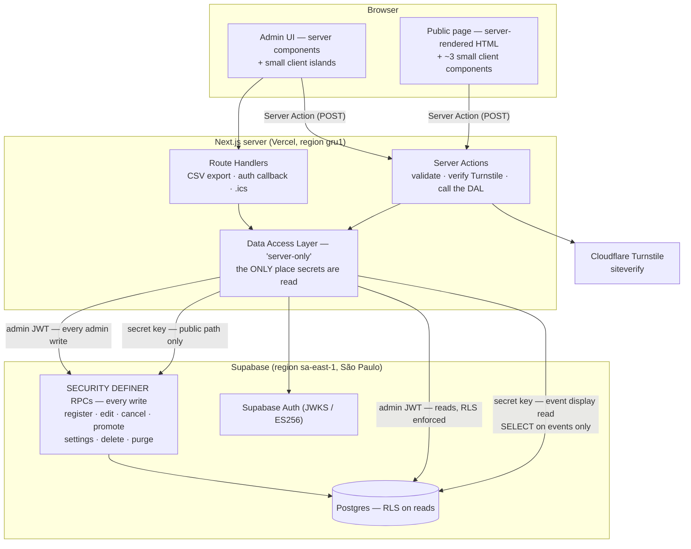
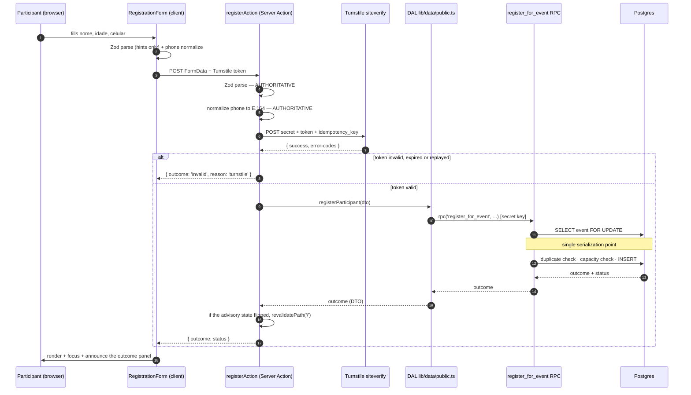
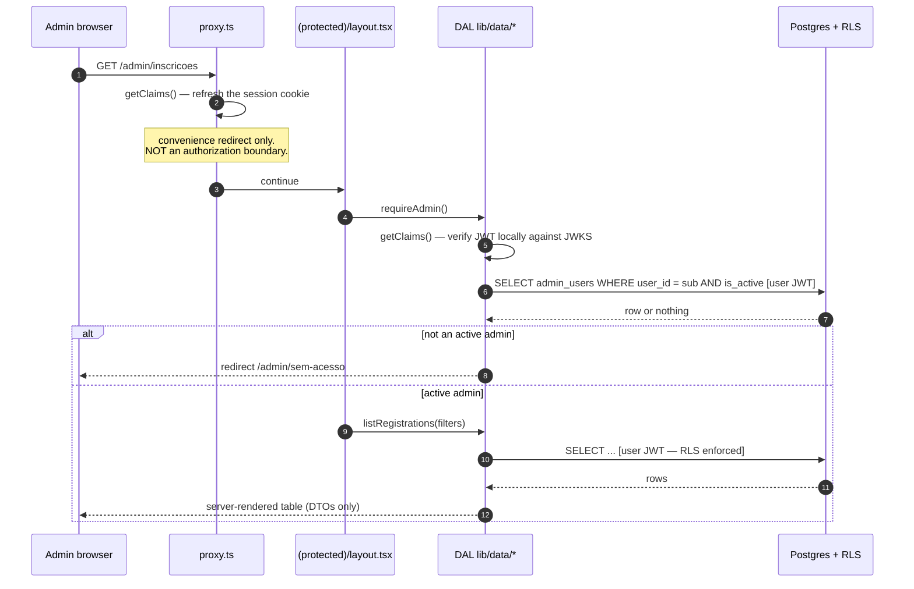

# Technical Architecture

Source of truth for the stack, boundaries and data flow. Database schema, concurrency and
authorization live in [DATABASE-SECURITY.md](./DATABASE-SECURITY.md).

**Version note.** Every version below was verified against the npm registry and official
documentation on **2026-09-09**. Versions marked *soak* were deliberately not taken at their latest
release. Re-verify before the first install; if a version has moved, prefer the latest **patch** of
the stated minor rather than jumping a major.

---

## 1. Stack

### 1.1 Core

| Package | Version | Verified | Why |
| --- | --- | --- | --- |
| `next` | `16.3.4` | npm `latest`, published 2026-08-31 | Server-first rendering, Server Actions, App Router, image and font optimization. Requires Node ≥ 20.9. |
| `react` / `react-dom` | `19.2.8` *(soak)* | 19.3.0 is `latest` but was published **2026-09-09** — the same day as this document and nine days *after* Next 16.3.4 | Next 16.3.4 cannot have been tested against React 19.3.0. Pin both to the same 19.2.x. Revisit once a Next release names 19.3 explicitly. |
| `typescript` | `^5.9` | `create-next-app@16.3.4` pins `typescript: "^5"` in its generated `package.json` | TypeScript 6.0.x and 7.0.x exist on npm, but Next's own scaffolder still targets 5.x. Follow the framework. Evaluating TS 7 (the native compiler) is a post-launch task, not a launch risk. |
| `@types/node` `@types/react` `@types/react-dom` | `^20` / `^19` / `^19` | same source | |

### 1.2 Data and auth

| Package | Version | Why |
| --- | --- | --- |
| `@supabase/supabase-js` | `2.116.0` | Postgres access, RPC, Auth. |
| `@supabase/ssr` | `0.12.7` | The official cookie-based session integration for the App Router. Supplies `createBrowserClient` / `createServerClient` with the `getAll` / `setAll(cookiesToSet, headers)` contract, including the cache-control headers that stop a CDN from caching one user's session onto another. Hand-rolling this is a security mistake. |

### 1.3 Supporting

| Package | Version | Why it earns its place |
| --- | --- | --- |
| `zod` | `4.6.1` | One schema definition drives client hints, the Server Action's authoritative validation, environment-variable validation and typed outputs. Server-side validation is a hard requirement; a schema library makes it a single reviewable artifact instead of scattered `if` statements. |
| `server-only` | latest | A zero-byte build-time guard that turns "a secret leaked into the client bundle" from a runtime incident into a build failure. Recommended by Next's own data-security guide. |
| `@vercel/speed-insights` | latest | ~2 KB. Field Core Web Vitals, which the performance budget in § 8 is written against. Without field data the budget is unverifiable. |

### 1.4 Development and testing

| Package | Version | Why |
| --- | --- | --- |
| `supabase` (CLI) | latest | Reproducible, version-controlled migrations and a local Postgres for the concurrency tests. A project requirement. |
| `vitest` | `4.1.11` *(soak)* | 5.0.0 shipped 2026-09-03. Nothing needed is exclusive to 5.x. |
| `@playwright/test` | `1.63.0` | E2E across real mobile and desktop viewports. |
| `@axe-core/playwright` | latest | Automated WCAG assertions inside the E2E run rather than as a separate manual pass. |
| `pg` | latest | Only for the concurrency harness — raw parallel connections against the local database. Not an application dependency. |
| `eslint` + `eslint-config-next` | `^9` / matching Next | The scaffolder's default. |

### 1.5 Styling

| Package | Version | Why |
| --- | --- | --- |
| `tailwindcss` + `@tailwindcss/postcss` | `4.3.3` | v4's `@theme` block is a CSS-native design-token system that maps one-to-one onto [VISUAL-DIRECTION.md § 3](./VISUAL-DIRECTION.md), with no JavaScript config file. The utility layer keeps the number of hand-written components low and the produced CSS is small because it is generated from actual usage. |

Plain CSS Modules were considered. Tailwind v4 wins here because the token layer *is* the design
system and because a single generated stylesheet is better for the LCP budget than a set of
per-component files.

### 1.6 Rejected dependencies

Each answers the question: *what problem does this solve that the platform does not?*

| Rejected | Answer |
| --- | --- |
| `react-hook-form` | None, at three fields. `useActionState` plus a Zod parse on the server covers submission, pending state and error mapping. RHF earns its place at roughly ten fields, dynamic arrays or cross-field dependencies. |
| `@tanstack/react-table` | None. Sorting, filtering and pagination are done **server-side** and driven by URL `searchParams` — which is also the correct privacy posture, since the full participant list must never be shipped to the browser. A semantic `<table>` is smaller, more accessible and printable. (v9 also only shipped in August 2026.) |
| `motion` | None. See [VISUAL-DIRECTION.md § 10](./VISUAL-DIRECTION.md): three CSS primitives plus one `IntersectionObserver`. No springs, gestures, layout or exit animations are required. Saves ~35 KB gzipped on the LCP path of a mobile-first page. |
| `lucide-react` (or any icon set) | None, for six icons. Six inline SVG paths cost ~1 KB. |
| A Turnstile React wrapper | None. Loading one script and reading one hidden input is about ten lines. |
| Redis / Upstash for rate limiting | None, at this scale. See § 7.3. |
| Sentry | Deferred. It would receive personal data unless carefully scrubbed, adds a client bundle, and the platform's own runtime logs plus structured outcome logging cover V1. Reconsider if error volume becomes unmanageable, and only with `beforeSend` scrubbing. |
| A phone-formatting library (`libphonenumber-js`) | None. Brazilian mobile validation is one regex, one DDD set and eight normalization steps ([PRODUCT-SPEC.md § 5](./PRODUCT-SPEC.md)). `libphonenumber-js` is ~145 KB for 200+ countries we do not serve. |
| A date library | None. `Intl.DateTimeFormat` with `pt-BR` and `America/Sao_Paulo` is built in. |
| `next-safe-action` | None. One Server Action needs input validation and one needs an auth check; both are explicit in the DAL. |

---

## 2. Application boundaries

Four layers. Each may only call the layer below it.



**The rule that makes this auditable:**

> The browser never holds a Supabase client on the public page. The Next.js server is the only
> Supabase caller, and it uses exactly two identities: the **secret key**, confined to the public
> read/write path in `lib/data/public.ts`; and the **signed-in administrator's own JWT** for every
> operation that touches participant data, so RLS is the real authorization boundary there.

The secret key's database privileges are sized to exactly that public path and no wider:
`SELECT` on `public.events` — event and configuration copy, from which the DAL projects an explicit
public-event DTO — plus `EXECUTE` on `register_for_event`. It holds **no** `SELECT` on
`registrations`, `admin_users` or `admin_actions`, and no write privilege on any table, so
participant data is unreachable with it even if it leaked. The full matrix is
[DATABASE-SECURITY.md § 8.3](./DATABASE-SECURITY.md).

The one exception is the admin **sign-in page**, which uses a browser client with the *publishable*
key to perform the OTP exchange. It never reads application tables.

---

## 3. Route architecture

```
app/
  layout.tsx                          <html lang="pt-BR">, font, metadata, Speed Insights
  page.tsx                            Public event page                      ISR
  privacidade/page.tsx                Privacy notice                          static
  evento.ics/route.ts                 Calendar download (GET)                 static-ish
  opengraph-image.tsx                 Social preview                          build-time
  robots.ts · sitemap.ts              Metadata routes                         static

  admin/
    (auth)/
      entrar/page.tsx                 Admin sign-in                  PUBLIC, dynamic
      sem-acesso/page.tsx             Signed in, not an admin        PUBLIC, dynamic
    (protected)/
      layout.tsx                      requireAdmin() + admin chrome         dynamic
      page.tsx                        Dashboard                             dynamic
      inscricoes/page.tsx             Registrations list (searchParams)     dynamic
      inscricoes/exportar/route.ts    CSV export (GET, assertAdmin)         dynamic
      configuracoes/page.tsx          Event settings                        dynamic
      equipe/page.tsx                 Admin team                            dynamic

  auth/
    confirmar/route.ts                OTP / magic-link callback (GET)
    sair/route.ts                     Sign out (POST only)

proxy.ts                              Session refresh on /admin/* ONLY

lib/
  env.ts                              Zod-validated env, split server/client
  data/                               ── the Data Access Layer, all 'server-only' ──
    public.ts                         getActiveEventForDisplay · registerParticipant
    auth.ts                           getAdminSession · requireAdmin · assertAdmin
    registrations.ts                  listRegistrations · edit · cancel · promote · delete · purge
    settings.ts                       getSettings · updateSettings   (settings_version token)
    team.ts                           listAdmins · inviteAdmin · setAdminActive · removeAdmin
    audit.ts                          listAdminActions               (writes happen inside the RPCs)
    supabase/
      secret.ts                       secret-key client   (public path only)
      user.ts                         per-request client bound to the admin's cookies
      browser.ts                      publishable-key client (sign-in page only)
  domain/
    phone.ts                          normalization + DDD set + mask
    schemas.ts                        Zod schemas shared by client and server
    outcomes.ts                       the outcome union and its pt-BR copy map
    csv.ts                            CSV serialisation + formula-injection guard
  ui/                                 presentational components

supabase/
  migrations/                         version-controlled, reproducible
  seed.sql                            the single active event + local test data
  tests/                              pgTAP / SQL invariant tests
```

Route groups `(auth)` and `(protected)` do not appear in URLs. They exist so the protected layout can
call `requireAdmin()` without the sign-in page inheriting it and looping.

**Naming:** URLs and user-facing route segments are pt-BR (`/admin/inscricoes`, `/privacidade`);
code identifiers, table names and file names are English. This is a project convention.

---

## 4. Rendering strategy

| Route | Strategy | Reason |
| --- | --- | --- |
| `/` | **ISR**, `export const revalidate = 60`, plus on-demand `revalidatePath('/')` | The page is 95% static event facts. Serving prerendered HTML from the CDN is what makes the LCP budget reachable. The 60-second window bounds how stale the *advisory* state banner can be. |
| `/privacidade` | Static | Never changes at runtime. |
| `/evento.ics` | Static, revalidated with `/` | Derived from the event row. |
| `/admin/**` | Dynamic (`force-dynamic` on the protected layout) | Every response depends on the caller's identity. **Must never be cached.** |
| `/admin/inscricoes/exportar` | Dynamic, `Cache-Control: no-store` | Personal data. |

**On-demand revalidation** is triggered by `revalidatePath('/')` from:

- any admin settings change (capacity, waitlist, open/closed);
- the registration Server Action, **but only when the returned outcome changes the page's advisory
  state** — that is, when the event has just become full or has just left the full state. Not on
  every registration, which would defeat the cache.

**`cacheComponents` / `use cache` is not enabled.** It is opt-in behind a `next.config` flag and
brings a caching model (`cacheLife`, `cacheTag`, the request-API restrictions) that this page does
not need — one ISR route and one dynamic subtree is the whole caching story. Simpler is correct here.

---

## 5. Server / client boundary

**Server Components by default.** A component becomes `'use client'` only if it needs state, an
event handler, or a browser API.

Client components on the public page — the complete list:

| Component | Why it must be a client component | Budget |
| --- | --- | --- |
| `RegistrationForm` | `useActionState`, phone mask, blur validation, focus management | ~6 KB |
| `StickyCta` | `IntersectionObserver` on the hero CTA | ~1 KB |
| `Reveal` | One shared `IntersectionObserver` for section entrances | ~1 KB |

Everything else — hero, details, poster, logos, footer — is a Server Component and ships zero
JavaScript.

Client components on the admin surface: the search input (debounced URL update), sortable table
headers, confirmation dialogs (native `<dialog>`), and the settings form. Each is an island inside a
server-rendered page.

**Non-negotiable rules**

1. `import 'server-only'` at the top of every file in `lib/data/`.
2. `process.env` is read **only** in `lib/env.ts`; `lib/env.ts` is imported only by `lib/data/`.
3. A Server Component never passes a raw database row to a Client Component. The DAL returns DTOs
   with exactly the fields the UI renders.
4. Every Server Action re-verifies authorization itself. A page-level check does not protect the
   actions defined on that page — Next's own guidance is explicit: *"A page-level authentication
   check does not extend to the Server Actions defined within it. Always re-verify inside the
   action."*
5. Server Action return values are narrow: `{ outcome, status? }`, never a row.

---

## 6. Registration data flow



Points that matter:

- **Client validation is a courtesy.** The Server Action re-parses and re-normalizes from scratch and
  ignores anything the client computed.
- **Turnstile is verified before the database is touched.** Tokens are valid for 300 seconds and are
  single-use; a replay returns `timeout-or-duplicate`, which maps to the retry message and a widget
  reset ([PRODUCT-SPEC.md § 6.2](./PRODUCT-SPEC.md)).
- **All decision logic is inside one database transaction.** The application never reads a count and
  then decides. See [DATABASE-SECURITY.md § 5](./DATABASE-SECURITY.md).
- **The whole path is idempotent.** A retry after a lost response returns `already_registered`.

## 7. Admin data flow



Three independent checks guard every admin request:

1. `proxy.ts` — cookie refresh and a convenience redirect. **Not a security control.**
2. `requireAdmin()` / `assertAdmin()` in the DAL — the application-level gate, run per request and
   deduplicated with `React.cache`.
3. **The database**, evaluated against the administrator's own JWT — the boundary that holds even if
   1 and 2 are both bypassed. For **reads** that is RLS; for **writes** it is the RPC's own
   `is_active_admin()` check, since `authenticated` holds no write privilege on any table
   ([DATABASE-SECURITY.md § 8.3](./DATABASE-SECURITY.md)).

**Every admin write is an RPC.** There are no direct table mutations from the application — not even
correcting a participant's name — so each write carries its authorization check, its lock ordering
and its audit record inside one database transaction.

### 7.1 Why `proxy.ts`, and why it is not trusted

Next.js 16 deprecated `middleware.ts` and renamed the convention to `proxy.ts`, which now defaults to
the Node.js runtime. The framework's own documentation is unambiguous:

> *"Always verify authentication and authorization inside each Server Function rather than relying on
> Proxy alone."*
> *"A matcher change or a refactor that moves a Server Function to a different route can silently
> remove Proxy coverage."*

So `proxy.ts` does exactly one necessary thing — refresh the Supabase session cookie on `/admin/*`,
which Supabase's SSR integration requires — plus one cosmetic thing, redirecting a visitor with no
session cookie to `/admin/entrar`. Its matcher is `['/admin/:path*']`, and if it were deleted
entirely the application would still be secure; users would merely see an occasional expired session.

### 7.2 Authentication mechanism

Full design in [DATABASE-SECURITY.md § 7](./DATABASE-SECURITY.md). Architectural summary:

- **Email OTP (six-digit code)** as the primary mechanism. No passwords means no password reuse, no
  credential stuffing, no reset flow, and nothing to phish beyond a single-use code.
- **Public sign-up disabled** in the Supabase dashboard. Accounts exist only via
  `auth.admin.inviteUserByEmail()`.
- **Asymmetric JWT signing keys (ES256)**, so `getClaims()` verifies signatures locally against the
  published JWKS with no round trip to the Auth server on every request.
- `getSession()` is **never** called in server code. Supabase's documentation: *"Never trust
  `supabase.auth.getSession()` inside server code such as Proxy."*
- **`shouldCreateUser: false` on every OTP request.** The Supabase default is `true`, which would
  make the sign-in form a public account-creation endpoint. Mandatory; see
  [DATABASE-SECURITY.md § 7.1.1](./DATABASE-SECURITY.md).
- **Requires custom SMTP for production** (Supabase's built-in mailer is rate-limited to a handful of
  messages per hour and is not for production). This is a **launch** prerequisite, not an
  implementation blocker: `supabase start` includes a local mail catcher, so the whole OTP flow is
  developed and tested without any external provider. See [DECISIONS.md](./DECISIONS.md) Q5.

### 7.3 Rate limiting

**Turnstile is the required control. Everything else is optional defense in depth.**

1. **Turnstile** on the public form — mandatory, server-verified, fail-closed.
2. **Vercel Firewall rate-limit rule** on `POST /` — optional, platform configuration, no code.
   *Requires a Vercel Pro plan.* Tune generously: Brazilian mobile carriers use CGNAT, so many
   legitimate participants share a public IP.
3. **Supabase Auth's own limits** on the sign-in path — automatic, 30 requests per 5 minutes by
   default, adjustable in the dashboard.
4. **The partial unique index on `(event_id, phone_e164)`** — structural. One phone can hold at most
   one seat no matter how many requests get through.

A previous revision specified a database rate-limiter fallback for projects without Vercel Firewall.
**It has been removed**, both because its count-then-insert design was itself race-prone and because
per-IP limiting is a poor fit for a CGNAT-heavy mobile audience. The reasoning and the escalation
path if abuse is actually observed are in
[DATABASE-SECURITY.md § 9.3](./DATABASE-SECURITY.md). There is no `abuse_events` table.

Redis-backed rate limiting is not warranted: the realistic threat is bot signups, which Turnstile
addresses directly, and the total expected volume is in the hundreds.

---

## 8. Performance

### 8.1 Budget

Targets are measured on a simulated mid-range Android over 4G. **Goals** are what the
implementation is tuned toward; **ceilings** are the Core Web Vitals "good" thresholds and are
treated as regressions if crossed.

| Metric | Goal | Ceiling |
| --- | --- | --- |
| LCP (mobile, field p75) | ≤ 1.8 s | 2.5 s |
| INP (mobile, field p75) | ≤ 150 ms | 200 ms |
| CLS | ≤ 0.05 | 0.1 |
| TTFB (`/`, cached) | ≤ 300 ms | 800 ms |
| First-load JS on `/`, gzipped | ≤ 90 KB | 120 KB |
| …excluding the React/Next framework chunk | ≤ 25 KB | 40 KB |
| Fonts | 1 file, ≤ 60 KB | 2 files, ≤ 100 KB |
| Total transfer, `/`, cold, mobile | ≤ 400 KB | 600 KB |
| Lighthouse mobile, `/` | P ≥ 95 · A11y 100 · BP ≥ 95 · SEO ≥ 95 | A11y 100 is a hard requirement |

These are engineering targets, not guarantees about any individual visitor's network. The **hard
correctness requirements** are elsewhere: no capacity overflow, no data leak, authorization enforced.

### 8.2 How the budget is met

- **The LCP element is text** — the `Financeira` display line. It is in the initial HTML of a
  prerendered page, with no image and no JavaScript in its critical path.
- **Region co-location:** Supabase in `sa-east-1` (São Paulo), Vercel functions pinned to `gru1`
  (São Paulo) via `vercel.json` (§ 10.1). Vercel defaults new projects to `iad1`, so this is a
  correction rather than a tweak: for a Hortolândia audience it removes roughly 200 ms of
  trans-continental round trip per database call.
- **One self-hosted variable font** via `next/font`, preloaded, with an automatically
  metric-matched fallback so the swap costs no layout shift.
- **Three client components**, listed in § 5.
- **No motion, icon, form or table library.**
- **Turnstile's script is loaded lazily**, after first paint, into a fixed-height container.
- **The poster image** is AVIF/WebP via `next/image`, lazy, `fetchPriority="low"`, with explicit
  dimensions.
- **The chart motif is inline SVG** — no request, ~2 KB.
- **CI gates:** a first-load-JS assertion on `/` and Lighthouse CI with the budget above.

---

## 9. Environment, secrets and headers

### 9.1 Variables

| Variable | Exposure | Consumed by |
| --- | --- | --- |
| `NEXT_PUBLIC_SUPABASE_URL` | public | admin browser client |
| `NEXT_PUBLIC_SUPABASE_PUBLISHABLE_KEY` | public (`sb_publishable_…`) | admin browser client only |
| `SUPABASE_SECRET_KEY` | **server only** (`sb_secret_…`) | `lib/data/supabase/secret.ts` only |
| `NEXT_PUBLIC_TURNSTILE_SITE_KEY` | public | the widget |
| `TURNSTILE_SECRET_KEY` | **server only** | the registration Server Action only |
| `NEXT_PUBLIC_SITE_URL` | public | canonical URL, OG tags, the auth redirect allowlist |

Supabase's legacy `anon` / `service_role` JWT keys are deprecated and are being retired at the end of
2026. Use the `sb_publishable_` / `sb_secret_` formats from day one.

`lib/env.ts` validates all of these with Zod at module load and exports **two** objects: a `client`
object containing only `NEXT_PUBLIC_*`, and a `server` object guarded by `import 'server-only'`. A
missing or malformed variable fails the build, not the first request.

### 9.2 Secret-leak guard

A CI step greps the production client bundle for `sb_secret_` and for the Turnstile secret's value
and fails the build on a hit. Cheap, and it catches the one mistake with catastrophic consequences.

### 9.3 Security headers

Set in `next.config.ts` for all routes:

```
Strict-Transport-Security: max-age=63072000; includeSubDomains; preload
X-Content-Type-Options: nosniff
Referrer-Policy: strict-origin-when-cross-origin
X-Frame-Options: DENY
Permissions-Policy: camera=(), microphone=(), geolocation=(), payment=(), interest-cohort=()
```

**Content-Security-Policy** — two profiles, because a nonce and a prerendered page are mutually
exclusive:

*Public routes* (static string in `next.config.ts`):

```
default-src 'self';
script-src 'self' 'unsafe-inline' https://challenges.cloudflare.com;
style-src 'self' 'unsafe-inline';
img-src 'self' data: blob:;
font-src 'self';
connect-src 'self' https://challenges.cloudflare.com;
frame-src https://challenges.cloudflare.com;
form-action 'self';
frame-ancestors 'none';
base-uri 'none';
object-src 'none';
```

*Admin routes* (per-request nonce, generated in `proxy.ts`): the same, but
`script-src 'self' 'nonce-{n}' 'strict-dynamic'` with no `'unsafe-inline'`.

**The trade-off, stated plainly:** a nonce must be unique per response, which forces dynamic
rendering. Applying a nonce CSP to `/` would give up ISR and add roughly 50–150 ms of TTFB on the
page whose LCP matters most. The public page therefore keeps `'unsafe-inline'` for scripts. This is
acceptable *specifically here* because the page renders **no user-generated HTML at all** — every
string is either a compile-time constant or a database value rendered through React's escaping, and
`dangerouslySetInnerHTML` is banned repository-wide. The admin, which does render user-supplied
names, gets the strict nonce policy. Recorded as an open decision in
[DECISIONS.md](./DECISIONS.md) so the trade-off can be reversed deliberately.

**CSRF** is handled by Next.js natively: Server Actions are POST-only, use encrypted non-deterministic
action IDs, and compare the `Origin` header against `Host`, aborting on mismatch. Combined with
`SameSite=Lax` session cookies, no CSRF token library is needed. `serverActions.allowedOrigins` is
not required because there is no reverse proxy in front of the deployment.

---

## 10. Deployment

| Concern | Decision |
| --- | --- |
| Host | **Vercel** — first-party support for the exact Next.js version, ISR and on-demand revalidation with no configuration, and Firewall rate-limit rules. |
| Function region | **`gru1`** (São Paulo) — see § 10.1 for how it is actually configured. |
| Database | **Supabase, `sa-east-1`** (São Paulo). |
| Environments | `production` (main), `preview` (per pull request). Previews point at a **separate Supabase project** — never at production data. |
| Migrations | `supabase/migrations/`, applied via the Supabase CLI in CI on merge to main. Forward-only; every migration is idempotent-safe to re-run in CI. |
| Node | ≥ 20.9, matching Next 16's requirement. Pin the major in `package.json` `engines`. |
| Lockfile | Committed. CI installs with `npm ci`. |
| Custom domain | Required before launch so the auth redirect allowlist and `NEXT_PUBLIC_SITE_URL` are stable. |

**Preview-environment rule:** preview deployments must never be pointed at the production Supabase
project. A preview URL is effectively public, and a misconfigured preview is the most likely way for
participant data to leak.

### 10.1 Region configuration — where it actually goes

**Not in `next.config.ts`.** Vercel does not read a compute region from the Next.js config file.
There are three supported mechanisms, and the first two are the ones this project uses
(<https://vercel.com/docs/functions/configuring-functions/region>):

| Mechanism | Form |
| --- | --- |
| **Project configuration file** | `vercel.json` at the repository root |
| **Dashboard** | Project → **Settings** → **Functions** → **Function Regions** |
| CLI | `vercel deploy --regions gru1` |

```json
{
  "$schema": "https://openapi.vercel.sh/vercel.json",
  "regions": ["gru1"]
}
```

`vercel.json` is the primary mechanism because it is version-controlled and reviewable; the
dashboard setting is the fallback if the project is deployed without the file. A per-function
override via the `functions` property exists but is not needed — every function in this project talks
to the same database.

Facts that make this matter:

- **`gru1` is São Paulo, Brazil, backed by AWS `sa-east-1`** — the same physical region as the
  Supabase project (<https://vercel.com/docs/regions>). This is the co-location the performance
  budget in § 8 assumes.
- **The default for new projects is `iad1` (Washington, D.C.).** Setting the region is therefore not
  an optimisation but a correction: left alone, every database round trip crosses a continent, and
  a registration makes several.
- **`gru1` works on every plan.** Hobby allows a single region, which is all this project needs;
  multiple regions require Pro or Enterprise. Deploying to more regions than the plan allows fails
  the build before it starts.

Verification after the first deploy: the deployment summary shows the resolved function region, and
a trivial timing check on any admin query should show single-digit-millisecond database latency
rather than ~200 ms.

---

## 11. Observability

**Deliberately small.** Observability that collects personal data is a liability, not an asset.

| Signal | Mechanism |
| --- | --- |
| Core Web Vitals (field) | `@vercel/speed-insights` |
| Server errors | Vercel runtime logs + structured `console.error` |
| Registration outcomes | One structured log line per submission: `{ event: 'registration', outcome, eventId, registrationId?, durationMs, correlationId }` |
| Admin actions | The `admin_actions` audit table, written transactionally with each action ([DATABASE-SECURITY.md § 6.7](./DATABASE-SECURITY.md)) |
| Database health | Supabase dashboard; `verify_event_counters()` as a manual reconciliation check ([DATABASE-SECURITY.md § 6.5](./DATABASE-SECURITY.md)) |
| Uptime | Optional external ping on `/`. Not required for a two-hour event. |

**Logging rule, enforced by a shared helper:** never log `full_name`, `phone_e164` or `age`. Log
identifiers, outcomes and durations. A `redactRegistration()` helper is the only sanctioned way to
put a registration into a log line, and it emits `{ id, status }` and nothing else.

Every error response carries a short `correlationId` that is shown to the user and written to the
log, so an organizer can report "erro ABC123" and it can be found without any personal data
appearing in a support conversation.

---

## 12. Multi-event seam

The V1 interface handles one event. The following make a second event a UI change rather than a
rewrite, and they cost nothing today:

1. Every table carries `event_id`; there are no singleton tables.
2. Every RPC takes `p_event_id` as its first parameter.
3. `events.slug` exists and is unique.
4. A partial unique index enforces **at most one** active event
   ([DATABASE-SECURITY.md § 4](./DATABASE-SECURITY.md)).
5. The DAL resolves the active event through a single function, `getActiveEvent()`. Nothing else
   hard-codes an event.
6. Public URL is `/` today. Later: `/e/[slug]`, with `/` redirecting to the active event.

**That is the entire seam. Do not build more.** No event switcher, no event CRUD, no event templates,
no organization model. Those are a different product.
