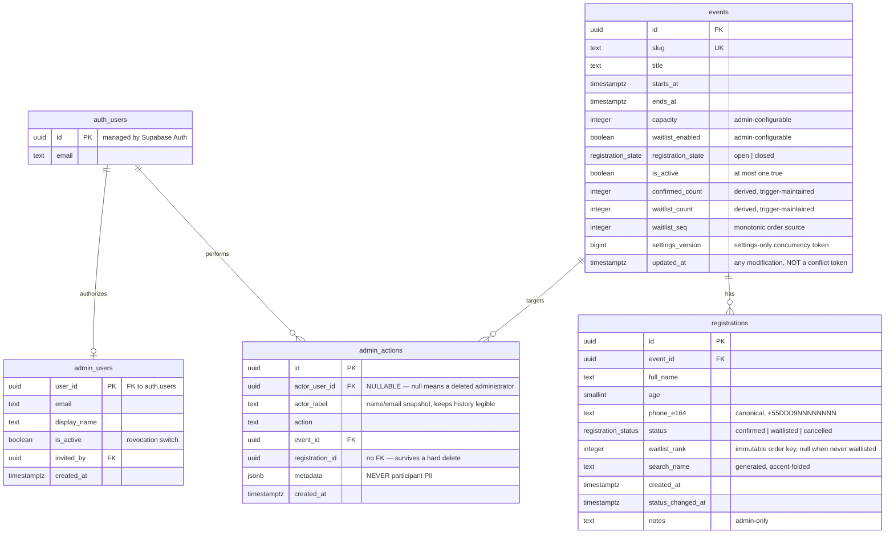
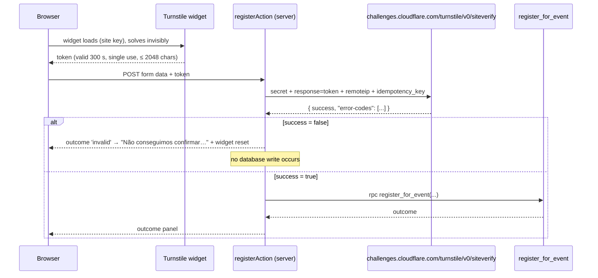

# Database, Concurrency, Authorization and Security

The most consequential document in this specification. The SQL below is **conceptual and
illustrative** — it defines exact required behaviour, not the literal migration text. Migrations are
written in Phase 2 of [IMPLEMENTATION-PLAN.md](./IMPLEMENTATION-PLAN.md).

Product rules: [PRODUCT-SPEC.md § 8–10](./PRODUCT-SPEC.md).
Stack and boundaries: [ARCHITECTURE.md](./ARCHITECTURE.md).

---

## 1. Invariants

Everything in this document exists to hold these statements true. Each is enforced by the
**database**, not by application code, so a future bug produces a failed transaction rather than a
corrupt event.

| # | Invariant | Enforced by |
| --- | --- | --- |
| **I1** | `events.confirmed_count` never exceeds `events.capacity` | `CHECK` constraint |
| **I2** | `confirmed_count` and `waitlist_count` always equal the actual number of rows in each status | `AFTER` trigger on `registrations`, single-writer |
| **I3** | At most one non-cancelled registration exists per `(event_id, phone_e164)` | partial `UNIQUE` index |
| **I4** | Waitlist order is total, stable and never renumbered | monotonic `events.waitlist_seq` + `UNIQUE(event_id, waitlist_rank)` |
| **I5** | At most one event has `is_active = true` | partial `UNIQUE` index |
| **I7** | An event can only be `open` while `capacity > 0` | `CHECK` constraint + `update_event_settings()` |
| **I8** | `events.settings_version` changes **only** when an administrator changes an admin-editable setting — never through registration activity | Written exclusively by the settings/purge RPCs; the counter trigger does not touch it |

Two further invariants cannot be expressed as constraints and are instead made structurally
unreachable by the privilege model:

| # | Invariant | Enforced by |
| --- | --- | --- |
| **I6** | Every lock is acquired in the order `events` → `raffles` → `registrations`, never another (the raffle step was added by RAFFLE-AND-CERTIFICATE-SPEC.md § 3.2) | No role can write `registrations` or `events` directly; all mutations go through event-first RPCs (§ 5.5, § 8.3) |
| **I9** | Every database-local administrative mutation writes its audit record in the **same transaction** as the mutation | The audit `INSERT` is the last statement inside each mutation RPC; no role can mutate outside an RPC (§ 6.7) |

---

## 2. Entity relationships



**Four tables. No more.** Rejected as speculative: `organizations`, `speakers`, `sessions`,
`check_ins`, `notifications`, `tags`, `custom_fields`, `roles`, `permissions`. No anti-abuse
infrastructure table exists either — see § 9.3 for why the database rate-limiter was removed rather
than repaired.

`admin_actions` earns its place: it is the only way to answer "who exported the participant list, and
when?" — a genuine privacy requirement — and "who closed registrations?", a genuine operational one.

---

## 3. Schema

### 3.1 Types

```sql
create type public.registration_status as enum ('confirmed', 'waitlisted', 'cancelled');
create type public.registration_state  as enum ('open', 'closed');
```

Enums rather than text plus a `CHECK`: adding a status becomes a deliberate, reviewed migration
instead of a typo in application code. `registration_state` is intentionally two-valued — a
`scheduled` state would require a scheduler that V1 does not have.

### 3.2 `events`

```sql
create table public.events (
  id                 uuid primary key default gen_random_uuid(),
  slug               text not null unique,

  -- display copy (seeded by migration; read-only in the V1 UI)
  title              text not null,
  kicker             text,                       -- 'Palestra'
  audience_label     text,                       -- 'para jovens'
  starts_at          timestamptz not null,
  ends_at            timestamptz,
  timezone           text not null default 'America/Sao_Paulo',
  venue_name         text,
  venue_address_line text,
  venue_district     text,
  venue_city         text,
  venue_state        text,
  price_label        text,                       -- 'Inscrições gratuitas'
  is_free            boolean not null default true,
  includes_label     text,                       -- 'Coffee break incluso'

  -- admin-configurable behaviour
  capacity           integer  not null default 0,
  waitlist_enabled   boolean  not null default true,
  registration_state public.registration_state not null default 'closed',   -- fail safe; see I7
  is_active          boolean  not null default false,

  -- derived state (trigger-maintained; see I2)
  confirmed_count    integer not null default 0,
  waitlist_count     integer not null default 0,
  waitlist_seq       integer not null default 0,

  -- concurrency tokens
  settings_version   bigint  not null default 1,   -- I8: settings changes ONLY
  created_at         timestamptz not null default now(),
  updated_at         timestamptz not null default now(),   -- any modification, incl. counters

  constraint events_capacity_non_negative  check (capacity        >= 0),
  constraint events_counts_non_negative    check (confirmed_count >= 0 and waitlist_count >= 0),
  constraint events_confirmed_within_capacity
                                           check (confirmed_count <= capacity),   -- I1
  constraint events_open_requires_capacity
                                           check (registration_state <> 'open'
                                                  or capacity > 0),               -- I7
  constraint events_ends_after_starts      check (ends_at is null or ends_at > starts_at)
);

-- I5: at most one active event, with no multi-event CMS
create unique index events_single_active_uidx
  on public.events ((true)) where is_active;
```

Three of these deserve explanation.

**`events_confirmed_within_capacity`** is the load-bearing constraint of the whole system. It is the
reason no code path — present or future, correct or buggy — can oversell the event.

**`events_open_requires_capacity` (I7)** makes a forgotten placeholder impossible to ship. Combined
with the `closed` / `capacity 0` defaults, a freshly seeded event is inert: it cannot accept a
registration, cannot silently waitlist everyone because capacity was never set, and cannot be opened
until a real capacity exists. Lowering capacity to `0` while the event is open is rejected by the
same constraint. See § 6.6.

**`settings_version` versus `updated_at` (I8).** These are deliberately different things.
`updated_at` records *any* modification to the row, including the counter updates that every
registration causes. `settings_version` is incremented **only** by `update_event_settings()` and
`purge_event_registrations()`. Using `updated_at` as an optimistic-concurrency token would mean a
member of the public registering could invalidate an administrator's open settings form — a
spurious conflict with no administrative cause. `updated_at` must never be used as a conflict token.

### 3.3 `registrations`

```sql
create table public.registrations (
  id                 uuid primary key default gen_random_uuid(),
  event_id           uuid not null references public.events(id) on delete cascade,

  full_name          text     not null,
  age                smallint not null,
  phone_e164         text     not null,

  status             public.registration_status not null,
  waitlist_rank      integer,          -- assigned once, on entering the waitlist; never renumbered

  notes              text,             -- admin-only, never shown publicly

  created_at         timestamptz not null default now(),
  status_changed_at  timestamptz not null default now(),

  constraint reg_name_length  check (char_length(btrim(full_name)) between 2 and 120),
  constraint reg_age_range    check (age between 1 and 120),          -- technical plausibility only
  constraint reg_phone_shape  check (phone_e164 ~ '^\+55[1-9]{2}9[0-9]{8}$'),
  constraint reg_waitlist_rank_present
    check (status <> 'waitlisted' or waitlist_rank is not null)
);
```

Notes on the constraints:

- `reg_age_range` is a **technical** bound, deliberately not an eligibility rule
  ([PRODUCT-SPEC.md § 4.3](./PRODUCT-SPEC.md)). The business restriction that the organizers have
  since set — **online registration is 12 and over** — lives where this note always said it would:
  nullable `events.min_age` / `events.max_age`, checked inside `register_for_event()` under the event
  row lock, returning the `age_not_eligible` outcome and storing nothing
  (migration `20260912090000_event_age_policy.sql`, DECISIONS.md Q7). The column CHECK is unchanged,
  because an administrator correcting a record through `edit_registration()` is not performing an
  online registration.
- `reg_phone_shape` is a shape check only. The ANATEL DDD allowlist lives in application code because
  it changes; the shape does not.
- `waitlist_rank` is intentionally *retained* after promotion or cancellation. It is a historical
  order key, not a live position. Keeping it means promotion order is auditable and re-cancellation
  is well defined.

### 3.4 Accent-insensitive name search

Brazilian names carry diacritics; searching `Joao` must find `João`. `unaccent()` is not marked
`IMMUTABLE`, so it cannot be used directly in a generated column. The standard workaround:

```sql
create extension if not exists unaccent;
create extension if not exists pg_trgm;

create or replace function public.immutable_unaccent(text)
returns text
language sql
immutable strict parallel safe
set search_path = ''
as $$ select public.unaccent('public.unaccent'::regdictionary, $1) $$;

alter table public.registrations
  add column search_name text
  generated always as (lower(public.immutable_unaccent(full_name))) stored;
```

Wrapping `unaccent` this way is safe **only** because the `unaccent` dictionary is never modified
after creation. Note this in the migration so nobody alters it later.

### 3.5 `admin_users`

```sql
create table public.admin_users (
  user_id      uuid primary key references auth.users(id) on delete cascade,
  email        text not null,
  display_name text,
  is_active    boolean not null default true,
  invited_by   uuid references auth.users(id) on delete set null,
  created_at   timestamptz not null default now()
);
```

**This table is the sole source of truth for administrator authorization.** Not
`auth.users.user_metadata` (user-editable), not `raw_app_meta_data`, not a JWT custom claim, not an
allowlist in an environment variable.

Why a table lookup and not a custom JWT claim: setting `is_active = false` revokes access on the
administrator's **very next request**. A claim baked into a JWT stays valid until the token expires,
which is exactly the wrong behaviour when removing someone's access. The cost is one indexed
primary-key lookup per policy evaluation, wrapped in `(select …)` so Postgres evaluates it once per
query rather than once per row.

### 3.6 `admin_actions`

```sql
create table public.admin_actions (
  id              uuid primary key default gen_random_uuid(),

  -- NULLABLE on purpose. See "Actor lifecycle" below.
  actor_user_id   uuid references auth.users(id) on delete set null,
  actor_label     text not null,          -- display name or e-mail, snapshotted at write time

  action          text not null,          -- see the allowlist below
  event_id        uuid references public.events(id) on delete set null,
  registration_id uuid,                   -- intentionally NOT a FK: survives a hard delete
  metadata        jsonb not null default '{}'::jsonb,
  created_at      timestamptz not null default now(),

  constraint admin_actions_known_action check (action in (
    'settings.updated',
    'registration.cancelled',
    'registration.promoted',
    'registration.edited',
    'registration.deleted',
    'registrations.exported',
    'registrations.purged',
    'admin.invited',
    'admin.deactivated',
    'admin.reactivated',
    'admin.removed'
  ))
);

create index admin_actions_created_idx on public.admin_actions (created_at desc);
create index admin_actions_actor_idx   on public.admin_actions (actor_user_id, created_at desc);
```

### Actor lifecycle — why `actor_user_id` is nullable

`actor_user_id` **must** be nullable. `ON DELETE SET NULL` and `NOT NULL` are mutually exclusive: if
the column were `NOT NULL`, deleting an administrator would either abort with a constraint violation
or, worse, make the deletion impossible without first destroying the audit history. The previous
revision of this document declared both, which was invalid.

The correct lifecycle is:

| State | `actor_user_id` | `actor_label` | Interpretation |
| --- | --- | --- | --- |
| Administrator still exists | the user's id | their name at the time of the action | Normal. Join to `admin_users` for the current name. |
| Administrator permanently removed | `NULL` | still populated | **Valid, not corrupt.** The actor existed and performed this action; their account has since been deleted. |

`NULL` therefore carries meaning: *"a since-removed administrator"*. It is never a sign of a broken
write, because `actor_label` is `NOT NULL` and is captured inside the same transaction as the action.

**Consumers must render it as such.** Any audit read renders a null actor as
`Organizador removido (<actor_label>)` — never as `—`, never as `desconhecido`, and never as an
error. The audit query must use a `LEFT JOIN` to `admin_users`; an inner join would silently drop
every action performed by a removed administrator, which is precisely the history most worth
keeping.

**Why `actor_label` exists.** Removing an administrator cascades their `admin_users` row away, so
without a snapshot the audit trail degrades to "somebody, once". That defeats the table's stated
purpose of answering *who* exported the participant list. `actor_label` is organizational data about
an authorized administrator, not participant personal data, and it is written by the RPC rather than
supplied by the caller.

`registration_id` is deliberately not a foreign key: the audit record of a permanent deletion must
outlive the row it describes. The same applies after an event-wide purge (§ 6.5).

**`metadata` must never contain participant personal data.** Permitted contents: counts, previous and
new setting values, filter parameters, row counts, changed-field *names*. Forbidden: names, ages,
phone numbers, and the before/after *values* of `full_name`, `age` or `notes`. This rule is enforced
by the RPCs themselves — which construct `metadata` server-side and never accept it from the caller
— and by a unit test on the audit helper.

### 3.7 Indexes

| Index | Definition | Serves |
| --- | --- | --- |
| `registrations_active_phone_uidx` | `unique (event_id, phone_e164) where status <> 'cancelled'` | **I3** — the duplicate rule, and a fast duplicate lookup |
| `registrations_waitlist_rank_uidx` | `unique (event_id, waitlist_rank) where waitlist_rank is not null` | **I4** — no two people share a queue position |
| `registrations_waitlist_order_idx` | `(event_id, waitlist_rank) where status = 'waitlisted'` | Promotion picks the N oldest without a sort |
| `registrations_event_created_idx` | `(event_id, created_at desc)` | The admin list's default ordering |
| `registrations_event_status_created_idx` | `(event_id, status, created_at desc)` | Status-filtered listing |
| `registrations_search_name_trgm_idx` | `gin (search_name gin_trgm_ops)` | Accent-insensitive substring name search |
| `registrations_phone_prefix_idx` | `(event_id, phone_e164 text_pattern_ops)` | Phone prefix search |
| `events_single_active_uidx` | `unique ((true)) where is_active` | **I5** |
| `admin_actions_created_idx` | `(created_at desc)` | Audit review |
| `admin_actions_actor_idx` | `(actor_user_id, created_at desc)` | "What did this administrator do?" |

`registrations_active_phone_uidx` is partial on purpose: a cancelled person can register again
([PRODUCT-SPEC.md § 9](./PRODUCT-SPEC.md)).

---

## 4. Counter maintenance

`confirmed_count` and `waitlist_count` are **derived** data stored on the event row. Storing derived
data needs justification; here there are two strong ones:

1. **The counter is the concurrency mechanism.** Comparing and updating a single integer on a single
   locked row is what makes allocation atomic. `SELECT count(*) FROM registrations` inside the
   critical section would be O(n) on every registration and would still need the same lock.
2. **The `CHECK` constraint can only reference the same row.** `confirmed_count <= capacity` is
   expressible; "the number of confirmed rows in another table must not exceed capacity" is not.
   Without the stored counter, invariant **I1** cannot be a database constraint at all — and that
   constraint is the single strongest guarantee in this system.

The update invariant is made safe by having exactly **one writer**: a trigger.

```sql
create or replace function public.sync_event_counts()
returns trigger
language plpgsql
security definer
set search_path = ''
as $$
declare
  d_conf integer := 0;
  d_wait integer := 0;
begin
  if tg_op = 'INSERT' then
    if new.status = 'confirmed'  then d_conf :=  1; end if;
    if new.status = 'waitlisted' then d_wait :=  1; end if;

  elsif tg_op = 'DELETE' then
    if old.status = 'confirmed'  then d_conf := -1; end if;
    if old.status = 'waitlisted' then d_wait := -1; end if;

  else -- UPDATE
    if old.event_id <> new.event_id then
      raise exception 'registrations.event_id is immutable';
    end if;
    if old.status = new.status then
      return null;                                   -- nothing to do
    end if;
    if old.status = 'confirmed'  then d_conf := d_conf - 1; end if;
    if old.status = 'waitlisted' then d_wait := d_wait - 1; end if;
    if new.status = 'confirmed'  then d_conf := d_conf + 1; end if;
    if new.status = 'waitlisted' then d_wait := d_wait + 1; end if;
  end if;

  if d_conf <> 0 or d_wait <> 0 then
    update public.events
       set confirmed_count = confirmed_count + d_conf,
           waitlist_count  = waitlist_count  + d_wait,
           updated_at      = now()
           -- NOTE (I8): settings_version is deliberately NOT touched here.
           -- Registration activity must never invalidate an administrator's settings form.
     where id = coalesce(new.event_id, old.event_id);
  end if;

  return null;
end;
$$;

create trigger registrations_sync_counts
after insert or update of status, event_id or delete on public.registrations
for each row execute function public.sync_event_counts();
```

Consequences worth stating explicitly:

- The counters cannot drift, whatever writes to `registrations` — an RPC, a plain `UPDATE`, a manual
  fix in the SQL editor, or a future feature.
- Any write that would push `confirmed_count` past `capacity` fails on the `CHECK` constraint and
  rolls back. The graceful, message-bearing path is the RPC; the constraint is the guarantee.
- The trigger takes the event row lock. In `register_for_event` and `promote_from_waitlist` that lock
  is **already held**, so there is no extra contention — and the lock order in **I6** is what keeps it
  deadlock-free (§ 5.5).

---

## 5. Capacity allocation

### 5.1 The forbidden pattern

```
-- NEVER DO THIS
SELECT count(*) FROM registrations WHERE event_id = $1 AND status = 'confirmed';   -- (1)
if (count < capacity) {                                                            -- (2)
  INSERT INTO registrations (...);                                                 -- (3)
}
```

Two requests interleaving between (1) and (3) both read `count = capacity − 1`, both pass the check,
and both insert. The event is oversold. Moving the check into a single SQL statement is not enough
either, because the duplicate check and the insert must also be atomic with it.

### 5.2 The allocation function

One database function performs the whole decision inside one transaction, serialised on the event row.

```sql
create or replace function public.register_for_event(
  p_event_id   uuid,
  p_full_name  text,
  p_age        smallint,
  p_phone_e164 text
)
returns table (
  outcome         text,                            -- confirmed|waitlisted|already_registered|closed|full
  status          public.registration_status,
  registration_id uuid
)
language plpgsql
security definer
set search_path = ''
as $$
declare
  v_event    public.events%rowtype;
  v_existing public.registrations%rowtype;
  v_id       uuid;
  v_rank     integer;
begin
  -------------------------------------------------------------------------
  -- STEP 1. Acquire the event row lock.
  -- This is the ONE serialization point for all registrations on this event.
  -- Everything after this line is effectively single-threaded per event.
  -------------------------------------------------------------------------
  select * into v_event
    from public.events
   where id = p_event_id
     for update;

  if not found then
    raise exception 'event_not_found' using errcode = 'no_data_found';
  end if;

  -------------------------------------------------------------------------
  -- STEP 2. Duplicate / idempotency check — inside the lock, so it is safe.
  -- Checked FIRST so a double-tap always gets a coherent answer, even if the
  -- event filled between the two taps.
  -------------------------------------------------------------------------
  select * into v_existing
    from public.registrations
   where event_id = p_event_id
     and phone_e164 = p_phone_e164
     and status <> 'cancelled'
   limit 1;

  if found then
    return query select 'already_registered'::text, v_existing.status, v_existing.id;
    return;
  end if;

  -------------------------------------------------------------------------
  -- STEP 3. Master switch.
  -------------------------------------------------------------------------
  if v_event.registration_state <> 'open' then
    return query select 'closed'::text, null::public.registration_status, null::uuid;
    return;
  end if;

  -------------------------------------------------------------------------
  -- STEP 4. Seat available? Read under the lock, so it cannot be stale.
  -------------------------------------------------------------------------
  if v_event.confirmed_count < v_event.capacity then
    insert into public.registrations (event_id, full_name, age, phone_e164, status)
    values (p_event_id, btrim(p_full_name), p_age, p_phone_e164, 'confirmed')
    returning id into v_id;
    -- the trigger increments confirmed_count; the CHECK constraint guards I1

    return query select 'confirmed'::text, 'confirmed'::public.registration_status, v_id;
    return;
  end if;

  -------------------------------------------------------------------------
  -- STEP 5. Full. Waitlist enabled?
  -------------------------------------------------------------------------
  if not v_event.waitlist_enabled then
    return query select 'full'::text, null::public.registration_status, null::uuid;
    return;
  end if;

  -- monotonic, never reused, never renumbered  (I4)
  v_rank := v_event.waitlist_seq + 1;

  update public.events
     set waitlist_seq = v_rank
   where id = p_event_id;

  insert into public.registrations
    (event_id, full_name, age, phone_e164, status, waitlist_rank)
  values
    (p_event_id, btrim(p_full_name), p_age, p_phone_e164, 'waitlisted', v_rank)
  returning id into v_id;

  return query select 'waitlisted'::text, 'waitlisted'::public.registration_status, v_id;
end;
$$;

revoke all on function public.register_for_event(uuid, text, smallint, text) from public, anon, authenticated;
grant  execute on function public.register_for_event(uuid, text, smallint, text) to service_role;
```

### 5.3 Why this is correct

**Isolation level.** Postgres (and therefore Supabase) defaults to `READ COMMITTED`. The proof below
holds at `READ COMMITTED`; `SERIALIZABLE` is deliberately **not** used, because it would introduce
serialization failures that the application would have to retry, for no additional safety here.

**The capacity race.** Two transactions T1 and T2 arrive when `confirmed_count = capacity − 1`.

1. T1 executes `SELECT … FOR UPDATE` and takes an exclusive row lock on the event.
2. T2 executes the same statement and **blocks**.
3. T1 reads `confirmed_count = capacity − 1`, inserts, the trigger sets `confirmed_count = capacity`,
   T1 commits and releases the lock.
4. T2 unblocks. Under `READ COMMITTED`, a blocked `FOR UPDATE` **re-reads the row after the lock is
   granted**, so T2 sees `confirmed_count = capacity`.
5. T2 takes the waitlist branch (or returns `full`).

Exactly one seat is issued. Generalises to any number of concurrent transactions: they form a queue
on the row lock and are processed strictly one at a time.

**The duplicate race.** Two transactions submit the same phone number simultaneously.

1. T1 takes the lock; T2 blocks at step 1.
2. T1's duplicate `SELECT` finds nothing, inserts, commits.
3. T2 acquires the lock. Its duplicate `SELECT` is a **new statement**, and under `READ COMMITTED`
   each statement takes a fresh snapshot — so it sees T1's committed row and returns
   `already_registered`.

Had the duplicate check been outside the lock, both would have inserted; `registrations_active_phone_uidx`
would have aborted the second with a unique violation instead of returning a clean outcome. The index
therefore acts as the backstop, and the lock provides the graceful path.

**The waitlist-rank race.** `waitlist_seq` is read and incremented while holding the same lock, so
ranks are strictly increasing with no gaps and no duplicates. `registrations_waitlist_rank_uidx`
backstops it.

**Failure atomicity.** Every branch is one transaction. A crash between the insert and the counter
update is impossible — the trigger fires within the same transaction, so either both happen or
neither does.

### 5.4 Contention and throughput

All registrations for one event serialise. Each critical section is one indexed `SELECT`, one
indexed `SELECT`, and one or two small `INSERT`/`UPDATE`s — sub-millisecond on a warm database.

Order-of-magnitude: even at 1 ms per transaction the ceiling is roughly a thousand registrations per
second on a single event. Realistic peak for this event, at the moment a link is posted to a
WhatsApp group, is on the order of ten per second. Contention is a non-issue by three orders of
magnitude, and paying for it buys perfect correctness.

Two consequences to keep in mind and *not* violate:

- **Never** put a network call inside the locked transaction. Turnstile verification happens in the
  Server Action, **before** the RPC is invoked.
- **Never** widen `register_for_event` to loop over multiple events; that would break **I6**.

### 5.5 Lock ordering — invariant I6

The trigger updates `events` *after* a row in `registrations` has been touched. So a plain
`UPDATE registrations SET status = …` acquires locks in the order **registrations → events**, while
`promote_from_waitlist` acquires them **events → registrations**. Two such transactions running
concurrently in opposite orders can deadlock.

**Rule, and the reason the schema is shaped this way:**

> Every operation that changes a `registrations.status` value **must** go through an RPC that locks
> the event row first. Direct `UPDATE`s on `registrations` are permitted only for
> **non-status** columns (`full_name`, `age`, `notes`), which do not fire the counter branch of the
> trigger.

**As of this revision the rule is stronger still: no role may write `registrations` or `events`
directly at all.** `INSERT`, `UPDATE` and `DELETE` are revoked from `anon` and `authenticated` on
both tables; `authenticated` holds `SELECT` only (§ 8.3). Every mutation — including a simple name
correction — goes through an RPC that locks the event row first. The earlier design granted
column-scoped `UPDATE (full_name, age, notes)` to `authenticated`; that path has been withdrawn
because it could not carry a transactional audit record (§ 6.7, **I9**). Routing *everything*
through RPCs makes **I6** and **I9** hold by construction rather than by convention, and it removes
the need for the column-privilege trick entirely.

With that rule, every transaction acquires `events` first. A single, consistently-ordered lock
sequence cannot deadlock.

---

## 6. Administrative mutations

Every database-local administrative mutation follows the same six-step shape, inside **one**
PostgreSQL transaction:

1. **authorize** — `is_active_admin()`, first statement, no exceptions;
2. **lock** — the event row, `FOR UPDATE`, before touching `registrations` (**I6**);
3. **validate** — business preconditions, with named errors the UI can map to pt-BR copy;
4. **mutate**;
5. **audit** — `INSERT INTO admin_actions`, in the same transaction (**I9**);
6. **return** a narrow outcome, never a raw row.

If any step raises, the whole transaction rolls back: no mutation without its audit record, and no
audit record without its mutation.

### 6.0 The audit helper

```sql
-- Resolves the acting administrator and writes the audit row.
-- Called ONLY from inside other SECURITY DEFINER RPCs, already past their authorization check.
create or replace function public.record_admin_action(
  p_action          text,
  p_event_id        uuid,
  p_registration_id uuid,
  p_metadata        jsonb
)
returns void
language plpgsql
security definer
set search_path = ''
as $$
declare
  v_uid   uuid := (select auth.uid());
  v_label text;
begin
  select coalesce(a.display_name, a.email) into v_label
    from public.admin_users a
   where a.user_id = v_uid;

  insert into public.admin_actions
    (actor_user_id, actor_label, action, event_id, registration_id, metadata)
  values
    (v_uid, coalesce(v_label, 'desconhecido'), p_action, p_event_id, p_registration_id,
     coalesce(p_metadata, '{}'::jsonb));
end;
$$;

revoke all on function public.record_admin_action(text, uuid, uuid, jsonb)
  from public, anon, authenticated, service_role;
-- No role holds EXECUTE. It is reachable only from other SECURITY DEFINER functions,
-- which run as the owner and therefore satisfy the privilege check.
```

Two properties matter:

- **`metadata` is constructed by the calling RPC, never accepted from the client.** There is no code
  path by which a browser can put arbitrary JSON — or participant personal data — into the audit log.
- **`actor_label` is snapshotted here**, so the record stays legible after the administrator is
  deleted (§ 3.6).

`auth.uid()` still resolves correctly inside a `SECURITY DEFINER` function: `SECURITY DEFINER`
changes the executing *role*, while `auth.uid()` reads the request's JWT claims from a transaction
setting that PostgREST populates. It returns `NULL` when a function is invoked with the secret key
(`service_role`), which is why `record_admin_action` is never called from the public registration
path — public registrations are not administrative actions and are not audited here.

### 6.1 The promotion function

```sql
create or replace function public.promote_from_waitlist(
  p_event_id uuid,
  p_count    integer default 1
)
returns table (registration_id uuid, full_name text, phone_e164 text, waitlist_rank integer)
language plpgsql
security definer
set search_path = ''
as $$
declare
  v_event    public.events%rowtype;
  v_headroom integer;
  v_take     integer;
begin
  -- SECURITY DEFINER bypasses RLS. Authorization must be explicit and first.
  if not public.is_active_admin() then
    raise exception 'not_authorized' using errcode = 'insufficient_privilege';
  end if;

  if p_count is null or p_count < 1 then
    raise exception 'invalid_count';
  end if;

  select * into v_event from public.events where id = p_event_id for update;   -- I6: events first
  if not found then
    raise exception 'event_not_found';
  end if;

  v_headroom := v_event.capacity - v_event.confirmed_count;
  v_take     := least(p_count, greatest(v_headroom, 0));

  if v_take = 0 then
    -- Zero rows: "no headroom". Not an error, and not an audited action.
    return;
  end if;

  create temporary table promoted_rows on commit drop as
  with next_up as (
    select r.id
      from public.registrations r
     where r.event_id = p_event_id
       and r.status = 'waitlisted'
     order by r.waitlist_rank asc         -- I4: deterministic, stable
     limit v_take
       for update                         -- registrations second
  )
  update public.registrations r
     set status = 'confirmed',
         status_changed_at = now()
   where r.id in (select id from next_up)
  returning r.id, r.full_name, r.phone_e164, r.waitlist_rank;
  -- the trigger moves the counters; the CHECK constraint guards I1

  -- I9: audit in the SAME transaction. Counts and ids only — never names or phones.
  perform public.record_admin_action(
    'registration.promoted', p_event_id, null,
    jsonb_build_object(
      'requested', p_count,
      'promoted',  (select count(*) from promoted_rows),
      'registration_ids', (select coalesce(jsonb_agg(pr.id), '[]'::jsonb) from promoted_rows pr)
    ));

  return query select pr.id, pr.full_name, pr.phone_e164, pr.waitlist_rank from promoted_rows pr;
end;
$$;

revoke all on function public.promote_from_waitlist(uuid, integer)
  from public, anon, authenticated, service_role;
grant  execute on function public.promote_from_waitlist(uuid, integer) to authenticated;
```

Behaviour that the admin UI depends on:

- Asking for more than the available headroom promotes exactly the headroom and returns that many
  rows. The UI reports the real number: `2 de 5 pessoas promovidas — não havia mais vagas.`
- Returning zero rows is a normal outcome, not an error, and writes no audit record: nothing changed.
- `waitlist_rank` is **kept** on the promoted rows, so the promotion order stays auditable.
- The returned name and phone are what the organizer needs to make the phone call. This is the one
  place an RPC returns participant data, and it returns it only to an authenticated administrator.
  Note the asymmetry: the *return value* carries names and phones because the organizer must dial
  them; the *audit metadata* carries only ids and counts.

The temporary table is the mechanism that lets one statement's `RETURNING` set feed both the audit
record and the function's result. An implementation may equally use a CTE with a data-modifying
`INSERT INTO admin_actions` branch, or an array variable — the requirement is only that the audit
write and the promotion share one transaction.

### 6.2 Cancellation

```sql
create or replace function public.cancel_registration(p_registration_id uuid)
returns public.registration_status
language plpgsql security definer set search_path = ''
as $$
declare
  v_event_id uuid;
  v_old      public.registration_status;
  v_new      public.registration_status;
begin
  if not public.is_active_admin() then
    raise exception 'not_authorized' using errcode = 'insufficient_privilege';
  end if;

  select event_id, status into v_event_id, v_old
    from public.registrations where id = p_registration_id;
  if v_event_id is null then
    raise exception 'registration_not_found';
  end if;

  perform 1 from public.events where id = v_event_id for update;   -- I6: events first

  update public.registrations
     set status = 'cancelled', status_changed_at = now()
   where id = p_registration_id and status <> 'cancelled'
  returning status into v_new;

  -- Idempotent: already cancelled is not an error, and is not re-audited.
  if v_new is not null then
    perform public.record_admin_action(
      'registration.cancelled', v_event_id, p_registration_id,
      jsonb_build_object('previous_status', v_old));       -- status only, never PII
  end if;

  return coalesce(v_new, 'cancelled');
end;
$$;
```

Cancelling a confirmed registration frees a seat immediately (trigger) and **does not** promote
anyone. That is a product decision, not an oversight — see § 6.8.

### 6.3 Participant correction

Administrators must be able to fix a mistyped name or age
([ADMIN-SPEC.md § 4.4](./ADMIN-SPEC.md)). This is now an RPC rather than a direct `UPDATE`, so the
correction and its audit record share a transaction.

```sql
create or replace function public.edit_registration(
  p_registration_id uuid,
  p_full_name       text,
  p_age             smallint,
  p_notes           text
)
returns table (registration_id uuid, full_name text, age smallint)
language plpgsql security definer set search_path = ''
as $$
declare
  v_event_id uuid;
  v_before   public.registrations%rowtype;
  v_changed  text[] := '{}';
begin
  if not public.is_active_admin() then
    raise exception 'not_authorized' using errcode = 'insufficient_privilege';
  end if;

  select * into v_before from public.registrations where id = p_registration_id;
  if not found then
    raise exception 'registration_not_found';
  end if;
  v_event_id := v_before.event_id;

  perform 1 from public.events where id = v_event_id for update;   -- I6: events first

  -- Validation mirrors the table constraints so the UI gets a named error, not a raw violation.
  if char_length(btrim(p_full_name)) not between 2 and 120 then
    raise exception 'invalid_name' using errcode = 'check_violation';
  end if;
  if p_age not between 1 and 120 then
    raise exception 'invalid_age' using errcode = 'check_violation';
  end if;

  -- Record WHICH fields changed. Never the values: those are participant PII.
  if btrim(p_full_name) <> v_before.full_name then v_changed := v_changed || 'full_name'; end if;
  if p_age             <> v_before.age       then v_changed := v_changed || 'age';       end if;
  if coalesce(p_notes,'') <> coalesce(v_before.notes,'') then v_changed := v_changed || 'notes'; end if;

  if cardinality(v_changed) = 0 then
    -- Nothing changed: no write, no audit noise.
    return query select v_before.id, v_before.full_name, v_before.age;
    return;
  end if;

  update public.registrations
     set full_name = btrim(p_full_name),
         age       = p_age,
         notes     = p_notes
   where id = p_registration_id;
  -- status and phone_e164 are deliberately NOT parameters: see below.

  perform public.record_admin_action(
    'registration.edited', v_event_id, p_registration_id,
    jsonb_build_object('changed_fields', to_jsonb(v_changed)));

  return query select p_registration_id, btrim(p_full_name), p_age;
end;
$$;
```

Three deliberate omissions:

- **`status` is not a parameter.** Status transitions belong to `cancel_registration` and
  `promote_from_waitlist`, which handle capacity and counters correctly.
- **`phone_e164` is not a parameter.** It is the identity key and the duplicate key; changing it
  would silently move a registration to a different person
  ([ADMIN-SPEC.md § 4.4](./ADMIN-SPEC.md)).
- **`event_id` is not a parameter.** A registration never moves between events (the counter trigger
  raises if it is attempted).

### 6.4 Settings changes

```sql
create or replace function public.update_event_settings(
  p_event_id                 uuid,
  p_capacity                 integer,
  p_waitlist_enabled         boolean,
  p_state                    public.registration_state,
  p_expected_settings_version bigint        -- I8: the SETTINGS token, not updated_at
)
returns table (settings_version bigint, capacity integer,
               waitlist_enabled boolean, registration_state public.registration_state)
language plpgsql security definer set search_path = ''
as $$
declare
  v_event public.events%rowtype;
  v_new   public.events%rowtype;
begin
  if not public.is_active_admin() then
    raise exception 'not_authorized' using errcode = 'insufficient_privilege';
  end if;

  select * into v_event from public.events where id = p_event_id for update;   -- I6
  if not found then
    raise exception 'event_not_found';
  end if;

  if v_event.settings_version <> p_expected_settings_version then
    raise exception 'settings_conflict' using errcode = 'serialization_failure';
  end if;

  if p_capacity < v_event.confirmed_count then
    raise exception 'capacity_below_confirmed:%', v_event.confirmed_count
      using errcode = 'check_violation';
  end if;

  -- I7: never open an event that has no meaningful capacity.
  if p_state = 'open' and p_capacity <= 0 then
    raise exception 'capacity_required_to_open' using errcode = 'check_violation';
  end if;

  update public.events
     set capacity           = p_capacity,
         waitlist_enabled   = p_waitlist_enabled,
         registration_state = p_state,
         settings_version   = settings_version + 1,   -- monotonic; only here and in the purge
         updated_at         = now()
   where id = p_event_id
  returning * into v_new;

  perform public.record_admin_action(
    'settings.updated', p_event_id, null,
    jsonb_build_object(
      'from', jsonb_build_object('capacity', v_event.capacity,
                                 'waitlist_enabled', v_event.waitlist_enabled,
                                 'registration_state', v_event.registration_state),
      'to',   jsonb_build_object('capacity', v_new.capacity,
                                 'waitlist_enabled', v_new.waitlist_enabled,
                                 'registration_state', v_new.registration_state)));

  return query select v_new.settings_version, v_new.capacity,
                      v_new.waitlist_enabled, v_new.registration_state;
end;
$$;
```

Four named errors, each mapped to pt-BR copy by the UI
([ADMIN-SPEC.md § 5](./ADMIN-SPEC.md)):

| Error | Meaning | pt-BR |
| --- | --- | --- |
| `not_authorized` | caller is not an active administrator | session/permission handling |
| `settings_conflict` | another administrator saved first | `As configurações foram alteradas por outra pessoa. Recarregue a página.` |
| `capacity_below_confirmed:N` | would strand confirmed participants | `Não é possível definir a capacidade abaixo de N inscrições confirmadas.` |
| `capacity_required_to_open` | **I7** | `Defina a capacidade antes de abrir as inscrições.` |

**Why `settings_version` and not `updated_at`.** `updated_at` is bumped by the counter trigger on
every registration, cancellation and promotion. Using it as the conflict token meant a member of the
public completing a registration would invalidate an administrator's open settings form, producing
`As configurações foram alteradas por outra pessoa` when no administrator had touched anything. A
monotonically increasing `bigint` written only by the two settings-mutating RPCs is both simpler to
reason about and deterministic — an integer comparison with no timestamp precision or clock
questions. The value is returned by every settings mutation so the form can refresh its token
without a re-read.

### 6.5 Permanent deletion, event purge, and reconciliation

```sql
-- Single-participant erasure. Deliberately separate from cancellation.
create or replace function public.delete_registration(p_registration_id uuid)
returns boolean
language plpgsql security definer set search_path = ''
as $$
declare
  v_event_id uuid;
  v_status   public.registration_status;
begin
  if not public.is_active_admin() then
    raise exception 'not_authorized' using errcode = 'insufficient_privilege';
  end if;

  select event_id, status into v_event_id, v_status
    from public.registrations where id = p_registration_id;
  if v_event_id is null then
    return false;                                  -- idempotent: already gone
  end if;

  perform 1 from public.events where id = v_event_id for update;   -- I6

  delete from public.registrations where id = p_registration_id;   -- trigger fixes the counters

  -- The audit row outlives the deleted registration (registration_id has no FK).
  perform public.record_admin_action(
    'registration.deleted', v_event_id, p_registration_id,
    jsonb_build_object('status_at_deletion', v_status));

  return true;
end;
$$;
```

#### Event-wide purge

The retention mechanism promised by
[PRODUCT-SPEC.md § 12](./PRODUCT-SPEC.md) and [ADMIN-SPEC.md § 6.4](./ADMIN-SPEC.md) is a
first-class atomic database operation, **not** a loop in application code.

```sql
create or replace function public.purge_event_registrations(
  p_event_id                  uuid,
  p_expected_settings_version bigint
)
returns table (deleted_count integer, settings_version bigint)
language plpgsql security definer set search_path = ''
as $$
declare
  v_event   public.events%rowtype;
  v_deleted integer;
  v_conf    integer;
  v_wait    integer;
  v_cancel  integer;
  v_new_ver bigint;
begin
  if not public.is_active_admin() then
    raise exception 'not_authorized' using errcode = 'insufficient_privilege';
  end if;

  select * into v_event from public.events where id = p_event_id for update;   -- I6
  if not found then
    raise exception 'event_not_found';
  end if;

  if v_event.settings_version <> p_expected_settings_version then
    raise exception 'settings_conflict' using errcode = 'serialization_failure';
  end if;

  select count(*) filter (where status = 'confirmed'),
         count(*) filter (where status = 'waitlisted'),
         count(*) filter (where status = 'cancelled')
    into v_conf, v_wait, v_cancel
    from public.registrations where event_id = p_event_id;

  -- One set-based statement. No per-row round trip, no partial purge.
  with gone as (
    delete from public.registrations where event_id = p_event_id returning 1
  )
  select count(*)::integer into v_deleted from gone;

  -- The per-row trigger has already driven the counters to zero. Assert it, and
  -- also close registrations so a purged event cannot immediately collect new data.
  update public.events
     set confirmed_count    = 0,
         waitlist_count     = 0,
         registration_state = 'closed',
         settings_version   = settings_version + 1,
         updated_at         = now()
   where id = p_event_id
  returning settings_version into v_new_ver;

  perform public.record_admin_action(
    'registrations.purged', p_event_id, null,
    jsonb_build_object('deleted_total', v_deleted,
                       'deleted_confirmed', v_conf,
                       'deleted_waitlisted', v_wait,
                       'deleted_cancelled', v_cancel,
                       'registration_state_forced', 'closed'));

  return query select v_deleted, v_new_ver;
end;
$$;
```

Design points, each answering a stated requirement:

| Requirement | How |
| --- | --- |
| Active-admin authorization | `is_active_admin()`, first statement |
| Explicit event id | `p_event_id` is required; there is no "purge everything" form |
| Lock order | event row `FOR UPDATE` before any `registrations` access (**I6**) |
| Atomic, no partial purge | one set-based `DELETE`; any failure rolls the whole transaction back |
| No JavaScript deletion loop | the RPC is called once and returns a count |
| Counters reconcile to zero | the trigger drives them there per row; the explicit `SET … = 0` asserts the end state deterministically |
| Audit written transactionally | `record_admin_action` is inside the same transaction (**I9**) |
| Audit metadata has counts only | four integers and one string; no ids, no names, no phones |
| Audit survives the deleted rows | `admin_actions.registration_id` has no foreign key, and the purge record does not reference individual rows at all |
| Repeated-call behaviour | **Idempotent.** A second call deletes 0 rows, still forces `closed`, still bumps `settings_version`, and still writes an audit record with `deleted_total: 0`. Documented rather than suppressed, so a duplicated click leaves a truthful trail. |

**The event is forced to `registration_state = 'closed'`.** This is the safer behaviour and is
therefore the specified one: purging data while registrations remain open would begin re-collecting
personal data seconds after an erasure, which defeats the purpose of the action. Forcing `closed`
also bumps `settings_version`, so any settings form left open elsewhere will correctly report a
conflict rather than silently re-opening registrations on its next save.

`waitlist_seq` is deliberately **not** reset. It is a monotonic sequence, and leaving it alone keeps
**I4** trivially true; after a purge there are no ranks left to collide with anyway.

**Optimistic concurrency is required here too.** Purging is the most destructive operation in the
product, and `p_expected_settings_version` ensures an administrator cannot purge an event whose
configuration changed after they loaded the confirmation screen.

#### Reconciliation

```sql
-- Maintenance: prove I2 holds. Should always return zero rows.
create or replace function public.verify_event_counters()
returns table (event_id uuid, stored_confirmed int, actual_confirmed bigint,
                              stored_waitlist  int, actual_waitlist  bigint)
language sql stable security definer set search_path = '' as $$
  select e.id, e.confirmed_count,
         count(*) filter (where r.status = 'confirmed'),
         e.waitlist_count,
         count(*) filter (where r.status = 'waitlisted')
    from public.events e
    left join public.registrations r on r.event_id = e.id
   group by e.id, e.confirmed_count, e.waitlist_count
  having e.confirmed_count <> count(*) filter (where r.status = 'confirmed')
      or e.waitlist_count  <> count(*) filter (where r.status = 'waitlisted');
$$;
```

`verify_event_counters()` is an assertion in the invariant test suite and a manual health check. It
must return zero rows at all times.

### 6.6 Safe initial event state (I7)

The production capacity is not yet known
([EVENT-SOURCE-OF-TRUTH.md § 9](./EVENT-SOURCE-OF-TRUTH.md)), so the schema is designed so that a
forgotten placeholder cannot cause harm.

**The seeded event is `registration_state = 'closed'` with `capacity = 0`.** Both are the column
defaults, so a seed that omits them is safe rather than dangerous.

That combination makes three specific failure modes unreachable:

| Failure mode that is now impossible | Prevented by |
| --- | --- |
| Registrations open with `capacity = 0`, so every submission is refused or waitlisted | `events_open_requires_capacity` (**I7**) — the row cannot exist in that state |
| Everyone silently waitlisted because capacity was never configured | Same constraint; the event cannot be `open` at all until capacity is set |
| An event organizers believed was unready quietly accepting registrations | `closed` is the default, so opening is an explicit, audited administrative act |

Enforcement is **two-layered**:

1. **`CHECK (registration_state <> 'open' or capacity > 0)`** on the `events` row. Because both
   columns live on the same row, this is expressible as a plain table constraint — no trigger
   needed. It holds against every write path, including a manual `UPDATE` in the SQL editor.
2. **`update_event_settings()`** raises the named error `capacity_required_to_open` first, so the
   administrator sees `Defina a capacidade antes de abrir as inscrições.` instead of a raw
   constraint violation.

The constraint also covers the reverse direction: lowering capacity to `0` while the event is open
is rejected. An administrator who genuinely wants to stop registrations closes them, which is what
the master switch is for.

Product consequences are in [PRODUCT-SPEC.md § 8.1](./PRODUCT-SPEC.md); the admin interface
behaviour is in [ADMIN-SPEC.md § 3.2 and § 5.1](./ADMIN-SPEC.md).

### 6.7 Audit atomicity and the distributed boundary (I9)

#### Database-local mutations — genuinely transactional

Every mutation below happens entirely inside PostgreSQL, so the mutation and its audit record share
one transaction. There is no window in which state changes without a corresponding audit row.

| Operation | RPC | Audit action | Metadata (PII-free) |
| --- | --- | --- | --- |
| Participant correction | `edit_registration` | `registration.edited` | changed field **names** only |
| Cancellation | `cancel_registration` | `registration.cancelled` | previous status |
| Waitlist promotion | `promote_from_waitlist` | `registration.promoted` | requested/promoted counts, registration ids |
| Event settings | `update_event_settings` | `settings.updated` | from/to setting values |
| Participant erasure | `delete_registration` | `registration.deleted` | status at deletion |
| Event-wide purge | `purge_event_registrations` | `registrations.purged` | four counts, forced state |

This is why the direct-`UPDATE` edit path was withdrawn (§ 5.5): a PostgREST `PATCH` cannot carry a
guaranteed audit write, so "mutation succeeded, audit failed" was reachable. It no longer is.

#### CSV export — audited, no database mutation

Export changes no state but *does* move personal data out of the system, so it must be audited. The
export Route Handler calls `record_export_action()` — a thin RPC that only writes the audit row —
**before** streaming any bytes:

```sql
create or replace function public.record_export_action(
  p_event_id uuid, p_row_count integer, p_filters jsonb
) returns void
language plpgsql security definer set search_path = '' as $$
begin
  if not public.is_active_admin() then
    raise exception 'not_authorized' using errcode = 'insufficient_privilege';
  end if;
  perform public.record_admin_action('registrations.exported', p_event_id, null,
    jsonb_build_object('row_count', p_row_count, 'filters', p_filters));
end; $$;
```

Ordering rationale: if the audit write fails, no data leaves. If the stream fails after the audit
write, the log records an export that may not have completed — over-recording, which is the safe
direction for a privacy log.

#### Supabase Auth Admin API — an honestly distributed operation

Inviting and removing administrators touch **two systems**: the Supabase Auth service (over HTTPS)
and our PostgreSQL database. **A PostgreSQL transaction cannot span an external HTTP call, and this
specification does not pretend otherwise.** These operations are eventually consistent, and the
design minimises and bounds the inconsistent states rather than claiming they cannot occur.

**Invite** — ordering: Auth first, then database.

1. `auth.admin.inviteUserByEmail(email)` — **secret key** (an HTTPS call to the Auth service).
2. `add_admin_user(…)` — **the inviting administrator's own JWT**, so `auth.uid()` resolves and the
   audit record names them. Inserts the `admin_users` row and writes `admin.invited` in one
   transaction.

Note the deliberate use of two identities in a single request: the secret key can call the Auth
Admin API but has no `auth.uid()`, so it could never satisfy `is_active_admin()` inside the RPC
(§ 8.5).

| Failure point | Resulting state | Why it is the safe direction |
| --- | --- | --- |
| Step 1 fails | Nothing happened | Clean. Report the failure. |
| Step 2 fails | An `auth.users` row exists with **no** `admin_users` row | The account can authenticate but is **not** an administrator: `is_active_admin()` returns false and they land on `/admin/sem-acesso`. **Fails closed.** The invite is safely retried — the flow already handles an existing `auth.users` row by inserting only the `admin_users` row. |

The reverse ordering (database first) would briefly grant administrator authorization to an identity
that does not yet exist, and would leave an orphaned authorization row on failure. Auth-first is
therefore mandatory.

**Removal** — ordering: database first, then Auth.

1. `remove_admin_user(user_id)` — **the acting administrator's JWT**. Deletes the `admin_users` row
   and writes `admin.removed` in one transaction. Authorization is revoked at this instant.
2. `auth.admin.deleteUser(id)` — **secret key**.

| Failure point | Resulting state | Why it is the safe direction |
| --- | --- | --- |
| Step 1 fails | Nothing happened; the administrator retains access | Reported to the operator, who retries. No silent partial revocation. |
| Step 2 fails | `admin_users` says revoked; the `auth.users` account still exists | **Authorization is already revoked** — the database is the sole authority (§ 3.5), so the residual Auth account can sign in but is not an administrator. **Fails closed.** The Team page surfaces it as `Conta de autenticação ainda existe — tente remover novamente.` and the action is idempotently retryable. |

**The load-bearing property:** authorization lives in `admin_users`, never in Auth and never in a
JWT claim. That single choice is what makes both failure modes fail closed, and is why a
cross-system transaction is not needed for security — only for tidiness.

**Deactivation and reactivation** (`is_active` toggling) touch no external system and are therefore
fully transactional and audited like any other database-local mutation.

### 6.8 Complete edge-case matrix

| Event | Confirmed | Waitlist | Waitlist order | Automatic promotion? |
| --- | --- | --- | --- | --- |
| Registration while a seat is free | +1 | — | — | n/a |
| Registration at capacity, waitlist **on** | — | +1, rank = `seq+1` | appended | n/a |
| Registration at capacity, waitlist **off** | — | — | unchanged | outcome `full` |
| Registration while `state = closed` | — | — | unchanged | outcome `closed` |
| Duplicate phone (any state) | — | — | unchanged | outcome `already_registered` |
| **Capacity raised** | unchanged | unchanged | unchanged | **No.** Dashboard prompts the admin. |
| **Capacity lowered, ≥ confirmed** | unchanged | unchanged | unchanged | No |
| **Capacity lowered, < confirmed** | unchanged | unchanged | unchanged | **Rejected**, nothing changes |
| **Confirmed cancelled** | −1 | unchanged | unchanged | **No.** Dashboard prompts. |
| **Waitlisted cancelled** | unchanged | −1 | rank retained on the row | No |
| **Admin promotes N** | +min(N, headroom) | −min(N, headroom) | oldest ranks first | manual, by definition |
| **Waitlist turned off** with people queued | unchanged | unchanged | **preserved** | Existing entries stay promotable. Only new over-capacity submissions change. |
| **Waitlist turned on** later | unchanged | unchanged | continues after existing ranks | No |
| **Registrations closed** then reopened | unchanged | unchanged | unchanged | No |
| **Permanent deletion** of a confirmed row | −1 | unchanged | unchanged | No |
| **Concurrent registrations at the boundary** | exactly to capacity | remainder | strict arrival order | n/a |
| **Admin changes capacity during a registration burst** | consistent | consistent | consistent | Both serialise on the same lock; either order is correct |
| **Attempt to open while `capacity = 0`** | unchanged | unchanged | unchanged | **Rejected** (`capacity_required_to_open`, **I7**) |
| **Attempt to lower capacity to 0 while open** | unchanged | unchanged | unchanged | **Rejected** by the same constraint |
| **Event purged** | → 0 | → 0 | `waitlist_seq` retained | State forced to `closed`; `settings_version` bumped |
| **Registration completes while an admin has the settings form open** | +1 | — | — | **No settings conflict** (**I8**) — `settings_version` is untouched |
| **Another admin saves settings first** | unchanged | unchanged | unchanged | Second save rejected with `settings_conflict` |

**Why promotion is never automatic.** The system's only contact channel is a phone number, and V1
has no messaging automation ([PRODUCT-SPEC.md § 3.2](./PRODUCT-SPEC.md)). Silently promoting someone
who was told "you are on the waitlist" and who never learns otherwise is worse than leaving them
queued: they would either not attend a seat they held, or arrive expecting nothing. Promotion is a
human act because notification is a human act. If a notification channel is added, this decision
should be revisited — and only then.

---

## 7. Authentication

### 7.1 Mechanism

| Aspect | Decision |
| --- | --- |
| Provider | Supabase Auth |
| Method | **Email OTP** — a six-digit code sent to the administrator's address |
| Passwords | **None.** No password field, no reset flow. |
| Public sign-up | **Disabled** in the dashboard (Authentication → Sign In / Providers). |
| **Implicit account creation** | **Disabled in code**: every `signInWithOtp` call passes `options: { shouldCreateUser: false }`. See § 7.1.1 — this is not optional. |
| Account creation | `supabase.auth.admin.inviteUserByEmail(email)`, called server-side with the **secret key**, from an action that itself requires an active admin |
| Code verification | `supabase.auth.verifyOtp({ email, token, type: 'email' })` |
| JWT signing | **Asymmetric ES256** signing keys, not the legacy shared HS256 secret |
| Verification | `supabase.auth.getClaims()` — verifies the JWT signature locally against the project's published JWKS, with no Auth-server round trip on the request path |
| Session storage | `HttpOnly`, `Secure`, `SameSite=Lax` cookies via `@supabase/ssr` |
| Session refresh | In `proxy.ts`, on `/admin/:path*` only |
| MFA | **Deferred.** Rationale in § 7.5. |

**Why no passwords.** The administrator set is small, known and invited. Removing passwords removes
password reuse, credential stuffing, phishable long-lived secrets, and the entire reset flow (which
is itself an attack surface). Account recovery collapses into "can you still read your e-mail?",
which is the property every password reset flow ultimately relies on anyway.

**The cost, stated plainly:** sign-in depends on e-mail deliverability. Supabase's built-in mailer is
rate-limited to a handful of messages per hour and is explicitly not for production use, so **custom
SMTP must be configured before launch** — a *launch* prerequisite, not an implementation blocker.
Local development uses the mail catcher included in `supabase start`, which captures OTP e-mails
without any external provider, so Phases 3 and 6 can be built and tested end to end before SMTP
exists. Tracked as Q5 in [DECISIONS.md](./DECISIONS.md). If SMTP ultimately cannot be arranged, the
documented fallback is email + password with a minimum length of 12, Supabase's leaked-password
protection (HIBP) enabled, and `is_active` revocation unchanged.

### 7.1.1 OTP must never create an account

`signInWithOtp()` **creates the user by default.** Supabase's own documentation states that "if the
user hasn't signed up yet, they are automatically signed up by default", and that you should "set
this to false if you do not want the user to be automatically signed up"
(<https://supabase.com/docs/guides/auth/auth-email-passwordless>).

Left at its default, the sign-in page would therefore be a **public account-creation endpoint**:
anyone typing an address would receive a code and obtain an `auth.users` identity. Authorization
would still deny them — `admin_users` is the sole authority — but the product would be silently
minting authenticated identities from an anonymous form, which contradicts "no public administrator
signup".

**Required, in every OTP request:**

```ts
await supabase.auth.signInWithOtp({
  email,
  options: { shouldCreateUser: false },   // MANDATORY — the default is true
})
```

This is **defense in depth**, layered with, not instead of, the project-level setting:

| Layer | Control | What it stops |
| --- | --- | --- |
| 1 | Public sign-up disabled in project configuration | Any provider-level self-registration |
| 2 | `shouldCreateUser: false` on every OTP call | An OTP request minting an identity, even if layer 1 is misconfigured or later re-enabled |
| 3 | `admin_users` as the sole authorization source | An existing identity being treated as an administrator |

Layer 2 matters specifically because layer 1 is a dashboard toggle that lives outside version
control. A future operator could flip it while debugging; the code-level flag would still hold.

**Response handling must not leak whether an address is an administrator.** With
`shouldCreateUser: false`, an unknown address produces an error while a known one succeeds — the
raw responses differ, so the *route handler must normalise them*:

- On success **and** on an unknown-user/`otp_disabled` error, return the identical
  `Verifique seu e-mail` screen with the same 60-second resend window.
- Log the real distinction server-side (with the address redacted to its domain) so a genuine
  configuration fault is still diagnosable.
- Never surface Supabase's error string to the browser. Supabase's own reference notes that error
  messages here "will not distinguish between the cases where the account does not exist or, that
  the account can only be accessed via social login" — do not reintroduce a distinction the
  platform deliberately blurs.

The same normalisation applies to `verifyOtp`: a wrong code and a code for a non-existent user both
render `Código inválido ou expirado. Peça um novo código.`

Tested in Phase 3 ([IMPLEMENTATION-PLAN.md](./IMPLEMENTATION-PLAN.md)): an unknown address must
produce a byte-identical response body to a known one, and must create **no** `auth.users` row.

**Never called in server code:** `getSession()`. Supabase's documentation is explicit — *"The session
is loaded directly from local storage and isn't re-validated against the Auth server, so the embedded
user object shouldn't be trusted on its own"* and *"Never trust `supabase.auth.getSession()` inside
server code such as Proxy."* Only `getClaims()` is used.

### 7.2 The authorization gate

```ts
// lib/data/auth.ts
import 'server-only'
import { cache } from 'react'

export const getAdminSession = cache(async () => {
  const supabase = await createUserClient()          // bound to this request's cookies
  const { data, error } = await supabase.auth.getClaims()
  const userId = data?.claims?.sub
  if (error || !userId) return null

  // Authorization source of truth. Read with the ADMIN'S OWN JWT, so RLS applies.
  const { data: row } = await supabase
    .from('admin_users')
    .select('user_id, display_name, is_active')
    .eq('user_id', userId)
    .maybeSingle()

  if (!row?.is_active) return null
  return { userId: row.user_id, displayName: row.display_name }
})

export async function requireAdmin() {           // pages and layouts
  const s = await getAdminSession()
  if (!s) redirect('/admin/entrar')
  return s
}

export async function assertAdmin() {            // Server Actions and Route Handlers
  const s = await getAdminSession()
  if (!s) throw new UnauthorizedError()
  return s
}
```

`cache()` deduplicates the check within a single request, so a layout, a page and three components
asking "who is this?" cost one verification and one query.

**Two different functions on purpose.** A page should redirect; an action or a route handler must
throw. An action that redirects on failure can be mistaken for a success by a caller that ignores the
result.

### 7.3 Rules that must not be broken

1. **Every** Server Action and Route Handler under `/admin` calls `assertAdmin()` as its first
   statement. A page-level check does not protect the actions defined on that page — Next's own
   documentation says so, and a matcher change can silently remove `proxy.ts` coverage.
2. **Every** `SECURITY DEFINER` function that performs an admin operation calls `is_active_admin()`
   as its first statement. `SECURITY DEFINER` bypasses RLS; without this check, granting `execute`
   to `authenticated` would hand every logged-in user full control.
3. `proxy.ts` is **never** treated as an authorization boundary. Deleting it must not create a
   vulnerability — only a worse session experience.
4. Authorization **never** reads `user_metadata`, `raw_user_meta_data`, or any user-writable field.
5. `SUPABASE_SECRET_KEY` is **never** used to serve an admin read of participant data. Those reads
   use the administrator's own JWT so that RLS is the enforcing layer.

### 7.4 Provisioning and removal

**Bootstrap (first administrator).** No self-service path can exist, so:

1. A person is invited from the Supabase dashboard (Authentication → Users → Invite).
2. A seed migration inserts their `auth.users.id` into `admin_users`.
3. They sign in at `/admin/entrar` and can invite everyone else.

**Invite.** `assertAdmin()` → `auth.admin.inviteUserByEmail(email)` with the secret key → insert into
`admin_users` (`is_active = true`, `invited_by = actor`) → audit `admin.invited`. If the address
already has an `auth.users` row, skip the invite and only insert the `admin_users` row.

**Deactivate / reactivate.** `set_admin_active(user_id, false|true)` — a single database-local,
fully transactional RPC that flips `is_active` and writes `admin.deactivated` / `admin.reactivated`
in the same transaction. Access ends on the administrator's next request. The row is retained so the
audit trail keeps a name. **This is the recommended way to remove access** and involves no external
system.

**Remove permanently.** A two-system operation, ordered database-first (§ 6.7):

1. `remove_admin_user(user_id)` — deletes the `admin_users` row and writes `admin.removed` in one
   transaction. Authorization is revoked at this point.
2. `auth.admin.deleteUser(user_id)` with the secret key.

`admin_actions.actor_user_id` becomes `NULL` via `ON DELETE SET NULL` when step 2 completes, while
`actor_label` preserves who acted (§ 3.6). The audit record for the removal itself is written in
step 1, so it exists regardless of whether step 2 succeeds. If step 2 fails, authorization is
already revoked and the operation is safely retryable.

**Two guards, enforced inside the RPCs, not in the UI:**

- An administrator cannot deactivate or remove themselves (prevents accidental self-lockout).
- The last active administrator cannot be deactivated or removed (prevents total lockout, which
  would require dashboard intervention to fix). Both `set_admin_active` and `remove_admin_user`
  count remaining active administrators **inside** the transaction, so two administrators removing
  each other concurrently cannot both succeed.

### 7.5 MFA — deferred, with a documented trigger

Not mandatory in V1. Reasoning against mandatory TOTP *for this specific threat model*: the data is
names, ages and phone numbers for a free two-hour local event; the administrators are volunteers;
and a lost TOTP seed for a volunteer team on the evening of the event is a realistic operational
failure with no on-call recovery path. Email OTP already means there is no reusable password to
steal, which removes the dominant real-world attack.

Supabase MFA remains available and should be **offered** as opt-in. Revisit and make it mandatory if
any of these becomes true:

- the administrator team grows beyond about five people;
- exports become routine rather than exceptional;
- the same accounts are reused across multiple events, accumulating a larger dataset;
- any additional personal data field is added.

---

## 8. Authorization: RLS and privileges

### 8.1 Baseline — deny by default, including routines

Two independent facts make an explicit deny-by-default posture mandatory rather than tidy:

1. **PostgreSQL grants `EXECUTE` on new functions to `PUBLIC` automatically.** From the official
   documentation: *"For other types of objects, the default privileges granted to `PUBLIC` are as
   follows: … `EXECUTE` privilege for functions and procedures"*
   (<https://www.postgresql.org/docs/current/ddl-priv.html>).
2. **Supabase additionally grants `EXECUTE` to the Data API roles.** From Supabase's own hardening
   guide: *"On existing projects, tables created in `public` receive `SELECT`, `INSERT`, `UPDATE`,
   and `DELETE` privileges for `anon`, `authenticated`, and `service_role` by default"*, and
   "Functions receive `EXECUTE`" (<https://supabase.com/docs/guides/api/securing-your-api>).

Consequently, **a newly created RPC in `public` is callable by an anonymous browser request unless
privileges are explicitly withdrawn.** That is not a hypothetical: it is the platform default, and
it is exactly how a future `SECURITY DEFINER` helper becomes a public data-exfiltration endpoint.

```sql
-- 1. RLS on every table.
alter table public.events        enable row level security;
alter table public.registrations enable row level security;
alter table public.admin_users   enable row level security;
alter table public.admin_actions enable row level security;

-- 2. Withdraw privileges on everything that ALREADY exists.
revoke all on all tables    in schema public from anon, authenticated;
revoke all on all sequences in schema public from anon, authenticated;
revoke all on all routines  in schema public from public, anon, authenticated, service_role;

-- 3. Change the DEFAULT for everything created LATER, so a future migration
--    that forgets to revoke is still safe. Migrations run as `postgres`.
alter default privileges for role postgres in schema public
  revoke select, insert, update, delete on tables from anon, authenticated, service_role;
alter default privileges for role postgres in schema public
  revoke usage, select on sequences from anon, authenticated, service_role;
alter default privileges for role postgres in schema public
  revoke execute on functions from anon, authenticated, service_role;
-- Role-wide, NOT schema-scoped, and that is load-bearing — see the note below.
alter default privileges for role postgres
  revoke execute on functions from public;

-- 4. Re-grant, narrowly and explicitly. Reads only; every write is an RPC.
grant select on public.events        to authenticated;
grant select on public.registrations to authenticated;
grant select on public.admin_users   to authenticated;
grant select on public.admin_actions to authenticated;
-- The single table privilege held by service_role: the server-side public event display read
-- (§ 8.3, § 8.6). Event and configuration copy only — never a participant record.
grant select on public.events        to service_role;
-- Per-function grants: see the ACL matrix in § 8.5.
```

Four things to understand about this block:

- **`ALTER DEFAULT PRIVILEGES` only affects future objects.** Step 2 is therefore not redundant with
  step 3; both are required.
- **It is scoped `FOR ROLE postgres`**, the role Supabase migrations run as. A routine created by a
  different role would not inherit these defaults, so the per-function `REVOKE` in § 8.5 remains the
  authoritative guarantee.
- **`ALL ROUTINES` rather than `ALL FUNCTIONS`.** PostgreSQL's `FUNCTION` keyword excludes
  procedures; `ROUTINE` covers functions, aggregates, window functions and procedures alike.
- **`PUBLIC` is revoked separately from the named roles.** Revoking from `anon` does not remove a
  grant held via `PUBLIC`, and every role is a member of `PUBLIC`.
- **The `PUBLIC` revoke must be role-wide, not schema-scoped.** Measured on PostgreSQL 17.6 during
  Phase 2: a *schema-scoped* default-privileges entry is merged on top of the built-in default for
  the object type, and the built-in default for a function is `EXECUTE` to `PUBLIC`. Written as
  `… IN SCHEMA public REVOKE EXECUTE ON FUNCTIONS FROM PUBLIC`, the entry loses `PUBLIC` but a newly
  created function still comes out world-executable. The role-wide form is applied authoritatively
  and does suppress it. Both statements are kept: the schema-scoped one removes the grants Supabase
  adds for the Data API roles, the role-wide one removes `PUBLIC`. The database test suite proves
  this by creating a routine with no ACL of its own and asserting that nobody can execute it.
  (Tables are unaffected either way: their built-in default grants `PUBLIC` nothing.)

**Per-object practice.** PostgreSQL recommends closing the creation window entirely: *"For maximum
security, issue the `REVOKE` in the same transaction that creates the object; then there is no window
in which another user can use the object."* Every migration that creates a routine must therefore
`REVOKE` and `GRANT` it in the same migration file, immediately after the `CREATE`. This is a
reviewable rule: a `CREATE FUNCTION` with no adjacent `REVOKE` fails review.

RLS with no matching policy denies, and a role with no `GRANT` cannot reach policy evaluation at
all. Two independent layers, both explicit.

**Do not enable `FORCE ROW LEVEL SECURITY`** on `admin_users`: the `is_active_admin()` helper is
`SECURITY DEFINER` and relies on the table owner's normal RLS bypass to read it without recursing
through the very policy it is being used to evaluate.

### 8.2 The authorization predicate

```sql
create or replace function public.is_active_admin()
returns boolean
language sql
stable
security definer
set search_path = ''
as $$
  select exists (
    select 1
      from public.admin_users a
     where a.user_id = (select auth.uid())
       and a.is_active
  );
$$;

revoke all on function public.is_active_admin() from public, anon, authenticated, service_role;
grant  execute on function public.is_active_admin() to authenticated;
```

`(select auth.uid())` is wrapped in a subselect deliberately: Postgres then evaluates it once per
query as an initPlan rather than once per row, which matters when the predicate appears in a policy
scanning hundreds of rows.

### 8.3 Table policy matrix

`anon` has no grants and no policies anywhere — it is omitted from the table below because every cell
would read "denied". `PUBLIC` likewise holds nothing on any application table.

| Table | Role | SELECT | INSERT | UPDATE | DELETE |
| --- | --- | --- | --- | --- | --- |
| `events` | `authenticated` | ✅ `is_active_admin()` | ❌ | ❌ | ❌ |
| `events` | `service_role` | ✅ all rows — no policy, `BYPASSRLS` | ❌ | ❌ | ❌ |
| `registrations` | `authenticated` | ✅ `is_active_admin()` | ❌ | ❌ | ❌ |
| `registrations` | `service_role` | ❌ | ❌ | ❌ | ❌ |
| `admin_users` | `authenticated` | ✅ own row, **or** all rows when `is_active_admin()` | ❌ | ❌ | ❌ |
| `admin_users` | `service_role` | ❌ | ❌ | ❌ | ❌ |
| `admin_actions` | `authenticated` | ✅ `is_active_admin()` | ❌ | ❌ | ❌ |
| `admin_actions` | `service_role` | ❌ | ❌ | ❌ | ❌ |
| `raffles` | `authenticated` | ✅ `is_active_admin()` | ❌ | ❌ | ❌ |
| `raffles` | `service_role` | ❌ | ❌ | ❌ | ❌ |
| `raffle_draws` | `authenticated` | ✅ `is_active_admin()` | ❌ | ❌ | ❌ |
| `raffle_draws` | `service_role` | ❌ | ❌ | ❌ | ❌ |

**`authenticated` holds `SELECT` and nothing else, on every table.** Every write — including a
simple name correction — happens through a `SECURITY DEFINER` RPC that begins with an
`is_active_admin()` check.

**`service_role` holds `SELECT` on `events` and nothing else, anywhere.** The public page is
rendered by our own server and the browser never contacts Supabase (§ 8.6), so the event display
read has to happen under the secret key — and Supabase/PostgreSQL checks table grants *before* RLS
and `BYPASSRLS`, so without this grant that read fails with `42501`. The intended final model, in
full:

| Role | Application access |
| --- | --- |
| `PUBLIC` | nothing |
| `anon` | nothing — no table privilege, no routine, no policy |
| `authenticated` | `SELECT` on all six tables, scoped by the RLS policies above; `EXECUTE` on the administrative RPCs, each of which re-checks `is_active_admin()` |
| `service_role` | `SELECT` on `public.events`; `EXECUTE` on `register_for_event` and `get_certificate`. **No `SELECT` on `registrations`, `admin_users`, `admin_actions`, `raffles` or `raffle_draws`. No write privilege on any table.** |

Three points about the `events` grant specifically:

- **Table-level, not column-level.** `events` carries event and configuration data — title, venue,
  schedule, capacity, waitlist flag, registration state, counters — and no participant column, so a
  column-scoped grant would narrow nothing that matters. It would, however, be brittle in a way that
  fails in production rather than in review: PostgreSQL does not extend a column-scoped grant to a
  column added later, so `alter table public.events add column …` would silently `42501` the public
  page while every migration still looked correct. The narrowing that actually shapes the response
  is the explicit field projection in `lib/data/public.ts`, which returns a hand-written
  public-event DTO rather than a row.
- **`SELECT` only.** A write privilege here would place a mutation outside the RPCs and break
  **I6** and **I9** exactly as it would for an administrator.
- **The participant tables are the boundary, and it is tested adversarially.** `registrations`,
  `admin_users` and `admin_actions` remain unreachable with the secret key — including as a
  PostgREST embedded resource of the event read (`events?select=id,registrations(...)`), which
  PostgREST resolves as the same role and which therefore returns `42501`.

```sql
-- Read policies. There are no write policies, by design.
create policy events_admin_read on public.events
  for select to authenticated using (public.is_active_admin());

create policy registrations_admin_read on public.registrations
  for select to authenticated using (public.is_active_admin());

create policy admin_users_read on public.admin_users
  for select to authenticated
  using (user_id = (select auth.uid()) or public.is_active_admin());

create policy admin_actions_admin_read on public.admin_actions
  for select to authenticated using (public.is_active_admin());

-- No INSERT / UPDATE / DELETE privilege is granted to any Data API role.
revoke insert, update, delete, truncate on public.events        from anon, authenticated, service_role;
revoke insert, update, delete, truncate on public.registrations from anon, authenticated, service_role;
revoke insert, update, delete, truncate on public.admin_users   from anon, authenticated, service_role;
revoke insert, update, delete, truncate on public.admin_actions from anon, authenticated, service_role;

-- And no SELECT beyond the matrix above: participant and administrator data are unreachable with
-- the secret key.
revoke select on public.events        from anon;
revoke select on public.registrations from anon, service_role;
revoke select on public.admin_users   from anon, service_role;
revoke select on public.admin_actions from anon, service_role;
```

This replaces the earlier design, which granted column-scoped
`UPDATE (full_name, age, notes)` on `registrations` to `authenticated`. That grant was withdrawn
because a direct PostgREST `PATCH` cannot carry a transactional audit record (**I9**, § 6.7), and
`edit_registration()` (§ 6.3) now covers the same need correctly.

Withdrawing every direct write makes two invariants hold **by construction** rather than by
convention:

- **I6** — no session can acquire a `registrations` lock before an `events` lock, because no session
  can lock `registrations` at all outside an event-first RPC. Deadlock between an admin mutation and
  a promotion is unreachable.
- **I9** — no state change can occur without its audit row, because every state change is inside an
  RPC whose last statement writes that row.

### 8.4 Why `SECURITY DEFINER` is safe here

Six of the routines are `SECURITY DEFINER`, which means they run with the owner's privileges and
**bypass RLS**. Three properties keep that safe, and all three are mandatory:

1. **`set search_path = ''` on every one.** An empty search path means every identifier must be
   schema-qualified (`public.events`, `auth.uid()`). Without it, a caller who can create objects in
   a schema earlier on the search path could shadow a table or function name and have the definer
   execute their object with elevated privileges. Note that this is also why every reference inside
   these functions is fully qualified — that is a requirement, not a style choice.
2. **Explicit authorization as the first statement.** Because RLS is bypassed, the policy is not
   protecting anything inside the function body. Every administrative routine therefore begins with
   `if not public.is_active_admin() then raise exception 'not_authorized' …`. A `SECURITY DEFINER`
   admin routine without that check is a privilege-escalation bug, not a style issue.
3. **Narrow scope and narrow ACL.** Each routine performs one operation, takes scalar parameters
   (never SQL fragments, never a `jsonb` blob that becomes a query), returns a narrow row type, and
   is granted to exactly the one role that needs it (§ 8.5).

`register_for_event` is the sole exception to point 2: it is granted only to `service_role`, is
never reachable from a browser, and its "authorization" is that the caller is our own server, which
has already validated input and verified the Turnstile token (§ 8.6).

### 8.5 Function / RPC ACL matrix

Complete — helper and internal routines included, because those are the ones most likely to be left
world-executable by accident. `S/D` = `SECURITY DEFINER`, `S/I` = `SECURITY INVOKER`.

| Routine | Mode | `search_path` | PUBLIC | `anon` | `authenticated` | `service_role` | Authorization inside | Notes |
| --- | --- | --- | --- | --- | --- | --- | --- | --- |
| `immutable_unaccent(text)` | **S/I** | `''` | ❌ | ❌ | ❌ | ❌ | none needed | Pure text function. Used only by the `search_name` generated column, which is evaluated by the table owner — **no role needs `EXECUTE`**. |
| `sync_event_counts()` | S/D | `''` | ❌ | ❌ | ❌ | ❌ | none — not callable | Trigger function. Triggers execute regardless of `EXECUTE` privilege, so **no grant at all**. `S/D` so counter updates are not subject to the caller's RLS. |
| `is_active_admin()` | S/D | `''` | ❌ | ❌ | ✅ | ❌ | n/a — it *is* the check | `S/D` to read `admin_users` without recursing through its own policy. Returns `false` for `anon` and for `service_role` (no `auth.uid()`). |
| `record_admin_action(text,uuid,uuid,jsonb)` | S/D | `''` | ❌ | ❌ | ❌ | ❌ | none — callers are already authorized | **Granted to nobody.** Reachable only from other `S/D` routines, which run as the owner. Prevents a client forging audit rows or injecting PII into `metadata`. |
| `register_for_event(uuid,text,smallint,text)` | S/D | `''` | ❌ | ❌ | ❌ | ✅ | none — server-only by ACL | The public write path. `service_role` only, so Turnstile and rate limiting cannot be bypassed (§ 8.6). |
| `edit_registration(uuid,text,smallint,text)` | S/D | `''` | ❌ | ❌ | ✅ | ❌ | **`is_active_admin()`** | § 6.3 |
| `cancel_registration(uuid)` | S/D | `''` | ❌ | ❌ | ✅ | ❌ | **`is_active_admin()`** | § 6.2 |
| `promote_from_waitlist(uuid,integer)` | S/D | `''` | ❌ | ❌ | ✅ | ❌ | **`is_active_admin()`** | § 6.1 |
| `update_event_settings(uuid,integer,boolean,registration_state,boolean,bigint)` | S/D | `''` | ❌ | ❌ | ✅ | ❌ | **`is_active_admin()`** | § 6.4. The `boolean` before the token is `certificates_enabled`; `null` leaves it unchanged, which is what lets the dashboard's partial forms post here safely. |
| `delete_registration(uuid)` | S/D | `''` | ❌ | ❌ | ✅ | ❌ | **`is_active_admin()`** | § 6.5 |
| `purge_event_registrations(uuid,bigint)` | S/D | `''` | ❌ | ❌ | ✅ | ❌ | **`is_active_admin()`** | § 6.5 |
| `record_export_action(uuid,integer,jsonb)` | S/D | `''` | ❌ | ❌ | ✅ | ❌ | **`is_active_admin()`** | § 6.7 |
| `set_admin_active(uuid,boolean)` | S/D | `''` | ❌ | ❌ | ✅ | ❌ | **`is_active_admin()`** + self-lockout and last-admin guards | § 7.4 |
| `add_admin_user(uuid,text,text)` | S/D | `''` | ❌ | ❌ | ✅ | ❌ | **`is_active_admin()`** | Database half of the invite flow (§ 6.7). Called with the **inviting administrator's JWT**, not the secret key — see the note below. |
| `remove_admin_user(uuid)` | S/D | `''` | ❌ | ❌ | ✅ | ❌ | **`is_active_admin()`** + guards | Database half of removal, run before the Auth delete (§ 6.7). Admin JWT, same reason. |
| `verify_event_counters()` | S/D | `''` | ❌ | ❌ | ✅ | ❌ | **`is_active_admin()`** | Maintenance assertion. Returns counts only, never participant data, but is still gated. Test suites and manual checks connect as `postgres`, which owns the routine and needs no grant. |
| `set_registration_attendance(uuid,boolean)` | S/D | `''` | ❌ | ❌ | ✅ | ❌ | **`is_active_admin()`** | Check-in. Refuses anything but a `confirmed` registration. |
| `create_raffle(uuid,text,text,raffle_pool,integer,boolean)` | S/D | `''` | ❌ | ❌ | ✅ | ❌ | **`is_active_admin()`** | |
| `update_raffle(uuid,text,text,raffle_pool,integer,boolean)` | S/D | `''` | ❌ | ❌ | ✅ | ❌ | **`is_active_admin()`** | `pool` and `exclude_previous_winners` freeze once a draw exists. |
| `delete_raffle(uuid)` | S/D | `''` | ❌ | ❌ | ✅ | ❌ | **`is_active_admin()`** | Audits the draw count *before* the cascade removes the rows. |
| `reset_raffle(uuid)` | S/D | `''` | ❌ | ❌ | ✅ | ❌ | **`is_active_admin()`** | Clears the draws, keeps `draw_seq`. |
| `draw_raffle_winner(uuid)` | S/D | `''` | ❌ | ❌ | ✅ | ❌ | **`is_active_admin()`** | Locks `events` → `raffles`. Decides, records and audits in one transaction (D31), storing the seed that makes the draw replayable (D32). |
| `resolve_raffle_draw(uuid,raffle_draw_outcome)` | S/D | `''` | ❌ | ❌ | ✅ | ❌ | **`is_active_admin()`** | `pending` is not a settable outcome. |
| `new_certificate_token()` | **S/I** | `''` | ❌ | ❌ | ❌ | ❌ | none needed | **Granted to nobody.** Evaluated only by the table owner, as the column default, and by the definer routines that insert. |
| `get_certificate(text)` | S/D | `''` | ❌ | ❌ | ❌ | ✅ | none — server-only by ACL | The public certificate read. `service_role` only, for the same reason as `register_for_event`: the page renders on our own server (§ 8.6). Returns the recipient's name and the event's display fields — never a phone number, an age or an id — and **zero rows for every negative case**, so it cannot distinguish "no such token" from "did not attend". |

**Twenty-six routines, and that is the whole list.** The public *read* of event display copy is not an
RPC — it is a hand-written DTO query in `lib/data/public.ts` using the secret key (§ 8.6), so it
adds no routine. If a future change introduces one, it must be added to this matrix in the same
commit.

Reading the matrix:

- **No routine is executable by `PUBLIC` or by `anon`. Not one.**
- **Four routines are granted to nobody** (`immutable_unaccent`, `sync_event_counts`,
  `record_admin_action`, `new_certificate_token`). They are reached through generated-column evaluation, trigger firing, and
  definer-to-definer calls respectively — none of which consult `EXECUTE` privilege for a Data API
  role. If a future change makes one of them need a grant, that is a signal to re-examine the
  design, not to add the grant.
- **`authenticated` may execute only the admin operations**, and every one of those re-checks
  `is_active_admin()` internally. A signed-in non-administrator gets `not_authorized` from all of
  them.
- **`service_role` may execute exactly two routines: `register_for_event` and `get_certificate`.**
  Together with `SELECT` on `public.events` (§ 8.3), that is the entire secret-key surface on the
  database: one table read and two narrow routines, all three on the public path. Both routines are
  the same shape — a server-rendered page calling a routine that returns only what that page
  displays, never a row.

  This is a correctness requirement, not merely least privilege. Every other routine authorizes with
  `is_active_admin()`, which resolves `auth.uid()` from the request's JWT claims. **Under
  `service_role` there is no `auth.uid()`**, so `is_active_admin()` returns false and the routine
  raises `not_authorized`. A `service_role` grant on any of them would therefore be dead weight — and
  an earlier draft of this matrix granted exactly that to the two admin-provisioning routines, which
  would have failed at runtime the first time an administrator was invited.

  The provisioning flows consequently use **two identities within one request**: the secret key for
  the Supabase Auth Admin API calls (`inviteUserByEmail`, `deleteUser`), which are HTTPS calls and
  not database routines at all; and the acting administrator's own JWT for `add_admin_user` /
  `remove_admin_user`, so that `auth.uid()` resolves and the audit record names a real person.

Every migration that creates one of these routines carries its `REVOKE`/`GRANT` pair in the same
file, in the pattern:

```sql
create or replace function public.<name>(…) … ;

revoke all on function public.<name>(…) from public, anon, authenticated, service_role;
grant  execute on function public.<name>(…) to <exactly the roles in the matrix>;
```

The argument type list is part of a function's identity: an overload created later does **not**
inherit the `REVOKE` applied to a different signature. Changing a routine's parameters therefore
requires re-issuing its ACL.

### 8.6 Public database access strategy

**The browser never contacts Supabase on the public page.** No client is created, no publishable key
is present in the public bundle, and there is no query for anyone to tamper with.

| Path | Identity | RLS |
| --- | --- | --- |
| Public event display read | secret key, inside `lib/data/public.ts` — `SELECT` on `public.events` only (§ 8.3) | bypassed — the DAL projects explicit fields and returns a hand-written display DTO |
| Public registration write | secret key → `register_for_event` | bypassed — invariants enforced by the function and its constraints |
| **Admin reads of participant data** | **the administrator's own JWT** | **enforced** |
| **Admin writes** | **the administrator's own JWT** → an RPC that checks `is_active_admin()`. There are no direct writes. | **bypassed inside the RPC, but the RPC re-checks authorization and is granted only to `authenticated`** |
| Admin provisioning | secret key → Auth admin API + `add_admin_user` / `remove_admin_user` | n/a |

**Why the secret key on the public write path, rather than granting `execute` to `anon`.** The
alternative — a publishable-key call to an `anon`-granted `SECURITY DEFINER` function — would make the
registration RPC reachable by anyone who obtained the project URL and the (publishable, therefore
discoverable) key. That would put Turnstile verification and rate limiting *outside* the only path to
the database, making both trivially bypassable. Since abuse protection on a public write endpoint is
a hard requirement, the endpoint must not be reachable except through our server.

The cost is that the Next.js server process holds a key that bypasses RLS. This is the standard
backend-for-frontend posture and is mitigated in depth:

- `import 'server-only'` in every DAL file, so importing one from client code is a **build error**;
- `process.env` is read only in `lib/env.ts`, which only the DAL imports;
- the secret-key client lives in one file, `lib/data/supabase/secret.ts`, used by exactly two
  functions;
- the DAL returns DTOs, never rows;
- a CI step greps the client bundle for `sb_secret_`;
- the key's own database privileges are minimal in their own right: `SELECT` on `public.events`,
  `EXECUTE` on `register_for_event`, and nothing else — so even a leaked secret key reads no
  participant record, no administrator record and no audit row;
- and the sensitive surface — **all** admin access to participant data — does not use it at all, so
  RLS is the genuine enforcement layer exactly where the data is.

### 8.7 Duplicate rule, restated as SQL

```sql
create unique index registrations_active_phone_uidx
  on public.registrations (event_id, phone_e164)
  where status <> 'cancelled';
```

Per event, keyed on the canonical E.164 phone, ignoring cancelled rows. Rationale and UX in
[PRODUCT-SPEC.md § 9](./PRODUCT-SPEC.md).

---

## 9. Anti-abuse

### 9.1 Turnstile flow



Implementation requirements:

- Endpoint: `POST https://challenges.cloudflare.com/turnstile/v0/siteverify`.
- Parameters: `secret`, `response`; plus `remoteip` (from the platform header) and a per-submission
  `idempotency_key` (UUID) so a retried verification is safe.
- **`TURNSTILE_SECRET_KEY` is server-only.** Cloudflare's documentation: *"Only call the Siteverify
  API in your backend environment. If you expose the secret key in front-end client code, attackers
  can bypass the security check."*
- Tokens are valid for **300 seconds** and are **single-use**. A replay returns
  `timeout-or-duplicate`.
- Error handling: `timeout-or-duplicate` and `invalid-input-response` → the retry message plus a
  widget reset. `internal-error` → retry the verification once, then the generic server message.
  `invalid-input-secret` → a configuration fault: log loudly, show the generic server message, and
  **fail closed**.
- **Never fail open.** If verification cannot be completed, the registration is refused. An open
  failure mode is an unauthenticated public write endpoint.
- A missing token skips the network call and returns `invalid` immediately.
- The widget occupies reserved height from first paint
  ([VISUAL-DIRECTION.md § 9.6](./VISUAL-DIRECTION.md)).

### 9.2 Rate limiting

**Turnstile is the required abuse control.** It is mandatory, server-verified, single-use and
fail-closed (§ 9.1). Everything else is optional defense in depth.

| Layer | Mechanism | Required? | Scope |
| --- | --- | --- | --- |
| 1 | **Turnstile** | **Required** | Every public submission. The primary and sufficient control. |
| 2 | Vercel Firewall rate-limit rule on `POST /` | Optional | Volumetric protection. Requires a Pro plan. Tune **generously** — see § 9.3. |
| 3 | Supabase Auth built-in limits | Automatic | Sign-in: 30 requests / 5 min by default; OTP: one per 60 s per user. Adjustable in the dashboard. |
| 4 | `registrations_active_phone_uidx` | Structural | A single phone can occupy at most one seat regardless of how many times it is submitted. |

Layer 4 is worth emphasising: it is race-free by construction and it caps the *damage* of any volume
of attempts, independently of how many requests get through. An attacker who defeats every other
layer still cannot claim two seats with one number.

### 9.3 The database rate limiter was removed, not repaired

A previous revision of this document specified an `abuse_events` table with a
`check_and_record_attempt()` function that did `SELECT count(*)` … then `INSERT`. **That is the same
count-then-insert race this document spends § 5 eliminating**, and shipping a security control with
a known race is worse than not shipping it: concurrent requests all read a count below the limit and
all proceed. It has been deleted rather than patched.

An atomic replacement is straightforward (a single `INSERT … ON CONFLICT DO UPDATE SET hits = hits + 1
RETURNING hits` against a `(subject, window_start)` bucket), so correctness was **not** the reason
for removing it. Two other reasons were:

1. **Per-IP limiting is actively harmful for this audience.** Brazilian mobile carriers place large
   numbers of subscribers behind CGNAT, so many legitimate participants — teenagers on mobile data,
   very possibly several on the same carrier in the same room after the link is shared in a WhatsApp
   group — present the *same* public IP. A per-IP limit tuned tightly enough to matter would refuse
   real registrations. This applies to layer 2 as well, which is why it is marked "tune generously"
   and left optional.
2. **It duplicates Turnstile's job less well.** Turnstile discriminates on behavioural and device
   signals rather than on a shared address, which is precisely the discrimination this threat needs.

**Consequence for the schema:** there are still four tables and no conditional anti-abuse
infrastructure table (§ 2). No `abuse_events`, no `check_and_record_attempt`, no daily salt, no
cleanup job.

**If abuse is actually observed**, the ordered response is: (a) raise Turnstile's difficulty to
`managed`/`interactive` in the Cloudflare dashboard — a configuration change, no deploy; (b) add or
tighten the Vercel Firewall rule; (c) only then consider a per-phone-prefix or per-session limiter,
designed atomically, with the CGNAT trade-off measured rather than assumed.

### 9.4 Rejected

Redis / Upstash rate limiting is not warranted: the realistic threat is automated signups, which
Turnstile addresses directly; the expected volume is in the hundreds; and it would add a dependency,
a service and a failure mode for no measurable gain.

---

## 10. Export safety

CSV export is the single highest-risk feature in the admin: it takes every participant's personal
data out of the controlled environment. Requirements:

1. `assertAdmin()` as the first statement of the Route Handler.
2. Rows are read with the **administrator's own JWT**, so RLS applies to the export exactly as it
   does to the on-screen list.
3. **Formula-injection guard.** Excel and Google Sheets execute a cell that begins with `=`, `+`,
   `-`, `@`, a tab or a carriage return. A participant named `=cmd|' /C calc'!A0` would otherwise
   become a payload on the organizer's laptop. Every cell whose first character is one of those is
   prefixed with a single quote **before** quoting.
4. **UTF-8 BOM** (``) at the start of the file, and `;` as the delimiter — this is what makes
   `João Gonçalves` open correctly in Brazilian Excel rather than as `João`.
5. `Content-Type: text/csv; charset=utf-8`,
   `Content-Disposition: attachment; filename="inscricoes-<slug>-<yyyy-mm-dd>.csv"`,
   `Cache-Control: no-store, no-cache, must-revalidate`.
6. Every export is audited **before any bytes are streamed**, via `record_export_action()`
   (§ 6.7): `registrations.exported` with `{ row_count, filters }` in `metadata`. Never the rows
   themselves.
7. The file is generated per request and streamed. Nothing is written to disk or to storage.
8. Columns: `Nome`, `Idade`, `Celular`, `Status`, `Inscrita em`, `Posição na lista`. Status and dates
   are localised to pt-BR. `id` is omitted — it has no meaning outside the system.

---

## 11. Threat model

| # | Threat | Vector | Control | Residual |
| --- | --- | --- | --- | --- |
| T1 | Bot fills the event with fake registrations | Automated POSTs to the Server Action | Turnstile (server-verified, single-use, fail-closed) + rate limiting + unique-phone index | Low |
| T2 | Participant list exfiltrated by an anonymous party | Direct Supabase query | `anon` has no grants; RLS denies; no Supabase client exists in the public bundle | Very low |
| T3 | Participant list exfiltrated by a signed-in non-admin | Calling an admin Server Action or PostgREST directly | `assertAdmin()` in every action; RLS keyed on `admin_users`; the export handler re-checks | Very low |
| T4 | Privilege escalation via self-service metadata | User edits `user_metadata` to claim admin | Authorization reads `admin_users` **only** | Eliminated |
| T5 | A removed administrator retains access | A still-valid JWT after removal | `is_active` is checked on **every** request, not baked into a claim | Eliminated |
| T6 | Phone-number enumeration | Probing the form to learn whether a number is registered | Turnstile + rate limiting; **no personal data echoed** in the duplicate response | **Accepted and disclosed** — an attacker with a specific number can learn a boolean. See below. |
| T7 | CSV formula injection | A malicious name executes on the organizer's laptop | Leading-character prefixing (§ 10.3) | Eliminated |
| T8 | Secret key leaks to the browser | Wrong env prefix, an accidental client import | No `NEXT_PUBLIC_` prefix; `server-only` guards; single-file client; CI bundle grep | Very low |
| T9 | CSRF against an admin action | Cross-site POST | Server Actions are POST-only with encrypted non-deterministic IDs and an `Origin`↔`Host` check; `SameSite=Lax` cookies | Eliminated |
| T10 | Stored XSS via a participant name | Name rendered in the admin | React escaping; `dangerouslySetInnerHTML` banned repo-wide; nonce CSP on `/admin` | Very low |
| T11 | Session leaked through a CDN cache | A cached response carrying `Set-Cookie` | `@supabase/ssr`'s `setAll(cookiesToSet, headers)` applies the cache-control headers that prevent it; `/admin` is `force-dynamic` and `no-store` | Eliminated |
| T12 | SQL injection | Untrusted input in a query | Parameterised RPC arguments and the query builder throughout; no string-built SQL anywhere | Eliminated |
| T13 | Capacity oversold | A race, or a future buggy code path | `FOR UPDATE` serialisation **plus** the `CHECK` constraint as a database-level guarantee | Eliminated |
| T14 | Preview deployment exposes production data | A preview pointed at the production project | Separate Supabase project per environment; documented as a deployment rule | Low, procedural |
| T15 | Personal data leaks into logs | Careless `console.log` | A single `redactRegistration()` helper; a unit test on it; a documented prohibition | Low, procedural |
| T16 | Brute force on admin sign-in | Credential stuffing | No passwords exist; Supabase OTP rate limits | Very low |
| T17 | Supply-chain compromise | A malicious transitive dependency reads `process.env` | Minimal dependency set (§ 1 of ARCHITECTURE); committed lockfile; `npm audit` in CI | Low |
| T18 | Data at rest | Database or backup compromise | Supabase managed encryption at rest; least-privilege keys | **Accepted** — no column-level encryption in V1 (see below) |
| T19 | **A new RPC is world-executable** | A future migration creates a `SECURITY DEFINER` function and relies on platform defaults, which grant `EXECUTE` to `PUBLIC` and to `anon`/`authenticated` | `ALTER DEFAULT PRIVILEGES` revokes `EXECUTE` for future routines; every migration carries a per-function `REVOKE`/`GRANT` pair; a test asserts `anon` cannot execute any routine (§ 8.1, § 8.5) | Low — the default is now deny |
| T20 | **Sign-in page used as an account factory** | `signInWithOtp` creates users by default, so any address typed into the public sign-in form gains an `auth.users` identity | `shouldCreateUser: false` on every OTP call, plus project-level sign-up disabled, plus `admin_users` as the only authorization source (§ 7.1.1) | Eliminated |
| T21 | **Administrator enumeration via sign-in** | Different responses for a known and an unknown address | Both paths render the identical `Verifique seu e-mail` screen with the same resend window; the real distinction is logged server-side only (§ 7.1.1) | Very low |
| T22 | **State changed with no audit record** | A mutation and its audit write happening as separate operations, the second failing | Every database-local mutation writes its audit row in the same transaction (**I9**); no role can mutate outside an RPC (§ 6.7, § 8.3) | Eliminated for database-local operations; bounded and fail-closed for the two Auth Admin API operations (§ 6.7) |
| T23 | **Event opened with no usable capacity** | A forgotten placeholder, or capacity lowered to 0 while open | `CHECK (registration_state <> 'open' or capacity > 0)` (**I7**), plus `closed`/`0` defaults on the seeded event (§ 6.6) | Eliminated |
| T24 | **Participant PII written into the audit log** | An RPC or caller putting names or phone numbers into `metadata` | `metadata` is built inside each RPC and never accepted from the client; `record_admin_action` is granted to no role; edits log field *names*, not values (§ 3.6, § 6.0) | Low |
| T25 | **Audit history destroyed by administrator removal** | A `NOT NULL` actor FK blocking or cascading the delete | `actor_user_id` is nullable with `ON DELETE SET NULL`; `actor_label` snapshots the name; readers use `LEFT JOIN` (§ 3.6) | Eliminated |

**On T6.** The duplicate response is honest by design: telling a returning visitor "you are already
registered" is the correct product behaviour and prevents a confusing double registration. The leak
is one bit of information, requires knowing the specific phone number in advance, and is rate-limited
and Turnstile-gated. Always returning a generic success would be a lie and would break the
correction path. Accepted, documented, and revisited only if the dataset becomes more sensitive.

**On T18.** Column-level encryption of `full_name` and `phone_e164` would prevent an administrator
from reading the data they need to run the event, and the decryption key would have to live in the
same server process as the secret key — so it would defend against very little while adding real
complexity. Supabase's encryption at rest, least-privilege keys and a short retention period are the
proportionate controls.

---

## 12. Privacy by design

| Principle | Implementation |
| --- | --- |
| **Data minimisation** | Three fields. No e-mail, no CPF, no birth date, no address, no marketing consent. Age is stored as an integer, not as a date of birth, so it degrades naturally rather than remaining precise forever. |
| **No unnecessary collection** | IP addresses are **not stored anywhere** in the database. Turnstile receives one for verification; the platform logs one transiently. The database rate limiter that would have stored a hashed IP was removed (§ 9.3), so there is now no IP-derived value in the schema at all. |
| **Purpose limitation** | Data is used to run this event and to contact someone about a waitlist seat. Nothing else. Not shared with `Sicredi` or any organizer beyond the named administrators. |
| **Notice at collection** | One line under the submit button plus a link to `/privacidade`. |
| **Access control** | Enforced in Postgres by RLS keyed on `admin_users.is_active`, not by hiding a URL. |
| **Accountability** | Every administrative touch of personal data — cancel, promote, edit, delete, export, purge — is recorded in `admin_actions`, **in the same transaction as the action itself** (**I9**, § 6.7). The record survives deletion of both the registration and the administrator (§ 3.6). |
| **Export protection** | § 10. |
| **Right to erasure** | `delete_registration()` performs a real hard delete for one participant; `purge_event_registrations()` does the same for an entire event, atomically (§ 6.5). `cancelled` is the routine operational state; deletion is the privacy action, and the two are deliberately separate. |
| **Retention** | **Up to 30 days after the event** (DECISIONS.md Q4, answered September 2026), then deletion or anonymisation, except where retention is required by a legal obligation or to exercise and defend rights. Published on `/privacidade`. Performed through the explicit, audited `registrations.purged` action: a human confirming deletion is more appropriate than a silent job for a one-off event, and `pg_cron` is the later option if this becomes recurring. **Nothing enforces the 30 days automatically** — the purge is an operational task inside the window the notice promises. |
| **Logging** | `full_name`, `phone_e164` and `age` are never logged, and never appear in `admin_actions.metadata`. Logs carry identifiers, outcomes, durations and a correlation ID. |
| **Backups** | Supabase managed. Note that a 90-day retention promise interacts with backup retention — the organizers should be told what the platform's backup window actually is rather than being promised something the platform does not deliver. |

### 12.1 Minors — a launch-readiness gate

**Status: this blocks production launch. It does not block implementation.**

The event is explicitly `para jovens`, one of the organizers is a teen ministry, and **the product
collects age**. Participants under 18 are therefore not a hypothetical — they are a reasonable
expectation, and the system will hold data that identifies their age band.

This specification **does not** invent a parental-consent checkbox and does not assert what the law
requires. Item 2 has since been answered and implemented; items 1 and 3 remain open. **None of this is legal advice.** What it does is refuse
to let the question pass silently: before the registration link is shared publicly, the organizers
must record an answer to three things.

| # | The organizers must confirm | Why it is operationally relevant here |
| --- | --- | --- |
| 1 | Whether participants under 18 are expected and accepted | Determines whether the dataset contains data about minors at all |
| 2 | Whether any minimum or maximum age applies | **Answered: online registration is 12 and over** (DECISIONS.md Q7). Implemented as `events.min_age = 12`, enforced inside `register_for_event()` with the `age_not_eligible` outcome; under-12s are directed to `contato@euqueroadh.com` and **nothing is stored** for them. The 1–120 column CHECK remains a technical plausibility bound. |
| 3 | What privacy handling they have determined is appropriate, given LGPD Art. 14's specific treatment of children and adolescents | Determines the wording of `/privacidade` and whether any additional step is needed at collection |

The minimum-age half of this gate is now closed: the online floor is 12, it is enforced by the
database rather than by the form, and no guardian data is collected from anyone. What must not happen
is the link going live while items 1 and 3 are still unexamined. Tracked as **Q8** in [DECISIONS.md](./DECISIONS.md) and as a blocking line item on the
launch checklist in [IMPLEMENTATION-PLAN.md](./IMPLEMENTATION-PLAN.md) Phase 7.

### 12.2 Items that block a lawful privacy notice

Four items must be answered by a human before `/privacidade` can be published, and therefore before
launch: the **minors privacy decision** above (Q8). Three of the four are answered and published on
`/privacidade`: the **contact channel** (Q3) is `contato@euqueroadh.com`, the **retention period**
(Q4) is up to 30 days after the event, and the online **minimum age** (Q7) is 12. The **data
controller's identity** (Q2) is still undecided, but it is an *internal* question: the notice names
the three organizers and one contact channel without designating one of them as controller, and it
must not be edited to announce the uncertainty. None of the remaining items blocks
implementation. See [DECISIONS.md](./DECISIONS.md).

---

## 13. What must not be done during implementation

A checklist for review. Each item is a real, tempting mistake.

**Concurrency**

1. Do **not** read a count in application code and then decide whether to insert.
2. Do **not** remove `FOR UPDATE` from `register_for_event` because "the CHECK constraint covers it".
   The constraint prevents overselling; the lock is also what makes the duplicate check atomic.
3. Do **not** add a network call (Turnstile, logging, webhook) inside a locked transaction.
4. Do **not** write `registrations` or `events` with a direct `INSERT`/`UPDATE`/`DELETE` from an
   admin session. No such privilege is granted (§ 8.3); reinstating one would break both the lock
   order (**I6**) and audit atomicity (**I9**). Use an RPC.
5. Do **not** raise the isolation level to `SERIALIZABLE`. It adds retry handling for no gain here.
6. Do **not** renumber `waitlist_rank`. It is a historical key, not a live position.
7. Do **not** maintain the counters from application code. The trigger is the single writer.
8. Do **not** let the counter trigger touch `settings_version` (**I8**). Registration activity must
   never invalidate an administrator's settings form.
9. Do **not** use `updated_at` as an optimistic-concurrency token. Use `settings_version` (§ 6.4).

**Authorization and privileges**

10. Do **not** rely on `proxy.ts` for authorization. Deleting it must not create a vulnerability.
11. Do **not** omit `assertAdmin()` from any admin Server Action or Route Handler, however small.
12. Do **not** omit `is_active_admin()` from a `SECURITY DEFINER` admin function. It bypasses RLS.
13. Do **not** create a routine without an adjacent `REVOKE`/`GRANT` pair in the same migration.
    PostgreSQL grants `EXECUTE` to `PUBLIC` by default and Supabase adds `anon`/`authenticated` on
    top; a `CREATE FUNCTION` with no ACL is a public endpoint (§ 8.1).
14. Do **not** assume `ALTER DEFAULT PRIVILEGES` retroactively secures existing routines. It applies
    only to objects created afterwards.
15. Do **not** omit `set search_path = ''` from a `SECURITY DEFINER` routine, and do **not** leave
    an identifier unqualified inside one (§ 8.4).
16. Do **not** read authorization from `user_metadata` or any JWT claim.
17. Do **not** call `getSession()` in server code. Use `getClaims()`.
18. Do **not** enable public sign-up "temporarily for testing".
19. Do **not** call `signInWithOtp` without `shouldCreateUser: false`. The default is `true` and
    turns the sign-in page into a public account-creation endpoint (§ 7.1.1).
20. Do **not** surface Supabase's raw sign-in error to the browser; it distinguishes known from
    unknown addresses (§ 7.1.1).
21. Do **not** grant `execute` on `register_for_event` to `anon` or `authenticated`.
22. Do **not** grant `execute` on `record_admin_action` to any role.

**Secrets and data**

23. Do **not** prefix a secret with `NEXT_PUBLIC_`.
24. Do **not** read `process.env` outside `lib/env.ts`.
25. Do **not** use the secret key to serve admin reads of participant data.
26. Do **not** point a preview deployment at the production Supabase project.
27. Do **not** log a name, phone number or age.
28. Do **not** put participant personal data into `admin_actions.metadata` — including the before or
    after *values* of an edited field. Log the field **names** (§ 6.3).
29. Do **not** accept `metadata` from the client. Each RPC builds its own.
30. Do **not** return a raw database row from a Server Action or to a Client Component.
31. Do **not** omit the CSV formula-injection guard.

**Behaviour**

32. Do **not** auto-promote from the waitlist. It is a product decision (§ 6.8).
33. Do **not** delete waitlisted registrations when the waitlist is turned off.
34. Do **not** auto-demote confirmed registrations when capacity is lowered.
35. Do **not** update a participant's stored name from a duplicate submission
    ([PRODUCT-SPEC.md § 9](./PRODUCT-SPEC.md)).
36. Do **not** fail open on Turnstile verification.
37. Do **not** show a public registration count.
38. Do **not** seed an event as `open`, and do **not** relax **I7** to allow opening with
    `capacity = 0` (§ 6.6).
39. Do **not** implement the event purge as a loop of per-row deletes in application code. It is one
    atomic RPC (§ 6.5).
40. Do **not** reintroduce a count-then-insert rate limiter. If a database limiter ever returns, it
    must be atomic (§ 9.3).
41. Do **not** disable a security control to make local development easier. Use the local Supabase
    stack, which has the same policies applied by the same migrations.
