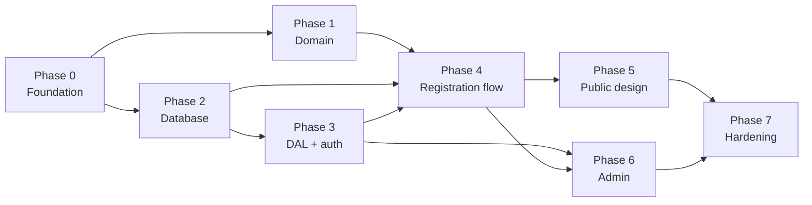

# Implementation Plan

A sequential implementation roadmap, to be started **only after these
specifications are reviewed and approved by a human**.

---

## Before you write any code

**Nothing blocks implementation.** The event date is confirmed (**19 September 2026, 19:00–21:00,
`America/Sao_Paulo`**). The remaining open questions block *production launch* or one optional
feature, never the build. Start at Phase 0 and keep going.

**Read, in this order:**

1. [README.md](../README.md) — repository overview.
2. [EVENT-SOURCE-OF-TRUTH.md](./EVENT-SOURCE-OF-TRUTH.md) — what is factually true about the event,
   and what is not.
3. [DECISIONS.md](./DECISIONS.md) — Part 1 for *why* things are the way they are, Part 2 for what
   still needs a human and when.
4. [PRODUCT-SPEC.md](./PRODUCT-SPEC.md) — what the product does.
5. [DATABASE-SECURITY.md](./DATABASE-SECURITY.md) — read § 5, § 6, § 8 and § 13 carefully. They are
   the parts that are easy to get subtly wrong.
6. [ARCHITECTURE.md](./ARCHITECTURE.md) — the stack and the boundaries.
7. [VISUAL-DIRECTION.md](./VISUAL-DIRECTION.md) and [ADMIN-SPEC.md](./ADMIN-SPEC.md) — read the
   relevant sections when you reach the phase that needs them.

**Nine things that are easy to get wrong and are already decided.** Each was a real defect found in
review; do not re-derive them, and do not let a plausible-looking alternative creep back in:

1. **No table is directly writable.** `authenticated` has `SELECT` only. Every mutation, including a
   name correction, is an RPC ([DATABASE-SECURITY.md § 8.3](./DATABASE-SECURITY.md)).
2. **Every RPC carries its own `REVOKE`/`GRANT` in the same migration.** PostgreSQL grants `EXECUTE`
   to `PUBLIC` by default and Supabase adds `anon`/`authenticated` — a `CREATE FUNCTION` with no ACL
   is a public endpoint (§ 8.1, § 8.5).
3. **`settings_version`, never `updated_at`, is the settings conflict token** (§ 6.4).
4. **Every database-local mutation writes its audit row in the same transaction** (§ 6.7).
5. **`signInWithOtp` always passes `shouldCreateUser: false`** — the default is `true` (§ 7.1.1).
6. **The seeded event is `closed` with `capacity = 0`**, and cannot be opened until capacity > 0
   (§ 6.6).
7. **The event purge is one atomic RPC**, not a delete loop (§ 6.5).
8. **`admin_actions.actor_user_id` is nullable**; null means "a since-removed administrator" (§ 3.6).
9. **The Vercel region goes in `vercel.json`**, not `next.config.ts`
   ([ARCHITECTURE.md § 10.1](./ARCHITECTURE.md)).

**Do not re-derive decisions already recorded.** Colours, type scale, dependency choices, the
allocation algorithm, the RLS matrix, the copy — all are decided. If you believe a decision is wrong,
say so and explain why; do not silently substitute a different one.

**Verify before installing.** Every version in [ARCHITECTURE.md § 1](./ARCHITECTURE.md) was checked
on 2026-09-09. Re-check against the npm registry. If a version has moved, take the latest **patch**
of the stated minor. Do not take a new major without recording why.

**Ordering principle.** The phases put the highest-risk, hardest-to-change work first: the database
invariants and the security boundaries are Phases 2 and 3, before a single pixel is styled. If
something in this plan has to be cut, it is cut from the end, never from the middle.

---

## Phase 0 — Project foundation

**Goal.** A running, typed, linted Next.js application with validated environment handling and
nothing else.

**Work**

- `create-next-app` with TypeScript, App Router, Tailwind, ESLint, `src` directory off.
- Pin `react` / `react-dom` to the same 19.2.x ([ARCHITECTURE.md § 1.1](./ARCHITECTURE.md) explains
  why not 19.3.0).
- `lib/env.ts`: a Zod schema validating every variable from
  [ARCHITECTURE.md § 9.1](./ARCHITECTURE.md), exporting a `client` object and a `server` object,
  the latter guarded by `import 'server-only'`. Fail the build on a missing variable.
- `.env.example` with every key and no values.
- Security headers and the public CSP in `next.config.ts`
  ([ARCHITECTURE.md § 9.3](./ARCHITECTURE.md)).
- **`vercel.json`** at the repository root with `{"regions": ["gru1"]}` — **not** `next.config.ts`,
  which Vercel does not read a region from. Vercel defaults new projects to `iad1`, so omitting this
  puts every database call a continent away from the database
  ([ARCHITECTURE.md § 10.1](./ARCHITECTURE.md)).
- Root layout: `<html lang="pt-BR">`, the Archivo variable font via `next/font/google`, base metadata.
- Design tokens in the Tailwind v4 `@theme` block, transcribed from
  [VISUAL-DIRECTION.md § 3.2 and § 6.2](./VISUAL-DIRECTION.md). Tokens only — no components.

**Dependencies.** None beyond the scaffold plus `zod` and `server-only`.

**Security.** `lib/env.ts` is the only file that reads `process.env`. Establish this now; it is hard
to retrofit.

**Verification.** `npm run build` succeeds. Deleting a required variable fails the build with a
readable message. Response headers include the CSP and HSTS.

**Exit criteria.** A deployable empty application. Tokens resolve in a test component. No secret is
reachable from client code.

---

## Phase 1 — Domain primitives

**Goal.** Pure, fully-tested functions with no I/O. Written first because the whole system depends on
them and they are trivial to test in isolation.

**Files.** `lib/domain/phone.ts`, `lib/domain/schemas.ts`, `lib/domain/outcomes.ts`,
`lib/domain/csv.ts`, `lib/domain/format.ts`

**Work**

- `phone.ts`: the eight-step normalization from
  [PRODUCT-SPEC.md § 5.2](./PRODUCT-SPEC.md), the DDD allowlist from § 5.3, the display mask, and a
  `formatForDisplay(e164)` inverse.
- `schemas.ts`: Zod schemas for the registration input, the settings input and the invite input,
  with the pt-BR messages from [PRODUCT-SPEC.md § 6.2](./PRODUCT-SPEC.md) attached to the schema.
  One definition, used by both client and server.
- `outcomes.ts`: the outcome union type and its copy map ([PRODUCT-SPEC.md § 6.1](./PRODUCT-SPEC.md)).
- `csv.ts`: cell escaping **including the formula-injection guard**
  ([DATABASE-SECURITY.md § 10](./DATABASE-SECURITY.md)), `;` delimiter, UTF-8 BOM.
- `format.ts`: pt-BR date and time formatting via `Intl` with `America/Sao_Paulo`.

**Tests (vitest).** This phase is 100% unit-testable and should be near-100% covered.

- Phone: a table of ~25 inputs — `+55 (19) 99123-4567`, `19991234567`, `5519991234567`,
  `(19) 3199-1234` (landline → the specific message), `(10) 99123-4567` (invalid DDD),
  `11111111111`, empty, letters, a 30-character paste.
- CSV: `=cmd|…`, `+1`, `-1`, `@x`, a leading tab, a name containing `;`, a name containing a quote,
  a name containing a newline, `João Gonçalves` round-tripping through the BOM.
- Schemas: boundary ages 0, 1, 120, 121; a 1-character name; a 121-character name; a name that is
  only whitespace.

**Exit criteria.** Every test passes. No function in this phase performs I/O or imports React.

---

## Phase 2 — Database

**The most important phase. Do not rush it, and do not start Phase 4 until it is green.**

**Goal.** A local Supabase instance whose schema enforces **all nine invariants (I1–I9)**, proven by
tests including real concurrency tests.

**Files.** `supabase/migrations/*.sql`, `supabase/seed.sql`, `supabase/tests/*`

**Work — in this order**

1. `supabase init`, `supabase start`.
2. **Migration 1 — privilege baseline, first.** Enable the extensions (`unaccent`, `pg_trgm`), then
   apply the `REVOKE` and `ALTER DEFAULT PRIVILEGES` block from
   [DATABASE-SECURITY.md § 8.1](./DATABASE-SECURITY.md) **before** any table or routine exists.
   Doing this first means every object created by later migrations is born deny-by-default rather
   than being briefly world-executable and then locked down.
3. Migration 2 — enums, `immutable_unaccent` (with its `REVOKE`).
4. Migration 3 — `events`, with **every** `CHECK` from § 3.2 — including
   `events_open_requires_capacity` (**I7**) — plus `settings_version` and
   `events_single_active_uidx`.
5. Migration 4 — `registrations`, its constraints, the `search_name` generated column, and every
   index from § 3.7.
6. Migration 5 — `admin_users`; `admin_actions` with a **nullable** `actor_user_id`
   (`ON DELETE SET NULL`) and a `NOT NULL actor_label`, plus both indexes.
7. Migration 6 — the `sync_event_counts()` trigger (§ 4). Confirm it does **not** touch
   `settings_version` (**I8**).
8. Migration 7 — `is_active_admin()` and `record_admin_action()`. The latter is granted to
   **no role at all**.
9. Migration 8 — `register_for_event()` (§ 5.2). `service_role` only.
10. Migration 9 — the admin mutation RPCs, each beginning with `is_active_admin()` and each ending
    with its audit write: `edit_registration()`, `cancel_registration()`, `promote_from_waitlist()`,
    `update_event_settings()`, `delete_registration()`, `purge_event_registrations()`,
    `record_export_action()`, `set_admin_active()`, `add_admin_user()`, `remove_admin_user()`,
    `verify_event_counters()`.
11. Migration 10 — RLS: enable on all four tables, the read-only policies from § 8.3, and the
    `REVOKE INSERT, UPDATE, DELETE` on every table. **No write policy, and no column-scoped
    `GRANT UPDATE`** — both were withdrawn in favour of RPC-only writes.
12. `seed.sql` — the one active event, populated **only** from
    [EVENT-SOURCE-OF-TRUTH.md](./EVENT-SOURCE-OF-TRUTH.md). The date is confirmed:
    `starts_at = 2026-09-19T19:00:00-03:00`, `ends_at = 2026-09-19T21:00:00-03:00`. Seed it
    **`registration_state = 'closed'` with `capacity = 0`** — the real capacity is unknown and the
    schema is designed so that this state is inert rather than harmful (§ 6.6).

**Every migration that creates a routine carries its `REVOKE`/`GRANT` pair immediately after the
`CREATE`, matching the ACL matrix in § 8.5 exactly.** A `CREATE FUNCTION` with no adjacent ACL is a
review failure, not a detail to tidy later.

**Tests.** These are the tests that matter most in the entire project.

*Invariants*

- Fill exactly to capacity → all confirmed, `confirmed_count = capacity`.
- One more, waitlist on → `waitlisted`, rank 1.
- One more, waitlist off → `full`, no row created.
- `registration_state = 'closed'` → `closed`, no row, even with free seats.
- Same phone twice → `already_registered`, exactly one row, name unchanged.
- Cancel a confirmed → count decrements; the same phone can now register again.
- Promote 5 with headroom 2 → exactly 2 promoted, in `waitlist_rank` order.
- Promote with zero headroom → zero rows, no error.
- Set capacity below `confirmed_count` → raises, nothing changes.
- Turn the waitlist off with people queued → rows survive and are still promotable.
- Turn the waitlist on again → new ranks continue after the existing ones.
- `verify_event_counters()` returns zero rows after every scenario above.
- Attempt to insert a 12th confirmed row directly with capacity 11 → the `CHECK` constraint aborts.

*Safe initial state (**I7**)*

- The seeded event is `closed` with `capacity = 0`, and a registration against it returns `closed`.
- `update_event_settings(state => 'open', capacity => 0)` → raises `capacity_required_to_open`;
  nothing changes.
- Setting capacity to 8 and then opening → succeeds.
- Lowering capacity to 0 while open → raises; nothing changes.
- A direct `UPDATE events SET registration_state = 'open'` with `capacity = 0` → the `CHECK`
  constraint aborts, proving the rule is not merely in the RPC.

*Settings concurrency (**I8**) — the regression this replaced*

- Two `update_event_settings` calls with the same `p_expected_settings_version` → the first
  succeeds, the second raises `settings_conflict`.
- **Read `settings_version`, complete a registration, then save settings using the version read
  before that registration → the save SUCCEEDS.** This is exactly the false conflict the old
  `updated_at` token produced, and it must not come back.
- Same, substituting a cancellation and then a promotion for the registration → also succeeds.
- Confirm `updated_at` *does* advance on registration while `settings_version` does not.

*Audit atomicity (**I9**)*

For each of `edit_registration`, `cancel_registration`, `promote_from_waitlist`,
`update_event_settings`, `delete_registration`, `purge_event_registrations`:

- A successful call leaves **exactly one** matching `admin_actions` row, with the correct
  `actor_user_id` and a populated `actor_label`.
- A call that raises (unauthorized, conflict, invalid input) leaves **zero** audit rows **and** zero
  state change — assert both in the same test.
- No audit `metadata` value anywhere contains a participant name, age or phone number. Assert by
  scanning every produced row against the seeded participants' values.
- `edit_registration` with no actual change writes no row at all.
- `cancel_registration` on an already-cancelled row writes no second row.

*Event purge (§ 6.5)*

- Purge with 90 registrations → returns `deleted_count = 90`; the event has no registrations left;
  both counters are `0`; `verify_event_counters()` is clean.
- The event is now `closed` and `settings_version` has advanced.
- Exactly one `registrations.purged` audit row exists, its metadata holds the four counts and no
  personal data, and it is still readable after the rows are gone.
- Purge with a stale `p_expected_settings_version` → raises `settings_conflict`; **nothing is
  deleted**.
- Purge called a second time → `deleted_count = 0`, no error, one further audit row.
- Purge as a non-admin → raises `not_authorized`; nothing deleted.

*Administrator lifecycle*

- Deleting an `auth.users` row leaves its historical `admin_actions` rows present, with
  `actor_user_id IS NULL` and `actor_label` still populated — the delete must **not** fail and must
  **not** cascade the audit rows away.
- A `LEFT JOIN` audit query returns those rows; an inner join does not. Assert the difference, so
  the reason for the rule is captured in a test rather than only in prose.
- `set_admin_active(self, false)` → raises. The last active administrator cannot be deactivated or
  removed.
- After `set_admin_active(other, false)`, that administrator's next query returns nothing.

*Concurrency — the decisive test*

A Node script using `pg` with **50 parallel connections** against `capacity = 10`, each calling
`register_for_event` with a distinct valid phone. Assert:

- exactly 10 rows with `status = 'confirmed'`;
- exactly 40 with `status = 'waitlisted'` (and, in a second run with the waitlist off, 40 `full`
  outcomes and 40 absent rows);
- `confirmed_count = 10` and `waitlist_count = 40`;
- `waitlist_rank` values are exactly 1…40 with no gaps and no duplicates;
- zero errors, zero deadlocks;
- `verify_event_counters()` returns zero rows.

Then a second concurrency test that mixes `register_for_event` with concurrent
`update_event_settings` and `promote_from_waitlist` calls, asserting no deadlock — this is what
proves invariant **I6**.

*Authorization*

Three clients — the publishable key (anon), an authenticated user absent from `admin_users`, and an
active admin. Assert:

- **anon**: `select` on all four tables returns nothing or errors. **And `rpc(...)` is denied for
  every routine in the § 8.5 matrix** — iterate that list programmatically rather than spot-checking,
  so that a routine added later without an ACL fails this test rather than slipping through.
- **non-admin authenticated**: the same read denials; every admin RPC raises `not_authorized`;
  `register_for_event` is denied by privilege.
- **admin**: reads succeed; `edit_registration` succeeds; a direct
  `update registrations set full_name = ...` is **rejected — no `UPDATE` privilege exists at all**;
  so are a direct status update, and a direct `insert` or `delete` on any of the four tables.
- **admin with `is_active = false`**: every read returns nothing and every RPC raises, on the very
  next query.

**Exit criteria.** Every test above passes locally. `supabase db reset` reproduces the schema from
scratch. **Do not proceed until the concurrency, ACL and audit-atomicity suites are green.**

---

## Phase 3 — Data Access Layer and authentication

**Goal.** The only code in the application permitted to talk to Supabase, plus a working admin
sign-in.

**Files.** `lib/data/**`, `app/admin/(auth)/**`, `app/auth/**`, `proxy.ts`

**Work**

- Supabase clients: `secret.ts` (secret key, server-only), `user.ts` (per-request, bound to cookies
  through `@supabase/ssr` with the `getAll` / `setAll(cookiesToSet, headers)` contract), `browser.ts`
  (publishable key, sign-in page only).
- `import 'server-only'` at the top of **every** file under `lib/data/`.
- `lib/data/auth.ts`: `getAdminSession` wrapped in `React.cache`, `requireAdmin`, `assertAdmin`
  ([DATABASE-SECURITY.md § 7.2](./DATABASE-SECURITY.md)).
- `proxy.ts`: session refresh with `getClaims()`, matcher `['/admin/:path*']`, plus the nonce CSP for
  admin routes. **Comment at the top stating it is not an authorization boundary.**
- `/admin/entrar`: the two-step OTP flow ([ADMIN-SPEC.md § 2](./ADMIN-SPEC.md)).
  - **`signInWithOtp({ email, options: { shouldCreateUser: false } })`.** The default is `true`;
    omitting it makes this public form an account-creation endpoint
    ([DATABASE-SECURITY.md § 7.1.1](./DATABASE-SECURITY.md)).
  - **Normalise the response.** With `shouldCreateUser: false`, Supabase returns success for a known
    address and an error for an unknown one. Both must render the identical `Verifique seu e-mail`
    screen, same body, same 60-second resend window. Log the real distinction server-side with the
    address reduced to its domain.
  - `verifyOtp({ email, token, type: 'email' })` for the code step; a wrong code and a code for a
    non-existent address produce the same message.
- `/auth/confirmar`: the OTP callback, with the redirect target validated against internal paths.
- `/auth/sair`: POST-only sign-out.
- `/admin/sem-acesso`.
- `lib/data/audit.ts`: **read-only** (`listAdminActions`) — audit *writes* happen inside the
  database RPCs, never from application code (**I9**). The read query uses a `LEFT JOIN` to
  `admin_users` and renders a null actor as `Organizador removido (<actor_label>)`.

**Supabase project configuration** (a checklist, not code):

- Disable public sign-up. (Layer 1; `shouldCreateUser: false` is layer 2 and lives in code.)
- Enable asymmetric (ES256) JWT signing keys.
- Set the redirect allowlist to the production and preview origins.
- Create the first administrator by dashboard invite plus a seed insert
  ([DATABASE-SECURITY.md § 7.4](./DATABASE-SECURITY.md)).
- **Custom SMTP is a *launch* prerequisite, not a blocker for this phase.** `supabase start` runs a
  local mail catcher that receives OTP e-mails, so build and test the entire flow against it. Note
  the mail UI URL printed by `supabase start`. Configure production SMTP in Phase 7
  ([DECISIONS.md Q5](./DECISIONS.md)).

**Security.** This is the phase that establishes every boundary in the product. Re-read
[DATABASE-SECURITY.md § 13](./DATABASE-SECURITY.md) before you finish it.

**Tests.**

- Playwright: unauthenticated `/admin` redirects; authenticated-but-not-admin lands on
  `/admin/sem-acesso`; sign-out clears the session.
- **Unknown-address OTP:** requesting a code for an address with no account must (a) create **no**
  `auth.users` row — assert by querying the database before and after — and (b) return a response
  body byte-identical to that for a known address. Both halves are required; either alone is
  insufficient.
- A rendered error must never contain Supabase's raw error text.

**Exit criteria.** An invited administrator can sign in and reach an empty protected page. A
non-administrator cannot. Deleting `proxy.ts` does not grant access to anything.

---

## Phase 4 — Registration flow, end to end, unstyled

**Goal.** All six outcomes working correctly through the real database, with no visual design at all.
Correctness before appearance.

**Files.** `lib/data/public.ts`, `app/actions/register.ts`, `app/page.tsx`,
`components/registration-form.tsx`

**Work**

- `getActiveEventForDisplay()` — returns a display DTO, never a row.
- `registerParticipant(dto)` — calls `rpc('register_for_event')` with the secret key, maps outcomes.
- The Server Action: Zod parse → phone normalize → **Turnstile siteverify** → DAL → conditional
  `revalidatePath('/')` ([ARCHITECTURE.md § 6](./ARCHITECTURE.md)).
- Turnstile: load the script, render the widget in a fixed-height container, verify server-side with
  `idempotency_key`, handle `timeout-or-duplicate` with a widget reset, **fail closed**.
- The form as a client component with `useActionState`, the phone mask, blur validation, the error
  summary and focus management ([PRODUCT-SPEC.md § 7](./PRODUCT-SPEC.md)).
- All six outcome panels with their specified pt-BR copy.
- The page's advisory state banner (§ 4.4).

**Security.** The Server Action validates from scratch and ignores anything the client computed.
It returns `{ outcome, status? }` and nothing else.

**Tests.** Integration (vitest, Turnstile mocked): each of the six outcomes; a rejected token; a
malformed payload; a payload with extra fields. Playwright at 390 px: happy path, duplicate,
closed state, validation error → summary appears and is focused.

**Exit criteria.** A real registration completes against the local database and produces the correct
outcome. Submitting without a valid token writes nothing. It looks like nothing — that is expected.

---

## Phase 5 — Public page design

**Goal.** Implement [VISUAL-DIRECTION.md](./VISUAL-DIRECTION.md).

**Work**

- The title lockup (§ 6.3) with correct semantics and `aria-hidden` on the decorative date block.
- The hero: mobile column, `lg` composition, `xl` asymmetric split (§ 5.1).
- The chart motif as inline SVG, the radial glow, the grain overlay (§ 7). Three decorative
  elements total.
- Sections: O convite (poster with ground shadow), Detalhes (`<dl>`), Inscrição, Realização e apoio,
  Rodapé.
- Form styling (§ 9), including the `:autofill` override and the 16 px input floor.
- The sticky mobile CTA with `scroll-padding-bottom`.
- Motion: three CSS primitives, one `IntersectionObserver`, the **additive** reveal rule (§ 10.5),
  and the reduced-motion block.
- `/privacidade` — blocked on Q2–Q4.
- `opengraph-image.tsx`, `robots.ts`, `sitemap.ts`, `/evento.ics`.
- Assets: the poster through `next/image`; logos as SVG if supplied, otherwise 3× WebP crops.

**Performance.** Check the first-load JS budget after this phase, not at the end. Only the three
client components listed in [ARCHITECTURE.md § 5](./ARCHITECTURE.md) may exist.

**Tests.** Playwright screenshots at 320/360/390/768/1024/1440/1920 with an assertion that
`document.scrollingElement.scrollWidth <= window.innerWidth` at every width. A 90-character name in
the success panel. Axe on `/` in default, error and success states. Lighthouse mobile against the
budget.

**Exit criteria.** The page matches the direction, hits the budget, and reports zero axe violations.
No item from the anti-pattern list (§ 14) is present.

---

## Phase 6 — Admin

**Goal.** Implement [ADMIN-SPEC.md](./ADMIN-SPEC.md).

**Work**

- Admin shell: sidebar on desktop, bottom tabs on mobile. Light visual language
  ([VISUAL-DIRECTION.md § 12](./VISUAL-DIRECTION.md)).
- Dashboard: the three numbers, the capacity meter, the promotion prompt with its confirmation and
  its post-promotion call list, inline controls, latest registrations.
- Registrations: server-side search/filter/sort/pagination driven by `searchParams`; one semantic
  table with priority columns; the `<dialog>` detail panel; row actions.
- Settings: three controls, the read-only copy block, and optimistic concurrency on
  **`settings_version`** — not `updated_at`. Carry the token in the form, send it back with the
  save, and store the new value returned by the RPC. The `Abertas` option is disabled while capacity
  is `0`, with `Defina a capacidade antes de abrir as inscrições.` as its explanation.
- Team: list, invite, deactivate/reactivate, remove, with the two RPC-enforced guards. Removal is
  database-first, then the Auth Admin API, and surfaces the residual state honestly if the second
  step fails ([DATABASE-SECURITY.md § 6.7](./DATABASE-SECURITY.md)).
- The `Zona de risco` purge block, calling `purge_event_registrations()` **once**. No per-row delete
  loop. It carries `settings_version`, shows exact counts by status, and states before the button is
  pressed that registrations will be forced closed.
- Participant correction through `edit_registration()`. There is no direct table write anywhere in
  this phase.
- CSV export Route Handler with every requirement from
  [DATABASE-SECURITY.md § 10](./DATABASE-SECURITY.md).
- `loading.tsx` and `error.tsx` for each route; every empty state from
  [ADMIN-SPEC.md § 7.2](./ADMIN-SPEC.md).
- Named-error mapping: `settings_conflict`, `capacity_below_confirmed:N`,
  `capacity_required_to_open`, `not_authorized` each map to their specified pt-BR message
  ([ADMIN-SPEC.md § 5](./ADMIN-SPEC.md)).

**Security.** `assertAdmin()` is the first statement of **every** Server Action and Route Handler
here. Reads *and writes* use the administrator's JWT, never the secret key — the only exceptions are
the two admin-provisioning halves. Grep the finished phase for `assertAdmin` and confirm the count
matches the number of admin entry points. The CSV export calls `record_export_action()` **before**
streaming a single byte.

**Tests.** Playwright: sign in → dashboard shows correct numbers; search finds an accented name by
its unaccented spelling; export downloads a file with a BOM **and** produces an audit row; cancel
frees a seat; promote respects headroom; correcting a name succeeds and records only the changed
field name; the settings form survives a concurrent public registration but conflicts on a
concurrent admin save; opening registrations is refused while capacity is `0`; the purge dialog
requires the checkbox and afterwards leaves the event closed and empty; a direct POST to an admin
Server Action without a session is rejected. Axe on every admin route including the open dialog.

**Exit criteria.** An organizer can run the event end to end from a phone.

**Delivered beyond the plan above, and why:**

- `promote_registration(uuid)` (migration 12). ADMIN-SPEC.md § 4.4 specifies `Confirmar vaga` on a
  named person, out of queue order; `promote_from_waitlist(event, count)` takes the N oldest and
  cannot express it. A direct table write could not carry the capacity check and the audit record in
  one transaction, so the action is a sibling RPC with the identical six-step shape.
- `/admin/auditoria`, linked from `Equipe` rather than added to the tab bar (ADMIN-SPEC.md § 10).
- The age policy of DECISIONS.md Q7, implemented across the database, the schemas, the Server Action
  and the public copy (migration 11).

---

## Phase 7 — Hardening and launch

**Goal.** Prove the acceptance criteria and deploy.

**Work**

- **CI gates:** unit + integration tests, the database invariant and concurrency suites against a
  fresh local Supabase, Playwright E2E, axe, Lighthouse CI with the budget, the first-load-JS
  assertion, and the client-bundle grep for `sb_secret_`.
- Walk [PRODUCT-SPEC.md § 13](./PRODUCT-SPEC.md) item by item and record evidence for each.
- Walk [DATABASE-SECURITY.md § 13](./DATABASE-SECURITY.md) as a review checklist.
- Manual passes that cannot be automated: keyboard-only through the whole public flow; VoiceOver on
  iOS through the form and the success panel; the page on a real low-end Android over throttled
  mobile data.
- Production Supabase project in `sa-east-1`; migrations applied through CI; the first administrator
  provisioned.
- Confirm `vercel.json` resolved the compute region to `gru1` — check the deployment summary, and
  spot-check database latency ([ARCHITECTURE.md § 10.1](./ARCHITECTURE.md)).
- Turnstile production keys. The Vercel Firewall rule is **optional** defense in depth; if added,
  tune it generously for CGNAT ([DATABASE-SECURITY.md § 9.3](./DATABASE-SECURITY.md)).
- A separate Supabase project for preview deployments. **Verify no preview points at production.**
- Add a CI check that fails on any `CREATE FUNCTION` in `supabase/migrations/` without an adjacent
  `REVOKE`, and on any migration granting `EXECUTE` to `anon` or `PUBLIC`. A grep is sufficient and
  turns the § 8.5 matrix into an enforced rule rather than a document.

### Launch gate — must be signed off by the organizers before the link is shared

These are the only remaining human decisions. **None of them blocks any of Phases 0–6**; all of them
block going live. Each maps to a question in [DECISIONS.md](./DECISIONS.md).

| # | Gate | Blocks | Owner |
| --- | --- | --- | --- |
| 1 | **Production SMTP configured** and verified by a real administrator sign-in (Q5) | Admin sign-in in production. Development uses the local mail catcher. | Organizers + implementer |
| 2 | **`/privacidade` published** with a named data controller (Q2) and a stated retention period (Q4). The contact channel (Q3) is answered and published: `contato@euqueroadh.com`. | Lawful collection | Organizers |
| 3 | **Minors decision recorded** — whether under-18s are expected, and what privacy handling the organizers determined is appropriate (Q8, [PRODUCT-SPEC.md § 12.1](./PRODUCT-SPEC.md)). The age-limit half is **answered and implemented**: online registration is 12 and over, enforced by `events.min_age`, with under-12s directed to `contato@euqueroadh.com`. | Lawful collection. **Not legal advice** — the specification requires an answer, not a particular answer. | Organizers |
| 4 | **Real capacity configured** and registrations deliberately opened (Q6) | Registration. The event is seeded `closed` with `capacity = 0` and refuses to open until this is done, so forgetting fails safe. | Organizers |
| 5 | ~~Contact channel wired in (Q3)~~ — **done**: `ORGANIZATION_EMAIL` in `lib/domain/schemas.ts` feeds the privacy notice and the under-12 panel | — | Implementer |

Gate 4 deserves emphasis: it is the one gate the system enforces for you. There is no way to ship an
event that silently collects registrations against a placeholder capacity.

**Exit criteria.** Every acceptance criterion in [PRODUCT-SPEC.md § 13](./PRODUCT-SPEC.md) is
demonstrably met, the launch gate above is signed off, and the public URL is live.

---

## Dependency graph

Phases 1 and 2 are independent of each other and can be done in either order. Everything else is
strictly sequential.

---

## Why the order is this order

- **The database is Phase 2, before any UI.** The capacity algorithm is the hardest thing to change
  later and the most expensive thing to get wrong. Proving it with a real concurrency test before
  anything depends on it removes the project's largest risk on day one.
- **Authentication is Phase 3, before the admin UI.** Retrofitting authorization onto existing pages
  is how `assertAdmin()` ends up missing from one action.
- **The registration flow is Phase 4 and deliberately unstyled.** Separating "does it work" from
  "does it look right" means a failure in either has one obvious cause.
- **Design is Phase 5, after correctness.** Styling a flow that later changes shape is rework.
- **The admin is Phase 6.** It depends on real registrations existing, which Phase 4 provides.

---

## Testing strategy

Priority order. If time is short, the top of this list is what protects the event.

| Tier | Scope | Tool | Priority |
| --- | --- | --- | --- |
| **1** | **Database invariants I1–I9.** Last-seat concurrency; duplicate concurrency; waitlist rank correctness; counter reconciliation; settings-version conflict **and** the proof that a registration does *not* cause one; opening with capacity 0 refused; audit atomicity for edit, cancel, promote, settings, delete and purge; purge correctness; deleted-administrator audit survival | `pg` + parallel connections against local Supabase | **Must** |
| **2** | **Privileges and authorization.** RLS for anon / non-admin / admin / deactivated admin, **plus a programmatic sweep asserting `anon` cannot `EXECUTE` any routine in the § 8.5 matrix**, and that no direct table write succeeds for any role | supabase-js with three identities | **Must** |
| **3** | Phone normalization, Zod schemas, CSV escaping, audit-metadata redaction | vitest | **Must** |
| **4** | The registration Server Action's six outcomes, with Turnstile mocked | vitest | **Must** |
| **5** | E2E: registration happy path, duplicate, closed, admin sign-in, **unknown-address OTP creating no user and returning an identical response**, export, purge, direct-POST rejection | Playwright, mobile + desktop | **Must** |
| **6** | Accessibility on every route and on error, success and dialog states | `@axe-core/playwright` | **Must** |
| **7** | Responsive: no horizontal overflow at seven widths; long-name handling | Playwright | Should |
| **8** | Performance budget | Lighthouse CI + a bundle-size assertion | Should |
| **9** | Keyboard-only and VoiceOver passes | manual | Should |

Tier 1 and tier 2 are where this project's real risk lives. Every scenario listed in them
corresponds to a defect that a review actually found in an earlier revision of this specification,
or to an invariant whose violation would be silent in production. If schedule pressure forces a cut,
cut from tier 7 upward — never from tiers 1 and 2.

**Not written:** snapshot tests of component markup (they break on every styling change and assert
nothing about behaviour), tests of framework behaviour, and tests that exist to raise a coverage
number. Tier 1 is worth more than a hundred component tests.

---

## What "done" is not

- Not "the tests pass" — the acceptance criteria in
  [PRODUCT-SPEC.md § 13](./PRODUCT-SPEC.md) must each have evidence.
- Not "it works on my laptop" — it must work on a mid-range Android over mobile data.
- Not "it looks like the references" — it must look like **this event**.
- Not "we can add the security later" — [DATABASE-SECURITY.md § 13](./DATABASE-SECURITY.md) is a
  launch requirement, not a backlog.
