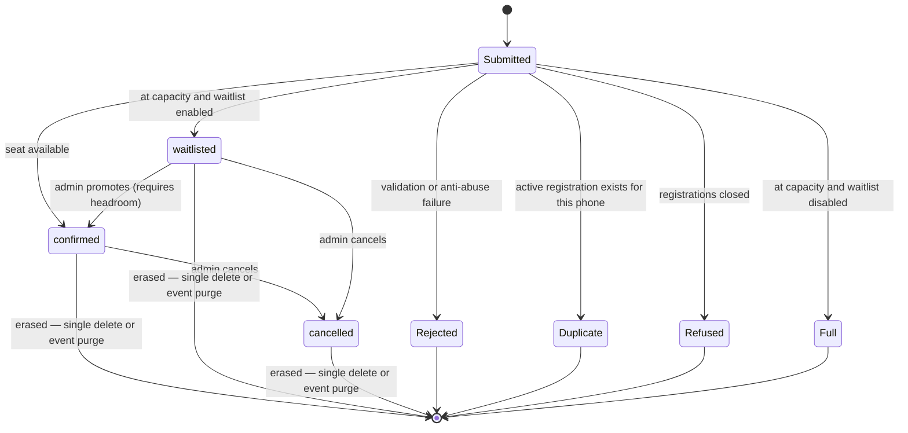

# Product Specification — V1

Source of truth for **what** the product does. Companion documents:
[VISUAL-DIRECTION.md](./VISUAL-DIRECTION.md) (how it looks),
[ARCHITECTURE.md](./ARCHITECTURE.md) (how it is built),
[DATABASE-SECURITY.md](./DATABASE-SECURITY.md) (data, concurrency, authorization),
[ADMIN-SPEC.md](./ADMIN-SPEC.md) (the admin surface).

Facts about the event come from [EVENT-SOURCE-OF-TRUTH.md](./EVENT-SOURCE-OF-TRUTH.md) only.

Requirement labels used throughout: **[C]** confirmed requirement · **[R]** recommended decision made
in this document · **[O]** open, needs a human answer (all collected in [DECISIONS.md](./DECISIONS.md)).

---

## 1. Objective

Let a young person in and around Hortolândia/SP go from seeing a link to holding a confirmed seat at
*Palestra — Educação Financeira para Jovens* in **under 30 seconds on a mobile phone**, and give the
organizers a trustworthy, real-time view of who is coming.

Two success measures:

1. **Conversion** — a visitor who intends to register completes it on the first attempt.
2. **Operational trust** — the number of confirmed registrations shown to an admin is never wrong,
   under any concurrency, and never exceeds the configured capacity.

## 2. Audiences

| Audience | Context | Design consequence |
| --- | --- | --- |
| **Participant** — a young person, arriving from an Instagram/WhatsApp link | Almost always a phone, often on mobile data, one hand, possibly outdoors | Mobile-first, three fields, large touch targets, correct keyboards, no account, no e-mail, no wizard |
| **Organizer/admin** — a small number of volunteers | Mixes phone (during the event, at the door) and laptop (planning) | Fast, dense, legible; must work fully on a phone; no training required |

There is no third audience. There are no participant accounts, no speaker portal, no sponsor login.

## 3. Scope

### 3.1 In scope (V1)

**Public**

- A single public page presenting the event and its registration form.
- A registration flow collecting exactly **nome**, **idade**, **celular**.
- Deterministic outcomes: confirmed, waitlisted, already registered, full, closed, invalid, error.
- A privacy notice page.
- An `.ics` calendar download on the success state.
- Open Graph / social preview metadata.

**Admin**

- Individual, invite-only administrator accounts.
- Dashboard: capacity state at a glance, plus the actions that state implies.
- Registrations list with search, status filter, sort and pagination.
- Per-registration actions: cancel, promote from waitlist, correct name/age, permanently delete.
- Event settings: capacity, waitlist on/off, registrations open/closed.
- CSV export.
- Admin team management: invite, deactivate, remove.
- An audit trail of administrative actions, written transactionally with each action.
- An atomic end-of-event data purge.

### 3.2 Explicit non-goals (V1)

Not built, not stubbed, not designed on paper:

- Payments, tickets, seat maps, QR check-in.
- ~~Attendance tracking~~ — **superseded.** Attendance shipped as one nullable timestamp plus a
  check-in screen, because the raffle draws from the people in the room and a certificate of
  participation must be true (RAFFLE-AND-CERTIFICATE-SPEC.md § 1). QR codes remain out of scope.
- E-mail or WhatsApp automation of any kind, including waitlist notifications.
- Participant accounts, self-service editing or self-service cancellation.
- A content management system for event copy. Event text is seeded by migration; only capacity,
  waitlist and open/closed are editable in the UI. **[R]**
- Multiple concurrent events in the UI. The data model supports it (§ 9); the interface does not.
- Analytics dashboards, funnels, cohort charts, conversion reports.
- Roles beyond "active administrator". No hierarchy, no per-permission grants.
- Internationalisation. The product is `pt-BR` only.
- A public count of registrations. See § 4.4.

## 4. Public experience

### 4.1 Page structure

One page, one URL (`/`), six sections in a single column on mobile. Rendering and layout behaviour
are in [VISUAL-DIRECTION.md § 10](./VISUAL-DIRECTION.md).

| # | Section | Answers | Notes |
| --- | --- | --- | --- |
| 1 | **Hero** | What is this? When? Where? | Kicker `Palestra`, the title, the date block, a one-line meta, the primary CTA. Contains the state banner when registrations are not open. |
| 2 | **O convite** | Why should I care? | Short editorial copy plus the original banner presented as a poster. |
| 3 | **Detalhes** | When exactly, where exactly, what do I get? | A `<dl>` of date, time, venue, address, price, coffee break, plus a "Como chegar" link. |
| 4 | **Inscrição** | How do I register? | The form. Target of every CTA and the skip link. |
| 5 | **Realização e apoio** | Who is behind this? | The four organization marks, reproducing the banner's own credibility bar. |
| 6 | **Rodapé** | Where is the fine print? | Privacy link, organizer names, nothing else. |

There is no navigation bar. A single-purpose page with one action does not need one; adding one
would be decoration. A **skip link** (`Ir para a inscrição`) is the first focusable element.

### 4.2 The three fields

Placeholders are never a substitute for a label. Every field has a visible `<label>`.

| | Nome | Idade | Celular |
| --- | --- | --- | --- |
| Label | `Nome completo` | `Idade` | `Celular` |
| Hint (`aria-describedby`) | — | `Sua idade em anos` | `Com DDD. Ex.: (19) 99999-9999` |
| `type` | `text` | `text` | `tel` |
| `inputmode` | — | `numeric` | `tel` |
| `pattern` | — | `[0-9]*` | — |
| `autocomplete` | `name` | `off` | `tel-national` |
| `autocapitalize` | `words` | `off` | `off` |
| `spellcheck` | `false` | `false` | `false` |
| `enterkeyhint` | `next` | `next` | `done` |
| `maxlength` | `120` | `3` | `15` (masked length) |
| `required` | yes | yes | yes |

**Why `type="text" inputmode="numeric"` for Idade rather than `type="number"`:** `type="number"`
adds spinner controls, accepts `e`, `+` and `-`, and mutates on accidental scroll. `inputmode`
gives the numeric keypad on iOS and Android without any of that. **[R]**

**Font size on all inputs must be ≥ 16px** or iOS Safari zooms the viewport on focus, which reads as
a bug. This is a hard rule, not a preference.

### 4.3 Field behaviour

**Validation timing** — validate on `blur` for a field the user has already left, and on submit for
everything. Never validate on every keystroke while the user is still typing: it produces an error
message for "Joã" before the user has finished typing "João". Once a field has shown an error,
re-validate it on input so the error clears as soon as it is fixed. **[R]**

**Nome**

- Trim, collapse runs of internal whitespace.
- Accept 2–120 characters after trimming. A single-word name is valid — many people have one.
- Store exactly as entered. Never title-case: it destroys `de Souza`, `d'Ávila`, `McCarthy`.
- No character allowlist. Cross-site scripting is prevented by React's escaping, not by rejecting
  apostrophes in people's names. CSV formula injection is handled at export time
  ([DATABASE-SECURITY.md § 10](./DATABASE-SECURITY.md)).

**Idade**

- Accept an integer 1–120. This is a **technical plausibility bound**, not an eligibility rule.
- No business age restriction is implemented, because none exists in the source material. **[O]** —
  if the organizers set one, it belongs in `events` as a nullable `min_age`/`max_age` pair and is
  enforced in the allocation function, not in the browser.

**Celular** — the Brazilian mobile input is specified in § 5.

### 4.4 What the page does *not* show

No live registration counter, no "faltam 3 vagas!", no "127 pessoas já se inscreveram".

Three reasons: it would leak the organization's turnout to anyone with the URL; a cached page makes
any number stale and therefore a lie; and manufactured scarcity is exactly the pattern this project
is meant to avoid. The page communicates **state**, not **numbers**:

| Event state | What the page shows |
| --- | --- |
| Open, seats available | Normal. CTA: `Garantir minha vaga`. |
| Full, waitlist enabled | A calm banner in the hero: `As vagas confirmadas acabaram — você ainda pode entrar na lista de espera.` CTA: `Entrar na lista de espera`. The form is unchanged. |
| Full, waitlist disabled | Banner: `As vagas para esta palestra se esgotaram.` The form is replaced by that message plus the event details. |
| Registrations closed | Banner: `As inscrições estão encerradas.` The form is replaced. |

This state is read at render time and is **advisory**. The authoritative outcome is always decided
by the database at submit time — a visitor may see "open" from a cached page and still be waitlisted
or rejected. Every one of those outcomes has a designed screen (§ 6).

### 4.5 Form placement — decision

**The form is a section of the page, not a modal or a bottom sheet. [R]**

- Nothing is hidden behind an extra tap.
- No focus trap, no scroll locking, no `inert` management, no dialog-dismissal edge cases.
- It works without JavaScript for layout and reading (submission requires JS — see § 7.3).
- A sticky bottom CTA bar appears on mobile once the hero CTA scrolls out of view, and simply
  scrolls to `#inscricao`. It is an anchor, not a launcher. It hides itself once the form is in
  view, so it never covers the fields or a focus ring.

A modal was considered and rejected: it buys a shorter page at the cost of accessibility complexity
and a lost progressive-enhancement story, for a form that is three fields long.

**Single step. No wizard.** Three fields at ~15 seconds of typing do not benefit from being split;
splitting them would add two navigation decisions and two more chances to abandon.

## 5. Brazilian mobile phone handling

### 5.1 Two representations

| | Purpose | Format | Example |
| --- | --- | --- | --- |
| **Display** | What the user sees and types | `(DD) 9NNNN-NNNN` | `(19) 99123-4567` |
| **Canonical** | What the database stores and matches on | E.164, digits only after `+` | `+5519991234567` |

The mask is a **typing aid only**. It is never the validation. A mask can be satisfied by
`(00) 00000-0000`; the canonical rules below cannot.

### 5.2 Normalization algorithm

Run identically on the client (for feedback) and on the server (for truth). The server result is
the only one that is stored.

1. Strip everything that is not a digit.
2. If the result has 13 digits and begins `55`, drop the leading `55`.
3. If the result has 12 digits and begins `55`, drop the leading `55` (leaves 10 digits → fails at
   step 4, correctly rejecting a landline written with a country code).
4. Require exactly **11** digits.
5. `DDD = digits[0..1]` must be in the valid Brazilian area-code set (§ 5.3).
6. `digits[2]` must be `9`. Brazilian mobile numbers are nine digits beginning with 9; this is what
   distinguishes a mobile from a landline, and the requirement is for a mobile.
7. Reject numbers whose eleven digits are all the same character (`11111111111`).
8. Canonical value is `"+55" + digits`.

Rejection at step 4 with 10 digits produces a specific message: `Esse número parece ser um telefone
fixo. Informe um celular com 9 dígitos.` Everything else produces the generic phone error.

### 5.3 Valid DDDs

```
11 12 13 14 15 16 17 18 19   21 22 24   27 28
31 32 33 34 35 37 38
41 42 43 44 45 46   47 48 49   51 53 54 55
61   62 64   63   65 66   67   68   69
71 73 74 75 77   79
81 87   82   83   84   85 88   86 89
91 93 94   92 97   95   96   98 99
```

Hortolândia is **19**. Prefill nothing, but the hint uses 19 in its example.

The allowlist lives in application code (a `Set`) because it changes when ANATEL changes it. The
database applies a shape-only check (`^\+55[1-9]{2}9[0-9]{8}$`) as a durable backstop
([DATABASE-SECURITY.md § 3](./DATABASE-SECURITY.md)).

### 5.4 Mask behaviour

- Apply the mask on input, allowing deletion to work naturally (do not fight the caret).
- Accept paste of any format: `+55 19 99123-4567`, `19991234567`, `(19)99123-4567` all normalize.
- Cap the visible length at 15 characters (`(19) 99123-4567`).
- Do not block non-digit keystrokes — filter them silently, so a paste with spaces is not rejected.

## 6. Registration outcomes

Exactly six terminal outcomes. Every one has a designed screen. There is no seventh, unlabelled path.

| Outcome | When | Recorded? |
| --- | --- | --- |
| `confirmed` | Registration open and `confirmed_count < capacity` | Yes, status `confirmed` |
| `waitlisted` | Registration open, at capacity, waitlist enabled | Yes, status `waitlisted` |
| `already_registered` | An active registration already exists for this phone at this event | No new row |
| `full` | At capacity, waitlist disabled | No |
| `closed` | `registration_state <> 'open'` | No |
| `invalid` / `error` | Validation failure, anti-abuse failure, or an unexpected fault | No |

Precedence when several apply: `already_registered` → `closed` → `confirmed` → `waitlisted` →
`full`. Checking duplicates first means a person who taps submit twice always sees a coherent
answer, even if the event filled up between their two taps.

### 6.1 Success and terminal copy (pt-BR)

Copy below is the specification, not a suggestion. Adjust wording only with a reason.

**`confirmed`**

> ### Inscrição confirmada!
> Guarde a data: **sábado, 19 de setembro, às 19h**, no Espaço Cezanne Eventos.
>
> `[ Adicionar ao calendário ]` `[ Como chegar ]` `[ Compartilhar ]`
>
> Chegue com alguns minutos de antecedência. Coffee break incluso.

*(The weekday appears only once the year is confirmed — see
[EVENT-SOURCE-OF-TRUTH.md § 2](./EVENT-SOURCE-OF-TRUTH.md).)*

**`waitlisted`**

> ### Você está na lista de espera
> As vagas confirmadas já foram preenchidas. Se alguma vaga abrir, a organização entra em contato
> pelo celular que você informou.
>
> `[ Como chegar ]`

No queue position is shown. Promotion is a manual decision made by an organizer who then telephones
the person; a number on screen would be a promise the system cannot keep. The ordering *is* stored
and *is* shown to admins ([DATABASE-SECURITY.md § 6](./DATABASE-SECURITY.md)). **[R]**

**`already_registered`**

> ### Você já está inscrito(a)
> Encontramos uma inscrição **confirmada** com este número de celular.
> *(or)* Encontramos uma inscrição na **lista de espera** com este número de celular.
>
> Precisa corrigir algum dado? Fale com a organização.

Deliberately echoes **no personal data** — not the name, not the age. Otherwise anyone who guesses a
phone number learns who it belongs to. The residual risk (learning *whether* a number is
registered) is accepted and documented in the threat model.

**`full`**

> ### As vagas se esgotaram
> Todas as vagas para esta palestra já foram preenchidas. Obrigado pelo interesse.

**`closed`**

> ### As inscrições estão encerradas
> O período de inscrições para esta palestra foi encerrado.

### 6.2 Error copy (pt-BR)

Field-level:

| Condition | Message |
| --- | --- |
| Nome empty | `Informe seu nome.` |
| Nome < 2 chars | `Informe seu nome completo.` |
| Idade empty | `Informe sua idade.` |
| Idade not a number / out of 1–120 | `Informe uma idade válida.` |
| Celular empty | `Informe seu celular.` |
| Celular 10 digits (landline) | `Esse número parece ser um telefone fixo. Informe um celular com 9 dígitos.` |
| Celular otherwise invalid | `Informe um celular válido com DDD. Ex.: (19) 99999-9999.` |

Form-level:

| Condition | Message |
| --- | --- |
| Anti-abuse check failed or token expired | `Não conseguimos confirmar que você não é um robô. Tente novamente.` |
| Request failed, offline | `Sem conexão. Verifique sua internet e tente novamente.` |
| Server or database fault | `Algo deu errado do nosso lado. Tente novamente em instantes.` (plus a short correlation code in small type) |
| Submission took longer than 10 s | Keep the pending state; do **not** time out the UI. See § 7.2. |

Error text is never technical and never contains an identifier, table name, SQL fragment or stack
frame.

## 7. Submission behaviour

### 7.1 The happy path

1. Client-side validation runs. If it fails, submission is blocked, an error summary appears above
   the form (`role="alert"`, focusable), focus moves to it, and each error links to its field.
2. The submit button enters a pending state: label becomes `Confirmando…`, the button is
   `aria-disabled="true"` and `aria-busy="true"`, and a spinner appears. It is **not** `disabled`,
   so it stays in the tab order and keeps its accessible name.
3. The anti-abuse token is attached (§ 7.3).
4. A Server Action performs authoritative validation, verifies the token, and calls the atomic
   allocation function ([DATABASE-SECURITY.md § 5](./DATABASE-SECURITY.md)).
5. The form region is replaced by the outcome panel. The panel has `role="status"`,
   `aria-live="polite"` and `tabindex="-1"`, and **receives focus**.

**The outcome is rendered and announced immediately.** Any transition is a 200 ms cross-fade applied
to already-present content. Nothing about the success state waits on an animation to finish. **[C]**

### 7.2 Slow and failed networks

- No client-side timeout. Aborting a request whose write may already have committed is how you
  create duplicates. The pending state persists.
- After 6 seconds still pending, add a reassurance line under the button: `Ainda estamos
  confirmando sua inscrição…`.
- If the request genuinely fails (network error), the form returns to its editable state **with the
  user's input preserved**, showing the offline or server message. Retrying is safe: the duplicate
  rule makes a second submission idempotent, returning `already_registered` if the first actually
  committed.
- Double-tap on the button is prevented by the pending state, and harmless if it slips through.

### 7.3 Anti-abuse and JavaScript

Cloudflare Turnstile (managed widget) protects the form. The token is verified **server-side** before
any database write; see [DATABASE-SECURITY.md § 9](./DATABASE-SECURITY.md).

Turnstile requires JavaScript, so **form submission requires JavaScript**. This is a deliberate,
disclosed trade-off:

- Everything else on the page — all event information, the address, the map link, the poster,
  the logos — renders and works with JavaScript disabled.
- With JavaScript disabled, the form area shows a `<noscript>` message:
  `Para se inscrever, ative o JavaScript no seu navegador.` plus the organizers' contact channel
  once one exists (**[O]**).
- The alternative (accepting tokenless submissions under a stricter rate limit) was rejected: it is
  precisely the bypass a bot would use, which would defeat the protection entirely.

The target audience is on modern mobile browsers with JavaScript enabled. The requirement to protect
a public write endpoint outweighs a `<noscript>` submission path here. **[R]**

## 8. Capacity and waitlist — product rules

Mechanism and concurrency proof live in [DATABASE-SECURITY.md § 5–6](./DATABASE-SECURITY.md). This
section defines the **behaviour** the organizers can rely on.

### 8.1 Configuration

Two independent admin settings plus one state:

| Setting | Values | Meaning |
| --- | --- | --- |
| `capacity` | integer ≥ 0 | Maximum number of **confirmed** registrations. |
| `waitlist_enabled` | on / off | What happens to a registration that arrives when confirmed seats are gone. |
| `registration_state` | `open` / `closed` | A manual master switch, independent of capacity — except for the safety rule below. |

Changing any of these takes effect immediately and requires no code change or deploy. **[C]**

### 8.1.1 The event starts closed, and cannot be opened without a capacity

The real venue capacity is not yet known
([EVENT-SOURCE-OF-TRUTH.md § 9](./EVENT-SOURCE-OF-TRUTH.md)), so the product is designed to fail
safe rather than to fail quietly. **[R]**

- **A newly created event is `closed` with `capacity = 0`.** It accepts nothing until an
  administrator deliberately configures it.
- **Registrations cannot be opened while `capacity = 0`.** The attempt is refused with
  `Defina a capacidade antes de abrir as inscrições.`
- **Capacity cannot be lowered to 0 while registrations are open.** Same refusal. To stop taking
  registrations, close them — that is what the master switch is for.

This is a database constraint, not a form validation, so it holds regardless of how the event row is
written ([DATABASE-SECURITY.md § 6.6](./DATABASE-SECURITY.md), invariant **I7**).

It removes three specific ways the event could have gone wrong in public: registrations open with
zero seats so that every visitor is refused; every visitor silently waitlisted because capacity was
never set; and an event the organizers believed was not ready quietly collecting personal data.

### 8.2 Guaranteed invariants

1. `confirmed_count` **never** exceeds `capacity`. Enforced by a database `CHECK` constraint, not by
   application logic. A bug in future code causes a failed transaction, never an oversold event.
2. A person (identified by canonical phone) has **at most one** non-cancelled registration per
   event. Enforced by a partial unique index.
3. Waitlist order is **total and stable**: the order in which people joined the waitlist never
   changes, including after promotions, cancellations or capacity changes.
4. Every registration is in exactly one of three statuses: `confirmed`, `waitlisted`, `cancelled`.

### 8.3 Behaviour of every state change

| Situation | Behaviour | Rationale |
| --- | --- | --- |
| **Capacity increased** (80 → 100) | Nothing happens automatically. The dashboard shows `Há 20 vagas livres e 12 pessoas na lista de espera` with a `Promover próximos 12` action. **[R]** | There is no automated way to tell a promoted person they now have a seat. Silently promoting someone who never learns of it is worse than leaving them queued. Promotion stays a human act because notification is a human act. Revisit if a notification channel is ever added. |
| **Capacity decreased below `confirmed_count`** | **Rejected** with `Não é possível definir a capacidade abaixo de N inscrições confirmadas. Cancele inscrições primeiro.` | Never auto-demote someone who was told they have a seat. |
| **Capacity decreased, still ≥ `confirmed_count`** | Applied. New registrations are waitlisted or refused once the new limit is reached. | |
| **A confirmed registration is cancelled** | `confirmed_count` decrements; a seat is free. No auto-promotion. The dashboard surfaces the free seat. | Same reason as capacity increase. |
| **An admin promotes N from the waitlist** | The N oldest waitlisted registrations (by stored order) become `confirmed`, capped at the available headroom. If headroom is 2 and the admin asks for 5, exactly 2 are promoted and the UI says so. | Predictable, never oversells. |
| **Waitlist disabled while people are on it** | Existing waitlisted registrations are **kept** and remain promotable. Only *future* over-capacity submissions change: they receive `full`. | Silently deleting queued people would be data loss. |
| **Waitlist enabled later** | New over-capacity submissions are waitlisted, with order continuing after the existing entries. | Ordering is a monotonic sequence, never renumbered. |
| **Registrations closed** | All new submissions receive `closed`, regardless of capacity. Existing registrations are untouched. Admins retain every action. | The master switch is independent of capacity by design. |
| **Two people submit the last seat simultaneously** | Exactly one is `confirmed`. The other is `waitlisted` (or receives `full`). Never both confirmed. | Serialised on the event row; see [DATABASE-SECURITY.md § 5.4](./DATABASE-SECURITY.md). |
| **An admin changes capacity while people are registering** | Both operations take the same row lock, so they serialise. Either order is correct and the invariant holds at commit. | |
| **Two admins change settings simultaneously** | The second save is rejected with `As configurações foram alteradas por outra pessoa. Recarregue a página.` | Optimistic concurrency on a dedicated `settings_version` counter; no silent overwrite. |
| **Someone registers while an admin has the settings form open** | **Nothing.** The administrator's save still succeeds. | The conflict token counts *settings* changes only, so ordinary public activity can never cause a spurious conflict. This is why `updated_at` is not the token — the counter trigger bumps it on every registration ([DATABASE-SECURITY.md § 6.4](./DATABASE-SECURITY.md), invariant **I8**). |
| **An admin tries to open registrations with capacity 0** | Refused: `Defina a capacidade antes de abrir as inscrições.` Nothing changes. | § 8.1.1, invariant **I7**. |
| **An admin purges the event's data** | Every registration for the event is permanently deleted in one atomic operation, counters return to zero, and **registrations are forced closed**. | A purged event must not immediately begin re-collecting personal data. See § 8.4. |

### 8.4 End-of-event data purge

The retention action described in § 12 is a single, atomic, audited operation — not a bulk delete
performed row by row. **[R]**

| Property | Behaviour |
| --- | --- |
| Scope | Exactly one event, named explicitly. There is no "purge everything". |
| Atomicity | All registrations for that event are deleted in one transaction, or none are. A failure leaves the data untouched — never half-purged. |
| Counters | Return to zero. |
| Registration state | **Forced to `closed`.** Purging while open would restart collection seconds after an erasure. |
| Audit | One `registrations.purged` record written in the same transaction, containing **counts only** — never names, ages or phone numbers. |
| Audit survival | The record outlives the deleted rows and remains readable afterwards. |
| Repeat calls | Safe. A second purge deletes nothing, still forces `closed`, and records `deleted_total: 0` rather than pretending it did not happen. |
| Confirmation | Deliberately heavy: the exact count is shown, and a checkbox must be ticked before the button activates ([ADMIN-SPEC.md § 6.4](./ADMIN-SPEC.md)). |

Mechanism: [DATABASE-SECURITY.md § 6.5](./DATABASE-SECURITY.md).

## 9. Duplicate policy

**Rule:** one active registration per `(event, canonical phone)`. **[R]**

**Why phone and not name:** names are not unique (two `João Silva`s may both attend) and not stable
(typos, abbreviations). The phone number is the organizers' only contact channel and their de-facto
identity key.

**On a duplicate submission** the system returns `already_registered` with the existing status and
**does not modify the stored row**.

**Why re-submission does not update the name or age:** if it did, anyone who knows a phone number
could overwrite that person's registration data. The correction path is deliberately human: the
duplicate screen says `Precisa corrigir algum dado? Fale com a organização.`, and an admin can edit
the record. A time-boxed "correction window" was considered and rejected as an attack window that
also adds state for a rare case.

**Cancelled registrations do not block re-registration.** The unique index is partial
(`WHERE status <> 'cancelled'`), so someone who cancelled — or was removed — can register again and
will be allocated a seat normally.

**Side effect used deliberately:** because duplicate detection happens inside the same locked
transaction as allocation, the whole registration operation is **idempotent**. A retry after a lost
response cannot create a second row.

## 10. State model



Permanent erasure is reachable from **any** status, not only from `cancelled`: the right to erasure
does not require the person to be cancelled first, and the end-of-event purge (§ 8.4) removes every
row regardless of status. Correcting a name or age is a separate, audited administrative action that
does not change status at all.

`Submitted`, `Rejected`, `Duplicate`, `Refused` and `Full` are **transient request outcomes** and are
never stored. Only `confirmed`, `waitlisted` and `cancelled` are persisted statuses.

`cancelled → confirmed` is intentionally absent as a direct transition: reactivating a cancelled
registration must go through allocation so it cannot bypass the capacity check. In practice the
person re-registers, or the admin deletes and the person registers again.

## 11. Copy direction (pt-BR)

**Voice:** direct, warm, adult. Speaks *to* a young person, never *down* to one.

**Do**

- Short sentences. Active voice. `Garantir minha vaga`, not `Realizar inscrição no evento`.
- Concrete over abstract: `19h às 21h`, not `no período noturno`.
- Inclusive agreement where it is natural: `inscrito(a)`. Do not contort every sentence to achieve it.
- Brazilian conventions: `19h`, `R$`, `(19) 99999-9999`, `19 de setembro`.

**Do not**

- No slang, no emoji in the interface, no exclamation stacking. `Inscrição confirmada!` uses the
  one exclamation mark the page is allowed.
- No urgency theatre: no countdown timer, no "últimas vagas", no scarcity language the system
  cannot substantiate.
- No corporate filler: `Transforme sua relação com o dinheiro`, `Descubra o poder de…`, `Não perca
  essa oportunidade única` — all banned.
- No English in the interface, with two exceptions: `coffee break` (as printed on the banner) and
  proper names.
- No invented claims about the event, the speaker or the content.

**Key strings**

| Context | String |
| --- | --- |
| Primary CTA (open) | `Garantir minha vaga` |
| Primary CTA (waitlist) | `Entrar na lista de espera` |
| Submit button | `Confirmar inscrição` |
| Submit pending | `Confirmando…` |
| Form heading | `Faça sua inscrição` |
| Form subheading | `Leva menos de um minuto. Inscrição gratuita.` |
| Privacy line under submit | `Usamos seus dados apenas para organizar este evento.` + link `Como usamos seus dados` |
| Skip link | `Ir para a inscrição` |
| Details heading | `Detalhes` |
| Logo bar labels | `Realização` / `Apoio` (as on the banner) |

## 12. Privacy considerations (product level)

Technical measures are in [DATABASE-SECURITY.md § 11](./DATABASE-SECURITY.md). Product-level rules:

1. **Collect only the three confirmed fields.** No e-mail, no CPF, no birth date, no address, no
   "how did you hear about us". Every extra field is a liability and a conversion cost. Adding an
   e-mail field would make waitlist notification automatable — that is a genuine trade-off the
   organizers should decide consciously, not a default. **[O]**
2. **Notice at the point of collection.** One line under the submit button plus a link to
   `/privacidade`. Not a checkbox — a checkbox for the data strictly necessary to perform the
   requested service is friction without meaning.
3. **The participant list is never public.** No count, no names, no "quem vai" section.
4. **Retention.** **Up to 30 days after the event** (DECISIONS.md Q4, answered September 2026), then
   deletion or anonymisation, except where retention is required by a legal obligation or to
   exercise and defend rights — published on `/privacidade`. Performed via the
   explicit, audited `Encerrar evento e apagar dados` action (§ 8.4). A human confirming deletion is
   more appropriate than a silent cron job for a one-off event. **[O]**
5. **Accountability.** Every administrative action that touches personal data — correcting, cancelling,
   promoting, deleting, exporting, purging — is recorded with its actor, in the same database
   transaction as the action itself. The record survives both the deletion of the participant row and
   the removal of the administrator who performed it.

### 12.1 Minors — a launch-readiness gate **[O — blocks launch, not implementation]**

The event is explicitly `para jovens`, one of the organizers is a teen ministry, and **the product
collects age**. Participants under 18 are a reasonable expectation, not an edge case.

This specification does **not** invent a parental-consent checkbox and does not state what the law
requires. Item 2 below has since been answered — the online minimum age is 12 — and is implemented;
items 1 and 3 remain open. **This is not legal advice.** What it does do is refuse to
let the question pass unexamined: before the registration link is shared publicly, the organizers
must record an answer to three things.

| # | To be confirmed by the organizers | Consequence |
| --- | --- | --- |
| 1 | Are participants under 18 expected and accepted? | Determines whether the dataset concerns minors at all |
| 2 | Does any minimum or maximum age apply? | **Answered: online registration is 12 and over** (DECISIONS.md Q7, September 2026). Implemented as `events.min_age = 12`, enforced inside `register_for_event()` with the `age_not_eligible` outcome and its own pt-BR panel; under-12s are directed to `contato@euqueroadh.com` and nothing is stored for them. The table CHECK (1–120) remains a technical plausibility bound and is not an eligibility rule. |
| 3 | What privacy handling have they determined is appropriate, given LGPD Art. 14's specific treatment of children and adolescents? | Determines the wording of `/privacidade` and whether anything is needed at the point of collection |

Implementation proceeds under the documented default of **no business age restriction**. Launch does
not. Tracked as **Q8** in [DECISIONS.md](./DECISIONS.md), enforced as a blocking line item on the
Phase 7 launch checklist in [IMPLEMENTATION-PLAN.md](./IMPLEMENTATION-PLAN.md), and described
technically in [DATABASE-SECURITY.md § 12.1](./DATABASE-SECURITY.md).

## 13. Acceptance criteria

V1 is done when every statement below is demonstrably true. Each maps to a test in
[IMPLEMENTATION-PLAN.md](./IMPLEMENTATION-PLAN.md).

**Correctness (non-negotiable)**

1. With `capacity = N`, launching `M > N` concurrent registrations with distinct valid phones yields
   **exactly** N confirmed and `M − N` waitlisted (waitlist on) or refused (waitlist off), with
   `confirmed_count = N` and no constraint violation.
2. Submitting the same phone twice creates exactly one row; the second returns `already_registered`.
3. An anonymous Supabase client cannot read a single row of `registrations` or `events`.
4. An authenticated user who is not in `admin_users` cannot read a single row of `registrations`,
   including by invoking an admin Server Action directly.
5. Deactivating an administrator revokes their access on their **next request**, without waiting for
   token expiry.
6. `SUPABASE_SECRET_KEY` and `TURNSTILE_SECRET_KEY` appear in no client bundle. Verified by grepping
   the build output in CI.
7. Setting capacity below the confirmed count is refused with a clear message and changes nothing.
8. A registration submitted without a valid Turnstile token is rejected before any database write.
9. **Opening registrations while `capacity = 0` is refused**, by database constraint as well as by
   the form, and a freshly seeded event is `closed` (§ 8.1.1).
10. **A public registration completing does not cause a settings conflict** for an administrator with
    the settings form open; a genuine concurrent settings save by another administrator does.
11. **No routine is executable by `anon`.** Verified by attempting every RPC with the publishable
    key and asserting a privilege error in each case.
12. **`signInWithOtp` for an address with no account creates no `auth.users` row**, and returns a
    response byte-identical to that for a known address.
13. **Every database-local administrative mutation writes its audit record atomically.** Verified by
    forcing the mutation to succeed and asserting exactly one matching `admin_actions` row, and by
    asserting that a failed mutation leaves none.
14. **Purging an event deletes every registration in one operation**, drives both counters to zero,
    forces `registration_state = 'closed'`, and leaves a `registrations.purged` audit record
    containing counts only.
15. **Deleting an administrator leaves their historical audit rows readable**, with a null
    `actor_user_id` and a populated `actor_label`.

**Product**

16. A first-time visitor on a 360 px viewport can complete registration in ≤ 30 seconds without
    zooming or scrolling horizontally.
17. All six outcomes in § 6 render their specified screen.
18. Focusing any input does not zoom the viewport on iOS Safari.
19. With JavaScript disabled, all event information renders correctly and the form area shows the
    `<noscript>` message.
20. An admin can go from sign-in to knowing confirmed / waitlist / free-seat counts in one screen,
    with no scrolling on a laptop.
21. A CSV export opens in Brazilian Excel with correct accents and no formula execution.
22. The admin settings screen refuses to open registrations without a capacity, showing
    `Defina a capacidade antes de abrir as inscrições.`

**Quality**

23. `@axe-core/playwright` reports zero WCAG 2.2 AA violations on `/`, `/privacidade`, `/admin`,
    `/admin/inscricoes`, and on the form's error and success states.
24. The whole public flow is operable by keyboard alone with a visible focus indicator at every step.
25. Lighthouse mobile on `/`: Performance ≥ 95, Accessibility 100, Best Practices ≥ 95, SEO ≥ 95.
26. No horizontal overflow at 320, 360, 390, 768, 1024, 1440 and 1920 px.
27. With `prefers-reduced-motion: reduce`, no entrance or scroll animation runs and all content is
    visible.

**Launch gates (production only — do not block implementation)**

28. ~~`/privacidade` is published~~ — **met**. The notice is final and indexed: the three organizers
    are named, the contact channel is `contato@euqueroadh.com` (Q3), retention is up to 30 days
    after the event (Q4) and the online minimum age is 12 (Q7). Designating the formal data
    controller (Q2) is still open, but it is an internal question — the notice does not claim one
    and does not announce the uncertainty to the reader.
29. The organizers have recorded their answer to the minors question (§ 12.1, Q8).
30. A real capacity is configured and registrations are deliberately opened (§ 8.1.1).
31. Production SMTP is configured and a real administrator sign-in has been performed end to end.
